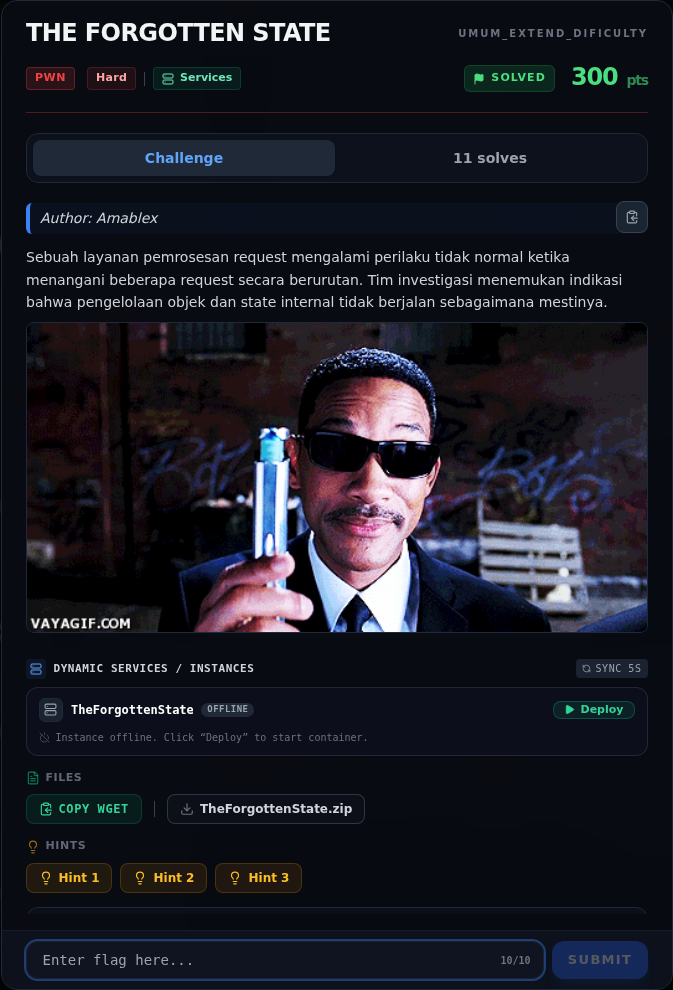
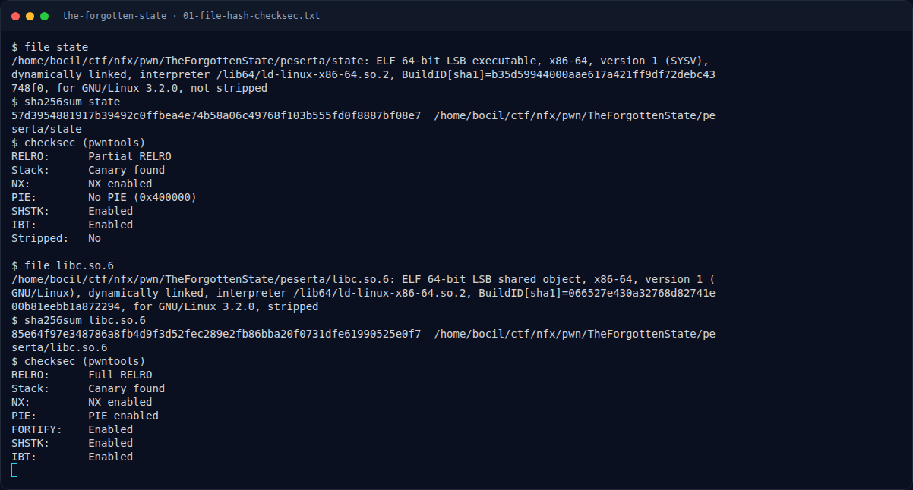
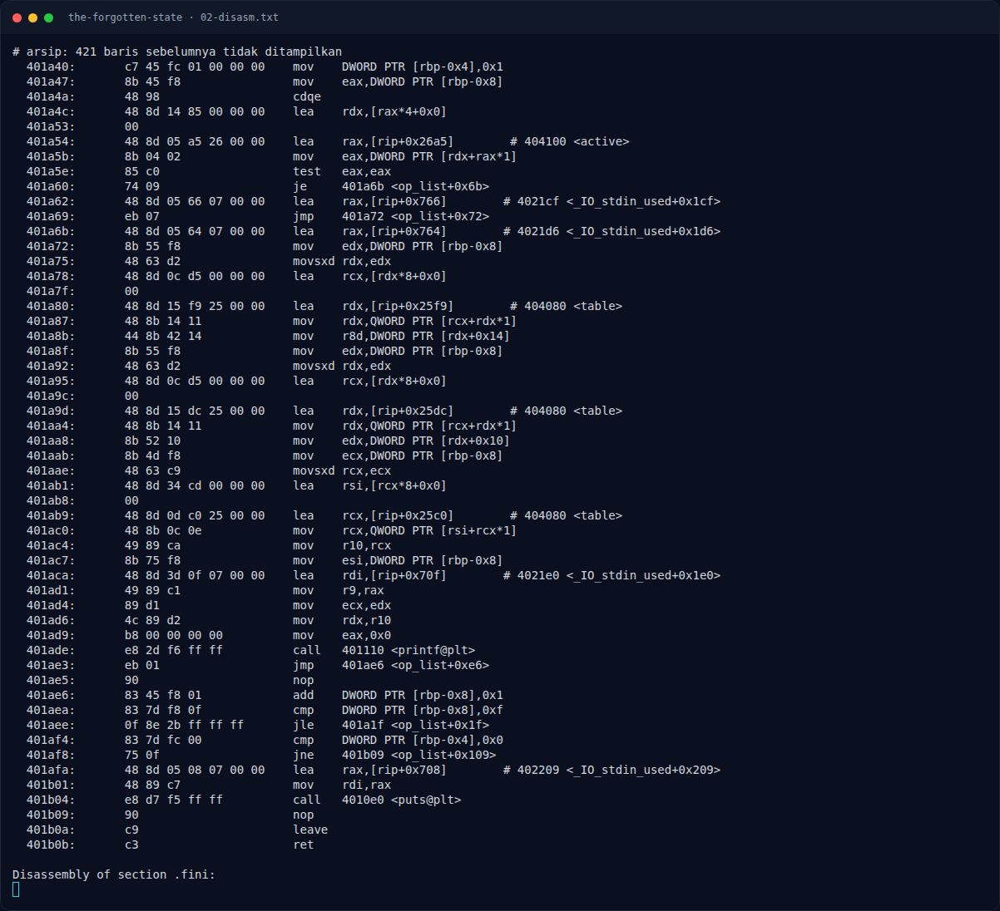
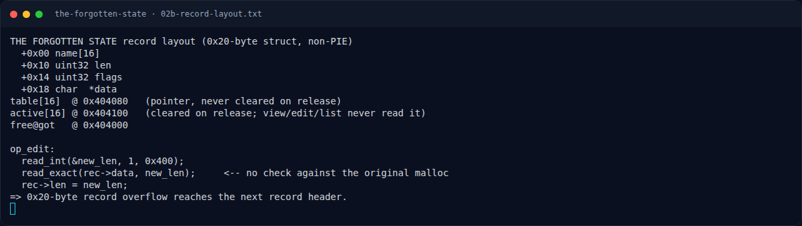
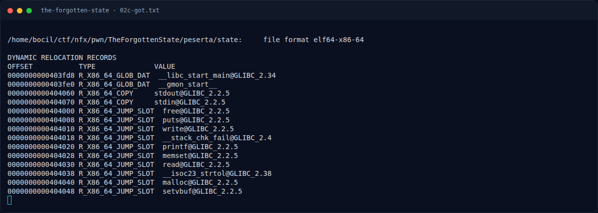
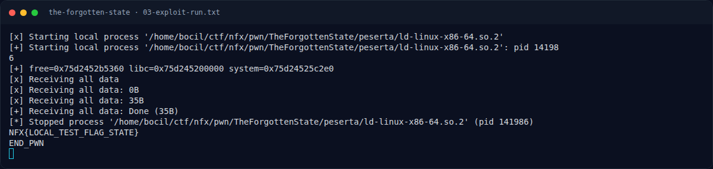
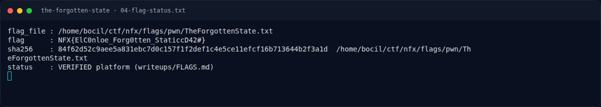
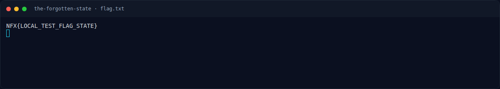
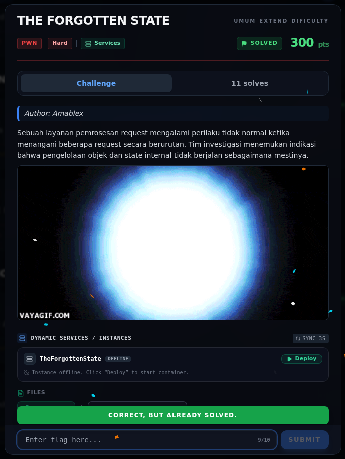

# THE FORGOTTEN STATE — Evidence / Bukti

9 screenshot8 transkrip / script

[← Overview](42-the-forgotten-state.md) · [Index](index.md)

> **Langkah 9/10 — Bukti / Evidence.** Bukti / Evidence
>
> **Titik penting:** arsip screenshot dan transkrip
>
> **Berikutnya:** [Referensi](42-the-forgotten-state-10-referensi.md)

## Arsip Evidence

> Semua file berasal dari `assets/the-forgotten-state/`. Screenshot platform dan terminal adalah bukti asli dari sesi solve; transkrip mentah tetap ditautkan di bagian bawah.

### Platform

<figure><figcaption>00-challenge-platform.png</figcaption></figure>

*Challenge brief asli di platform NFX CTF 2026.*

<figure><figcaption>Terminal evidence (real)</figcaption></figure>

*Terminal evidence (real).*

### Terminal (arsip sesi)

<figure><figcaption>term-01-file-hash-checksec.png</figcaption></figure>

*Terminal evidence — `01-file-hash-checksec.txt` (arsip transkrip sesi solve).*

<figure><figcaption>term-02-disasm.png</figcaption></figure>

*Terminal evidence — `02-disasm.txt` (arsip transkrip sesi solve).*

<figure><figcaption>term-02b-record-layout.png</figcaption></figure>

*Terminal evidence — `02b-record-layout.txt` (arsip transkrip sesi solve).*

<figure><figcaption>term-02c-got.png</figcaption></figure>

*Terminal evidence — `02c-got.txt` (arsip transkrip sesi solve).*

<figure><figcaption>term-03-exploit-run.png</figcaption></figure>

*Terminal evidence — `03-exploit-run.txt` (arsip transkrip sesi solve).*

<figure><figcaption>term-04-flag-status.png</figcaption></figure>

*Terminal evidence — `04-flag-status.txt` (arsip transkrip sesi solve).*

<figure><figcaption>term-flag.png</figcaption></figure>

*Terminal evidence — `flag.txt` (arsip transkrip sesi solve).*

### Transkrip mentah & script

- [`01-file-hash-checksec.txt`](assets/the-forgotten-state/01-file-hash-checksec.txt)
- [`02-disasm.txt`](assets/the-forgotten-state/02-disasm.txt)
- [`02b-record-layout.txt`](assets/the-forgotten-state/02b-record-layout.txt)
- [`02c-got.txt`](assets/the-forgotten-state/02c-got.txt)
- [`03-exploit-run.txt`](assets/the-forgotten-state/03-exploit-run.txt)
- [`04-flag-status.txt`](assets/the-forgotten-state/04-flag-status.txt)
- [`exploit.py`](assets/the-forgotten-state/exploit.py)
- [`flag.txt`](assets/the-forgotten-state/flag.txt)

## Validasi platform (real)

*Screenshot asli dari platform NFX CTF 2026. Platform menjawab
`CORRECT, BUT ALREADY SOLVED.` untuk flag ini.*

## Tabel Evidence

| Bukti | File | Keterangan |
|---|---|---|
| Identitas/hash/checksec | `writeups/assets/the-forgotten-state/01-file-hash-checksec.txt` | non-PIE, partial RELRO |
| Disassembly | `writeups/assets/the-forgotten-state/02-disasm.txt` | `op_create`, `op_release`, `op_view`, `op_edit`, `op_list` |
| Layout record/global | `writeups/assets/the-forgotten-state/02b-record-layout.txt` | `table`, `active`, field record |
| GOT | `writeups/assets/the-forgotten-state/02c-got.txt` | `free@got` |
| Exploit | `writeups/assets/the-forgotten-state/exploit.py` | Overflow + GOT hijack |
| Output | `writeups/assets/the-forgotten-state/03-exploit-run.txt` | Leak + shell + flag lokal |
| Flag/status | `writeups/assets/the-forgotten-state/04-flag-status.txt` | Flag dari `flags/pwn/` |