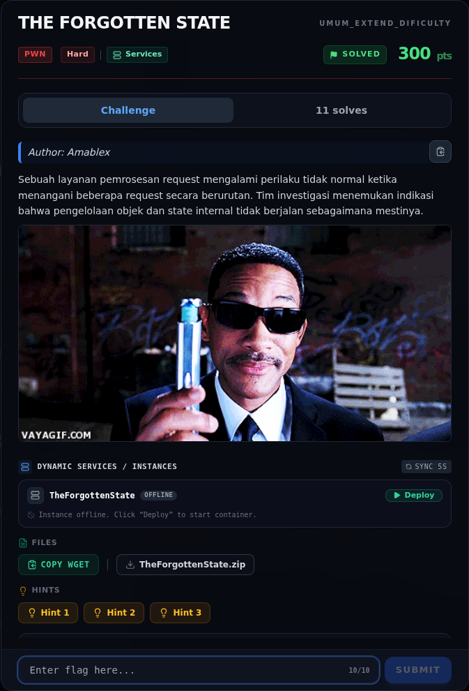

# THE FORGOTTEN STATE — Referensi

[← Overview](42-the-forgotten-state.md) · [Index](index.md)

> **Langkah 10/10 — Referensi.** Referensi
>
> **Titik penting:** —
>
> **Selesai.** Kembali ke [Overview](42-the-forgotten-state.md).

- `pwn/TheForgottenState/peserta/state`.
- `writeups/assets/the-forgotten-state/02b-record-layout.txt`.
- `writeups/assets/libc-offsets-and-gadgets.txt`.
- Teknik `free@got → system` + `free("/bin/sh")`.

### Evidence langkah ini

*Challenge brief asli di platform NFX CTF 2026.*
