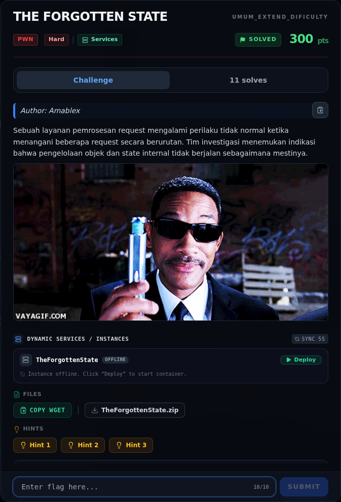
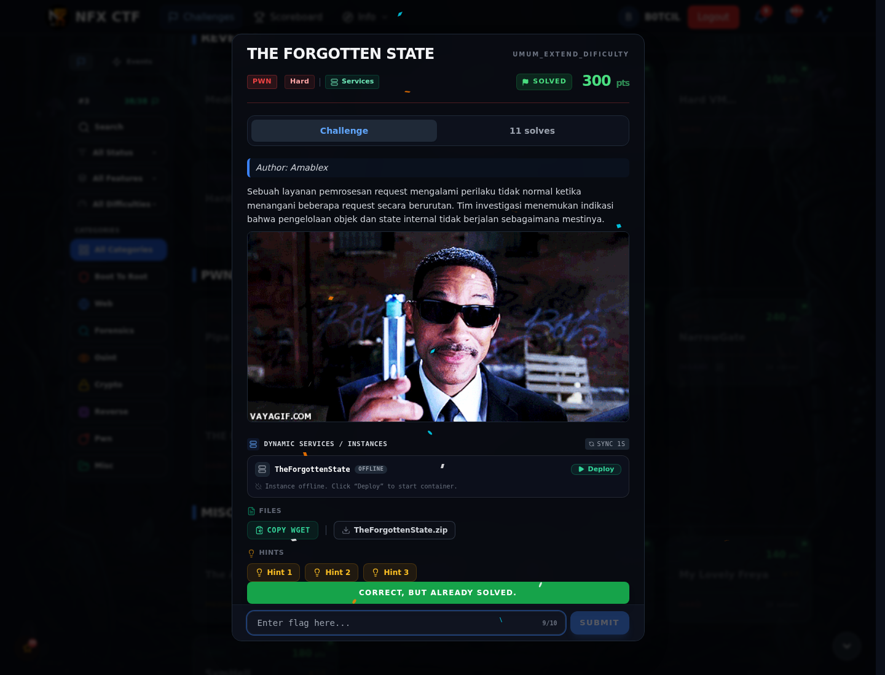

# THE FORGOTTEN STATE

Track Umum / Extend · PwnHard340 poinVERIFIED

| Field | Nilai |
|---|---|
| Event | `umum_Extend` |
| Kategori | `Pwn` |
| Difficulty | `Hard` |
| Poin | `340` |
| Author | `Amablex` |
| Solves | `9` |
| Tools | python3, pwntools, checksec, objdump, readelf, strings |
| Flag | `NFX{ElC0nloe_Forg0tten_StaticcD42#}` |
| Status | `VERIFIED` |

[← Kembali ke Index](index.md)

## Challenge Brief (platform)

*Challenge brief asli di platform NFX CTF 2026.*

## TL;DR

- Service mengelola 16 record (`create`, `release`, `view`, `edit`, `list`).
- `op_release()` melakukan `free(record->data)` lalu `free(record)`, mengosongkan `active[idx]`, tetapi **tidak mengosongkan `table[idx]`** → dangling pointer. `op_view`/`op_edit`/`op_list` **tidak memeriksa `active[]`**, jadi pointer basi masih bisa dipakai (use-after-free).
- `op_edit()` memvalidasi `new_len` hanya pada rentang `1..0x400`, bukan terhadap ukuran alokasi asli → **heap overflow** ke record berikutnya.
- Exploit yang diverifikasi memakai overflow: record pertama (data 0x20 byte) diedit 0x50 byte, menimpa header record kedua: `name`, `len=8`, `flags=1`, dan `data = free@got`.
- `view` → leak `free@got`; `edit` → tulis `system` ke `free@got`; `release` pada record berisi `"/bin/sh"` → `free("/bin/sh")` = `system("/bin/sh")`.
- Flag: `NFX{ElC0nloe_Forg0tten_StaticcD42#}`.

Pratinjau evidence. Buka halaman <a href="42-the-forgotten-state-09-bukti-evidence.html">Evidence / Bukti</a> untuk semua screenshot dan transkrip.

## Navigasi Halaman

<a class="nx-page-card" href="42-the-forgotten-state-01-recon.html"><b>Recon</b>Enumerasi target dan bukti awal</a>
<a class="nx-page-card" href="42-the-forgotten-state-02-triage-awal.html"><b>Triage awal</b>Baca bagian ini</a>
<a class="nx-page-card" href="42-the-forgotten-state-03-analisis.html"><b>Analisis</b>Membaca alur dan akar masalah</a>
<a class="nx-page-card" href="42-the-forgotten-state-04-analisis-2.html"><b>Analisis</b>Membaca alur dan akar masalah</a>
<a class="nx-page-card" href="42-the-forgotten-state-05-analisis-3.html"><b>Analisis</b>Membaca alur dan akar masalah</a>
<a class="nx-page-card" href="42-the-forgotten-state-06-eksploitasi.html"><b>Eksploitasi</b>Langkah exploit dan solver</a>
<a class="nx-page-card" href="42-the-forgotten-state-07-catatan-jalur-uaf.html"><b>Catatan jalur UAF</b>Baca bagian ini</a>
<a class="nx-page-card" href="42-the-forgotten-state-08-flag.html"><b>Flag</b>Flag dan verifikasi platform</a>
<a class="nx-page-card" href="42-the-forgotten-state-09-bukti-evidence.html"><b>Bukti / Evidence</b>Screenshot, transkrip, dan artefak</a>
<a class="nx-page-card" href="42-the-forgotten-state-10-referensi.html"><b>Referensi</b>Sumber dan bacaan lanjutan</a>

