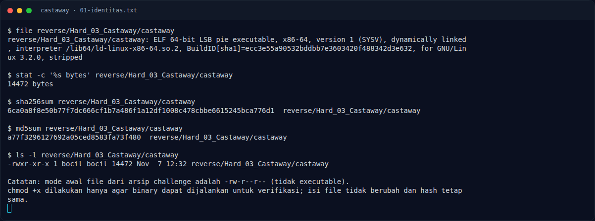
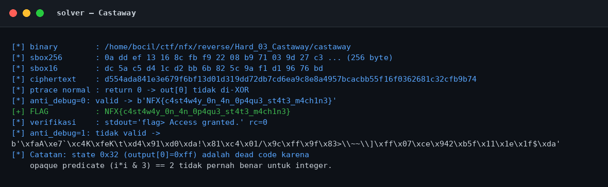

# Castaway — Recon

[← Overview](43-castaway.md) · [Index](index.md)

## 1.1 Deskripsi challenge

> **Author: Kesatria Baja Ringan**
>
> Diberikan sebuah binary mandiri yang membaca calon flag dari stdin. Program memvalidasi input melalui state machine kecil dengan opaque predicate, transformasi per-byte yang melibatkan state, S-box, dan key, serta pengecekan anti-debug menggunakan `ptrace`. Analisis program dan temukan input yang tepat agar lolos validasi internalnya.
>
> Format: `NFX{...}`

Deskripsi menyebut semua komponen penting: stdin, state machine, opaque predicate, S-box, key, dan `ptrace`. Tantangannya adalah memetakan alur state dan membalik transformasi yang bergantung pada state.

## 1.2 File yang diberikan

| File | Ukuran | SHA-256 | MD5 |
|---|---|---|---|
| `reverse/Hard_03_Castaway/castaway` | 14.472 byte | `6ca0a8f8e50b77f7dc666cf1b7a486f1a12df1008c478cbbe6615245bca776d1` | `a77f3296127692a05ced8583fa73f480` |

Catatan operasional: file asli tidak executable; `chmod +x` dilakukan agar bisa dijalankan untuk verifikasi. Isi binary tidak berubah (hash tetap).

## 1.3 Environment

- Linux x86-64; tools: `file`, `readelf`, `objdump`, `strings`, `gdb`, `strace`, `python3`, `pyelftools`, `pwntools`.
- `checksec` standalone tidak tersedia; memakai `ELF.checksec()`.
- Binary membaca input dari stdin dan mencetak prompt `flag> `.

### Evidence langkah ini

*Terminal evidence — `01-identitas.txt` (arsip transkrip sesi solve).*

*Evidence — `01-solver.png`.*
