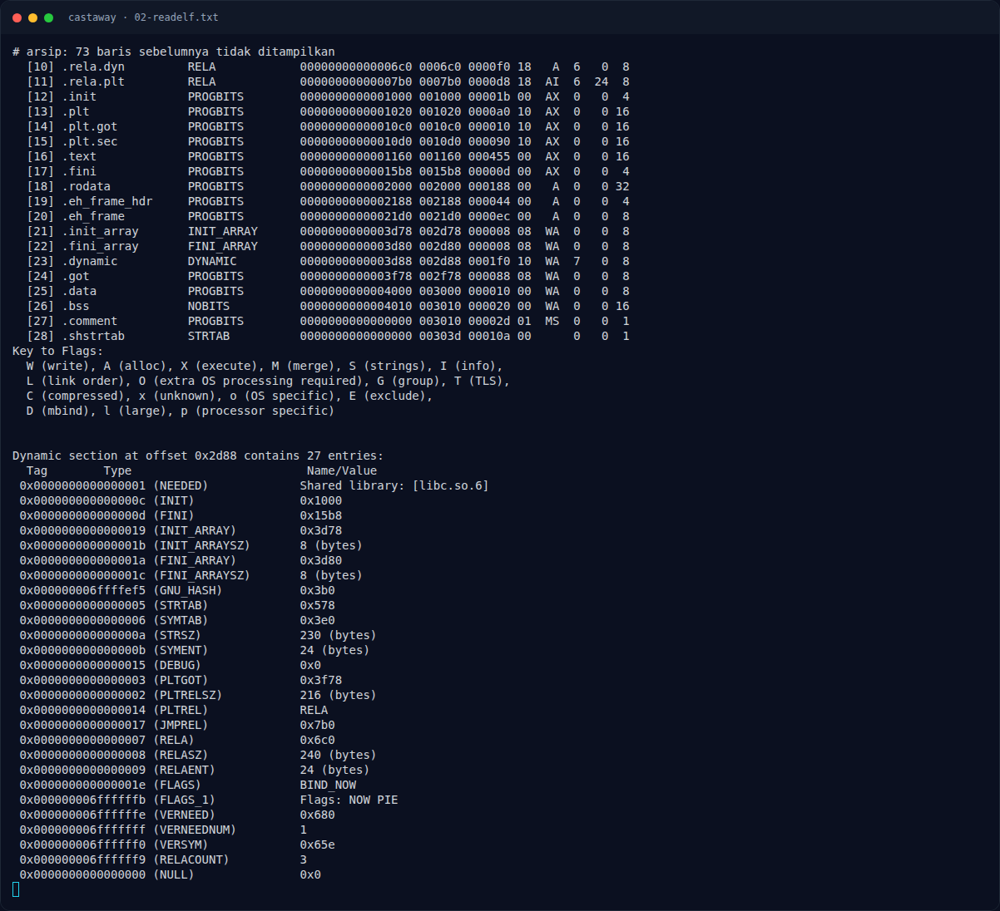
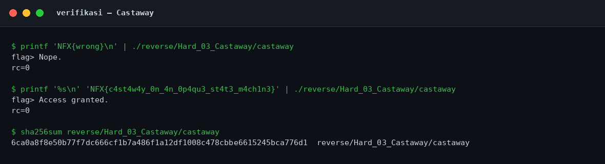

# Castaway — Fungsi `main`

[← Overview](43-castaway.md) · [Index](index.md)

## 2.1 Fungsi `main`

Main ada di `0x142d`. Bagian penting:

```asm
144b:  mov    ecx,0x0
1450:  mov    edx,0x1
1455:  mov    esi,0x0
145a:  mov    edi,0x0
145f:  mov    eax,0x0
1464:  call   1150 <ptrace@plt>      ; ptrace(PTRACE_TRACEME, 0, 1, 0)
1469:  mov    QWORD PTR [rbp-0x150],rax
1470:  cmp    QWORD PTR [rbp-0x150],0xffffffffffffffff
1478:  sete   al
147b:  mov    BYTE PTR [rbp-0x151],al ; anti_debug = (ret == -1)

1481:  lea    rax,[rip+0xce0]        # 2168 "flag> "
1490:  call   1100 <printf@plt>
1495:  mov    rax,QWORD PTR [rip+0x2b74] # 4010 stdout
149f:  call   1140 <fflush@plt>
14a4:  mov    rdx,QWORD PTR [rip+0x2b75] # 4020 stdin
14ab:  lea    rax,[rbp-0x110]        ; buffer input
14b2:  mov    esi,0x100             ; fgets(buf, 256, stdin)
14ba:  call   1130 <fgets@plt>
```

Setelah input:

```asm
14ce:  lea    rax,[rbp-0x110]
14d5:  lea    rdx,[rip+0xc93]        # 216f "\r\n"
14e2:  call   1110 <strcspn@plt>     ; cari newline
14e7:  mov    BYTE PTR [rbp+rax*1-0x110],0x0  ; ganti dengan NUL
14ef:  mov    rdi,rax
14f9:  call   10e0 <strlen@plt>
14fe:  mov    QWORD PTR [rbp-0x148],rax
1505:  cmp    QWORD PTR [rbp-0x148],0x28 ; harus 40
150d:  je     1525
150f:  ... "Nope."
```

Lalu transformasi dan perbandingan:

```asm
1525:  lea    rdx,[rbp-0x140]        ; buffer output
152c:  mov    rcx,QWORD PTR [rbp-0x148] ; len
1533:  lea    rax,[rbp-0x110]        ; input
153a:  mov    rsi,rcx
153d:  mov    rdi,rax
1540:  call   1282 <transform>

1545:  movzx  eax,BYTE PTR [rbp-0x140]
154c:  xor    al,BYTE PTR [rbp-0x151] ; output[0] ^= anti_debug
1552:  mov    BYTE PTR [rbp-0x140],al

1558:  lea    rax,[rbp-0x140]
155f:  mov    edx,0x28              ; 40 byte
1564:  lea    rcx,[rip+0xbd5]        # 2140 ciphertext
156b:  mov    rsi,rcx
156e:  mov    rdi,rax
1571:  call   1120 <memcmp@plt>
1576:  test   eax,eax
1578:  jne    158b                   ; "Nope."
157a:  ... "Access granted."
```

### Evidence langkah ini



*Terminal evidence — `02-readelf.txt` (arsip transkrip sesi solve).*



*Evidence — `02-verifikasi.png`.*
