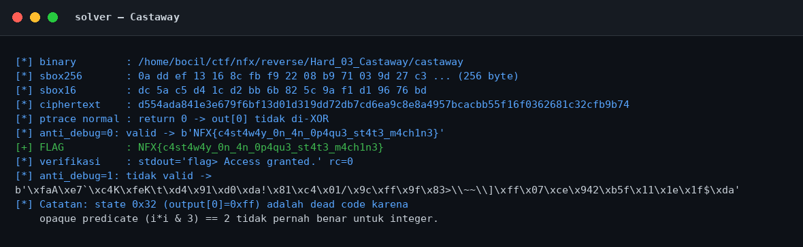
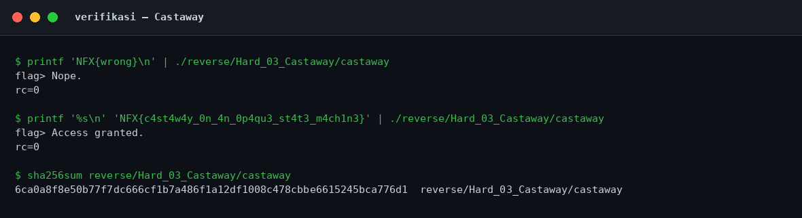
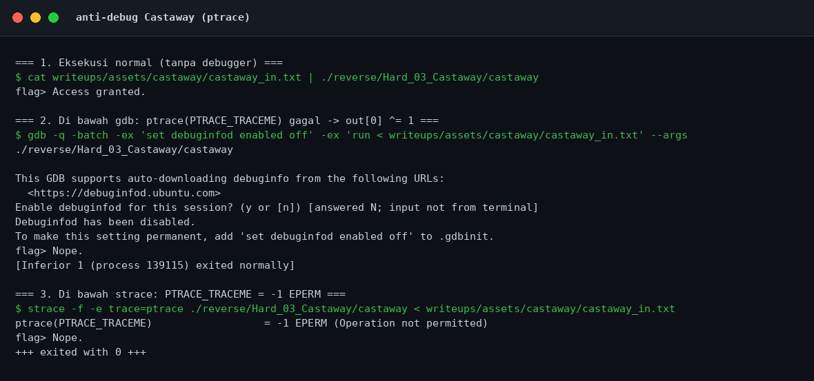
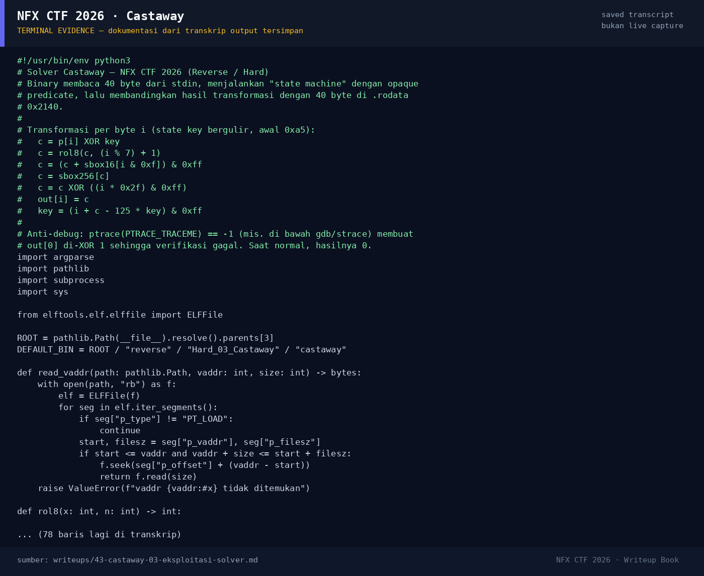

# Castaway — Evidence / Bukti

4 screenshot11 transkrip / script

[← Overview](43-castaway.md) · [Index](index.md)

## Arsip Evidence

> Semua file di bawah berasal dari folder `assets/castaway/`. Screenshot ditempel langsung; file teks/script ditautkan.

### Screenshot

<figure><figcaption>01-solver.png</figcaption></figure>
<figure><figcaption>02-verifikasi.png</figcaption></figure>
<figure><figcaption>03-antidebug.png</figcaption></figure>
<figure><figcaption>98-terminal-evidence.png</figcaption></figure>

### Transkrip / file pendukung

- [`01-identitas.txt`](assets/castaway/01-identitas.txt)
- [`02-readelf.txt`](assets/castaway/02-readelf.txt)
- [`03-strings.txt`](assets/castaway/03-strings.txt)
- [`04-disasm.txt`](assets/castaway/04-disasm.txt)
- [`05-rodata-data-hexdump.txt`](assets/castaway/05-rodata-data-hexdump.txt)
- [`06-solver-output.txt`](assets/castaway/06-solver-output.txt)
- [`07-verifikasi.txt`](assets/castaway/07-verifikasi.txt)
- [`08-antidebug-gdb-strace.txt`](assets/castaway/08-antidebug-gdb-strace.txt)
- [`08-checksec.txt`](assets/castaway/08-checksec.txt)
- [`castaway_in.txt`](assets/castaway/castaway_in.txt)
- [`solve_castaway.py`](assets/castaway/solve_castaway.py)

## Tabel Evidence

| Bukti | File | Keterangan |
|---|---|---|
| Identitas & hash | `01-identitas.txt` | `file`, hash, permission |
| ELF metadata | `02-readelf.txt` | Header, segmen, section |
| Strings | `03-strings.txt` | `strings -n 4` |
| Disassembly | `04-disasm.txt` | Transform + main + anti-debug |
| Hex dump | `05-rodata-data-hexdump.txt` | S-box + ciphertext |
| Solver | `solve_castaway.py` | Inversi state machine |
| Output solver | `06-solver-output.txt` | Output asli |
| Verifikasi | `07-verifikasi.txt` | Salah vs benar + hash |
| Checksec | `08-checksec.txt` | Hasil `ELF.checksec()` |
| Anti-debug | `08-antidebug-gdb-strace.txt` | gdb + strace, ptrace gagal |
| Input uji | `castaway_in.txt` | Flag yang dipakai untuk bukti anti-debug |
| Screenshot solver | `01-solver.png` | Render output solver |
| Screenshot verifikasi | `02-verifikasi.png` | Render output verifikasi |
| Screenshot anti-debug | `03-antidebug.png` | Render bukti gdb/strace |