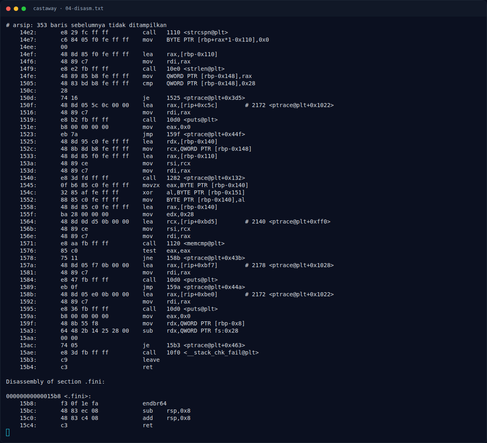
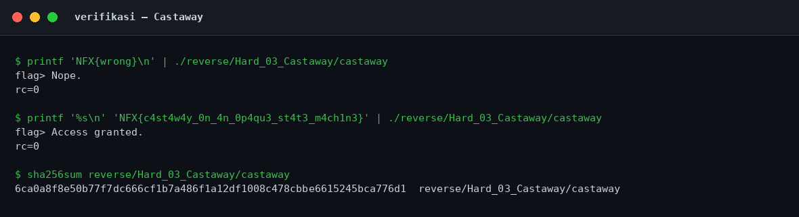

# Castaway — Fungsi transform `0x1282`

[← Overview](43-castaway.md) · [Index](index.md)

## 2.4 Fungsi transform `0x1282`

Fungsi ini menerima `(input, len, output)` dan menjalankan state machine. Variabel lokal:

- `[rbp-0x18]` = input pointer
- `[rbp-0x20]` = len
- `[rbp-0x28]` = output pointer
- `[rbp-0xe]` = key (awal `0xa5`)
- `[rbp-0x8]` = i
- `[rbp-0xc]` = state (awal 0)

Inisialisasi:

```asm
129a:  mov    BYTE PTR [rbp-0xe],0xa5  ; key = 0xa5
129e:  mov    QWORD PTR [rbp-0x8],0x0  ; i = 0
12a6:  mov    DWORD PTR [rbp-0xc],0x0  ; state = 0
12ad:  jmp    141f
```

Dispatch state:

```asm
12b2:  cmp    DWORD PTR [rbp-0xc],0x32 ; state == 50?
12b6:  je     1407
12bc:  cmp    DWORD PTR [rbp-0xc],0x32
12c0:  jg     1417
12c6:  cmp    DWORD PTR [rbp-0xc],0x2  ; state == 2?
12ca:  je     13e0
12d0:  cmp    DWORD PTR [rbp-0xc],0x2
12d4:  jg     1417
12da:  cmp    DWORD PTR [rbp-0xc],0x0  ; state 0?
12de:  je     12eb
12e0:  cmp    DWORD PTR [rbp-0xc],0x1  ; state 1?
12e4:  je     12f7
12e6:  jmp    1417
```

State machine:

| State | Aksi | Transisi |
|---|---|---|
| `0` | Tidak ada | `1` |
| `1` | Jika `i < len`, proses byte ke-`i`; jika tidak, selesai | `2` setelah proses, `0x63` jika `i >= len` |
| `2` | Opaque predicate `(i*i) & 3 == 2` | `0x32` jika true, `1` jika false |
| `0x32` | `output[0] = 0xff`, selesai | `0x63` |
| `0x63` | Terminasi loop | — |

State `0x32` **tidak pernah tercapai** karena untuk semua integer `i`, `i² mod 4` hanya `0` atau `1`, tidak pernah `2`.

```asm
13e0:  mov    rax,QWORD PTR [rbp-0x8]
13e4:  mov    edx,eax
13ea:  imul   eax,edx             ; i*i
13ed:  and    eax,0x3
13f0:  cmp    eax,0x2
13f3:  jne    13fe                 ; hampir selalu ke sini
13f5:  mov    DWORD PTR [rbp-0xc],0x32
13fc:  jmp    141f
13fe:  mov    DWORD PTR [rbp-0xc],0x1
```

### Evidence langkah ini



*Terminal evidence — `04-disasm.txt` (arsip transkrip sesi solve).*



*Evidence — `02-verifikasi.png`.*

**Berkas mentah langkah ini:**

- [`04-disasm.txt`](assets/castaway/04-disasm.txt)
