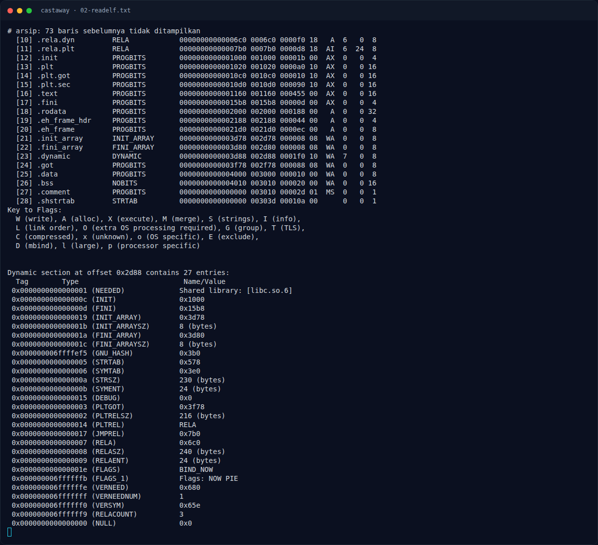
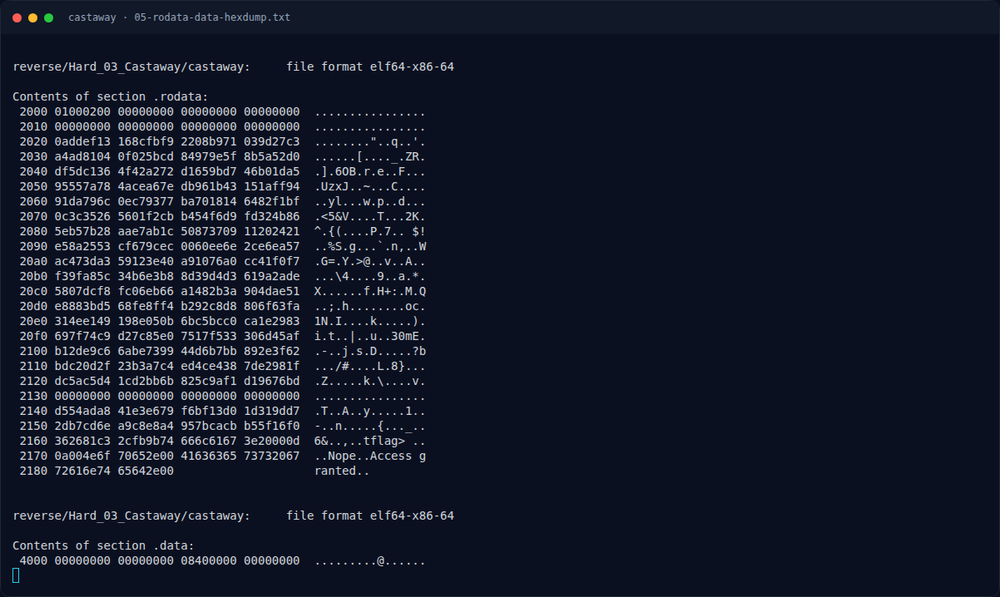

# Castaway — Data di `.rodata`

[← Overview](43-castaway.md) · [Index](index.md)

## 2.6 Data di `.rodata`

```text
Contents of section .rodata:
 2020 0addef13 168cfbf9 2208b971 039d27c3  ........"..q..'.
 ...
 2120 dc5ac5d4 1cd2bb6b 825c9af1 d19676bd  .Z.....k.....v.
 2130 00000000 00000000 00000000 00000000
 2140 d554ada8 41e3e679 f6bf13d0 1d319dd7  .T..A..y.....1..
 2150 2db7cd6e a9c8e8a4 957bcacb b55f16f0  -..n.....{..._..
 2160 362681c3 2cfb9b74 666c6167 3e20000d  6&..,..tflag> ..
 2170 0a004e6f 70652e00 41636365 73732067  ..Nope..Access g
 2180 72616e74 65642e00                    ranted..
```

Alamat yang dipakai:

- `0x2020` — S-box 256 byte.
- `0x2120` — S-box 16 byte.
- `0x2140` — ciphertext 40 byte.
- `0x2168` — string `"flag> "`.
- `0x2172` — string `"Nope."`.
- `0x2178` — string `"Access granted."`.

Ciphertext:

```text
d5 54 ad a8 41 e3 e6 79 f6 bf 13 d0 1d 31 9d d7
2d b7 cd 6e a9 c8 e8 a4 95 7b ca cb b5 5f 16 f0
36 26 81 c3 2c fb 9b 74
```

### Evidence langkah ini



*Terminal evidence — `02-readelf.txt` (arsip transkrip sesi solve).*



*Terminal evidence — `05-rodata-data-hexdump.txt` (arsip transkrip sesi solve).*

**Berkas mentah langkah ini:**

- [`02-readelf.txt`](assets/castaway/02-readelf.txt)
- [`05-rodata-data-hexdump.txt`](assets/castaway/05-rodata-data-hexdump.txt)
