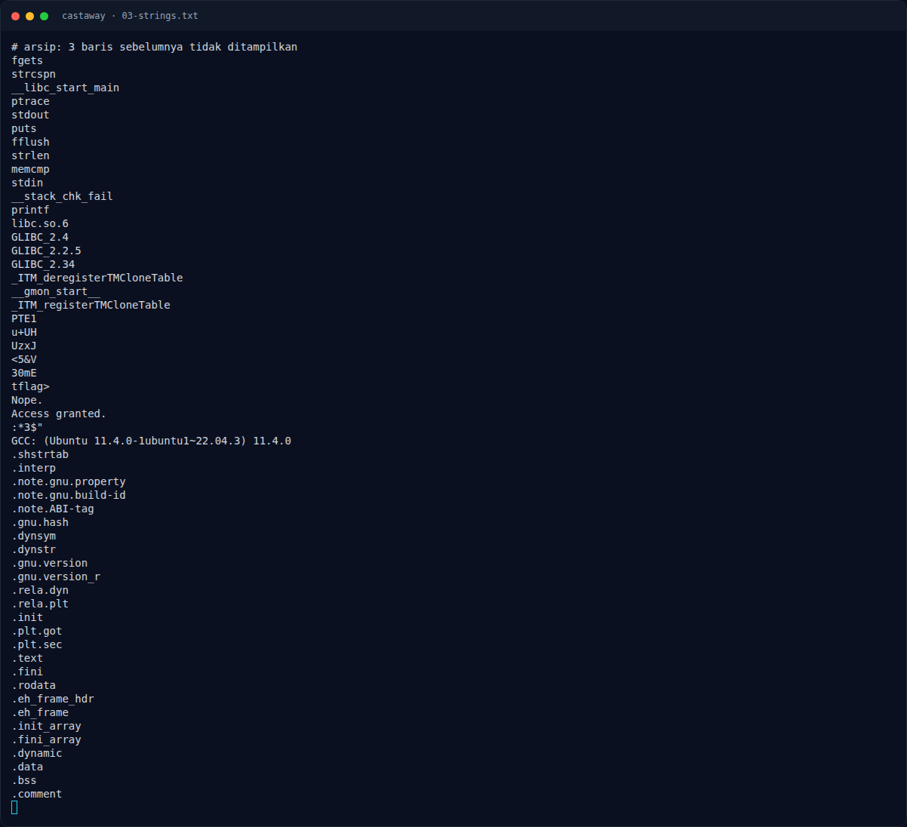

# Castaway — Strategi

[← Overview](43-castaway.md) · [Index](index.md)

## 3.1 Strategi

1. Ekstrak `sbox256` (256 byte), `sbox16` (16 byte), dan ciphertext (40 byte) dari `.rodata`.
2. Untuk tiap byte `i`, coba semua 256 nilai plaintext `p`; hitung transformasi forward dengan `key` saat ini; pilih `p` yang menghasilkan ciphertext `target`.
3. Setelah ketemu, update `key` memakai `target` (karena update key memakai output byte).
4. Untuk byte pertama, coba dua kemungkinan: `target = ct[0]` (anti_debug = 0) dan `target = ct[0] ^ 1` (anti_debug = 1). Pilih hasil yang seluruhnya printable.
5. Verifikasi dengan menjalankan binary tanpa debugger.

Karena S-box 256 byte belum tentu permutasi, brute force 256 kandidat lebih aman daripada mencoba menginversi S-box secara langsung. Pada challenge ini setiap byte menghasilkan tepat satu kandidat.

### Evidence langkah ini

*Terminal evidence — `03-strings.txt` (arsip transkrip sesi solve).*

*Evidence — `03-antidebug.png`.*
