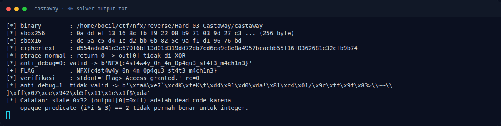
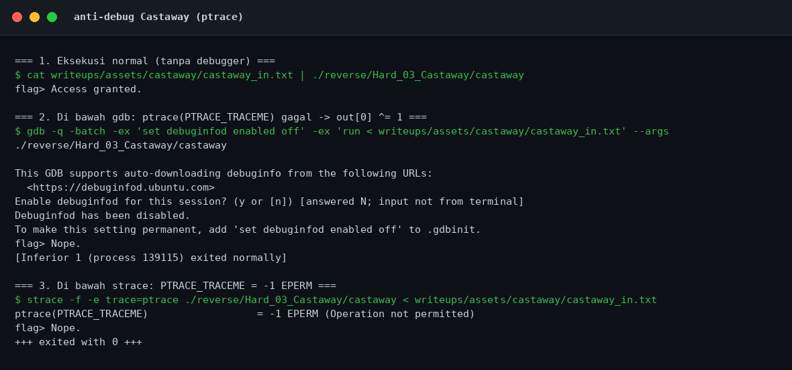

# Castaway — Solver lengkap

[← Overview](43-castaway.md) · [Index](index.md)

> **Langkah 10/14 — Solver lengkap.** File: writeups/assets/castaway/solvecastaway.py
>
> **Titik penting:** File: writeups/assets/castaway/solvecastaway.py
>
> **Berikutnya:** [Output asli](43-castaway-11-output-asli.md)

## 3.2 Solver lengkap

File: `writeups/assets/castaway/solve_castaway.py`

```python
#!/usr/bin/env python3
# Solver Castaway — NFX CTF 2026 (Reverse / Hard)
# Binary membaca 40 byte dari stdin, menjalankan "state machine" dengan opaque
# predicate, lalu membandingkan hasil transformasi dengan 40 byte di .rodata
# 0x2140.
#
# Transformasi per byte i (state key bergulir, awal 0xa5):
#   c = p[i] XOR key
#   c = rol8(c, (i % 7) + 1)
#   c = (c + sbox16[i & 0xf]) & 0xff
#   c = sbox256[c]
#   c = c XOR ((i * 0x2f) & 0xff)
#   out[i] = c
#   key = (i + c - 125 * key) & 0xff
#
# Anti-debug: ptrace(PTRACE_TRACEME) == -1 (mis. di bawah gdb/strace) membuat
# out[0] di-XOR 1 sehingga verifikasi gagal. Saat normal, hasilnya 0.
import argparse
import pathlib
import subprocess
import sys

from elftools.elf.elffile import ELFFile

ROOT = pathlib.Path(__file__).resolve().parents[3]
DEFAULT_BIN = ROOT / "reverse" / "Hard_03_Castaway" / "castaway"

def read_vaddr(path: pathlib.Path, vaddr: int, size: int) -> bytes:
    with open(path, "rb") as f:
        elf = ELFFile(f)
        for seg in elf.iter_segments():
            if seg["p_type"] != "PT_LOAD":
                continue
            start, filesz = seg["p_vaddr"], seg["p_filesz"]
            if start <= vaddr and vaddr + size <= start + filesz:
                f.seek(seg["p_offset"] + (vaddr - start))
                return f.read(size)
    raise ValueError(f"vaddr {vaddr:#x} tidak ditemukan")

def rol8(x: int, n: int) -> int:
    n &= 7
    return ((x << n) | (x >> ((8 - n) & 7))) & 0xFF if n else x & 0xFF

def transform(data: bytes, sbox: bytes, sbox16: bytes) -> bytes:
    key = 0xA5
    out = bytearray()
    for i, p in enumerate(data):
        c = p ^ key
        c = rol8(c, (i % 7) + 1)
        c = (c + sbox16[i & 0xF]) & 0xFF
        c = sbox[c]
        c ^= (i * 0x2F) & 0xFF
        out.append(c)
        key = (i + c - 125 * key) & 0xFF
    return bytes(out)

def invert(ct: bytes, sbox: bytes, sbox16: bytes) -> tuple[bytes | None, int]:
    """Inversi brute force 256 kandidat per byte; key state dipulihkan berurutan."""
    key = 0xA5
    pt = bytearray()
    for i, target in enumerate(ct):
        found = []
        for p in range(256):
            c = p ^ key
            c = rol8(c, (i % 7) + 1)
            c = (c + sbox16[i & 0xF]) & 0xFF
            c = sbox[c]
            c ^= (i * 0x2F) & 0xFF
            if c == target:
                found.append(p)
        if len(found) != 1:
            return None, key
        pt.append(found[0])
        key = (i + target - 125 * key) & 0xFF
    return bytes(pt), key

def main() -> int:
    ap = argparse.ArgumentParser()
    ap.add_argument("--bin", default=str(DEFAULT_BIN))
    args = ap.parse_args()
    path = pathlib.Path(args.bin)

    # Alamat dari disassembly:
    #   0x137e lea rdx,[rip+0xc9b] -> sbox256 0x2020
    #   0x136a lea rax,[rip+0xdaf] -> sbox16  0x2120
    #   0x1564 lea rcx,[rip+0xbd5] -> ciphertext 0x2140 (40 byte)
    sbox = read_vaddr(path, 0x2020, 256)
    sbox16 = read_vaddr(path, 0x2120, 16)
    ct = read_vaddr(path, 0x2140, 40)

    print(f"[*] binary        : {path}")
    print(f"[*] sbox256       : {sbox[:16].hex(' ')} ... ({len(sbox)} byte)")
    print(f"[*] sbox16        : {sbox16.hex(' ')}")
    print(f"[*] ciphertext    : {ct.hex()}")
    print(f"[*] ptrace normal : return 0 -> out[0] tidak di-XOR")

    # anti_debug=0 -> eksekusi normal; anti_debug=1 -> simulasi ptrace gagal.
    for anti in (0, 1):
        adjusted = bytes([ct[0] ^ anti]) + ct[1:]
        pt, _ = invert(adjusted, sbox, sbox16)
        ok = pt is not None and all(32 <= b < 127 for b in pt)
        print(f"[*] anti_debug={anti}: {'valid' if ok else 'tidak valid'} "
              f"-> {pt!r}")
        if ok:
            flag = pt.decode()
            # Buktikan transformasi forward menghasilkan ciphertext (mode normal).
            assert transform(pt, sbox, sbox16) == adjusted
            print(f"[+] FLAG          : {flag}")
            proc = subprocess.run([str(path)], input=flag + "\n",
                                  capture_output=True, text=True)
            print(f"[*] verifikasi    : stdout={proc.stdout.strip()!r} rc={proc.returncode}")

    print("[*] Catatan: state 0x32 (output[0]=0xff) adalah dead code karena")
    print("    opaque predicate (i*i & 3) == 2 tidak pernah benar untuk integer.")
    return 0

if __name__ == "__main__":
    raise SystemExit(main())
```

### Evidence langkah ini



*Terminal evidence — `06-solver-output.txt` (arsip transkrip sesi solve).*



*Evidence — `03-antidebug.png`.*

**Berkas mentah langkah ini:**

- [`06-solver-output.txt`](assets/castaway/06-solver-output.txt)
