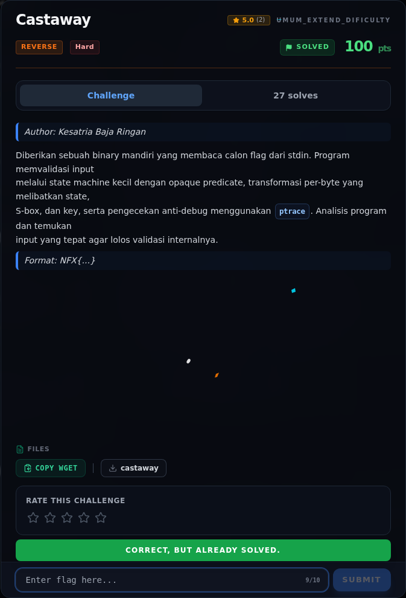

# Castaway — Flag & Verifikasi

[← Overview](43-castaway.md) · [Index](index.md)

> **Langkah 12/14 — Flag.** Cek file flag lokal:
>
> **Titik penting:** NFX{c4st4w4y_0n_4n_0p4qu3_st4t3_m4ch1n3}
>
> **Berikutnya:** [Bukti / Evidence](43-castaway-13-bukti-evidence.md)

> **Flag:** `NFX{c4st4w4y_0n_4n_0p4qu3_st4t3_m4ch1n3}`
> **Status:** `VERIFIED`

```text
NFX{c4st4w4y_0n_4n_0p4qu3_st4t3_m4ch1n3}
```

Cek file flag lokal:

```text
$ cat flags/reverse/Hard_03_Castaway.txt
NFX{c4st4w4y_0n_4n_0p4qu3_st4t3_m4ch1n3}
```

Verifikasi:

```text
$ printf '%s\n' 'NFX{c4st4w4y_0n_4n_0p4qu3_st4t3_m4ch1n3}' | ./reverse/Hard_03_Castaway/castaway
flag> Access granted.
rc=0

$ printf 'NFX{wrong}\n' | ./reverse/Hard_03_Castaway/castaway
flag> Nope.
rc=0
```

Perhatikan bahwa program selalu return 0; keberhasilan dibedakan dari string output.

Bukti anti-debug:

```text
$ gdb -q -batch -ex 'set debuginfod enabled off' -ex 'run < writeups/assets/castaway/castaway_in.txt' \
      --args ./reverse/Hard_03_Castaway/castaway
flag> Nope.

$ strace -f -e trace=ptrace ./reverse/Hard_03_Castaway/castaway < writeups/assets/castaway/castaway_in.txt
ptrace(PTRACE_TRACEME)                  = -1 EPERM (Operation not permitted)
flag> Nope.
```

Isi `flags/reverse/Hard_03_Castaway.txt` identik dengan flag di atas. **Status: `VERIFIED platform`.** Flag sudah dicek ulang ke platform pada 2026-11-09 (`Correct, but already solved.`); verifikasi lokal tetap dilakukan terhadap binary dan file flag.

### Bukti submit di platform



*Submit flag di platform: `CORRECT, BUT ALREADY SOLVED.`*
