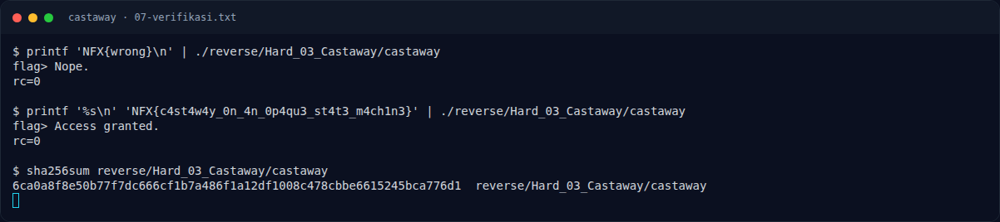

# Castaway — Referensi

[← Overview](43-castaway.md) · [Index](index.md)

- `ptrace(2)` — Linux man page; `PTRACE_TRACEME` dan perilakunya saat proses sudah di-trace.
- Opaque predicate — teknik obfuscation yang memanfaatkan ekspresi yang selalu bernilai sama.
- `objdump(1)`, `readelf(1)`, `gdb`, `strace`.
- `pyelftools`, `pwntools` `ELF.checksec()`.

### Evidence langkah ini

*Terminal evidence — `07-verifikasi.txt` (arsip transkrip sesi solve).*
