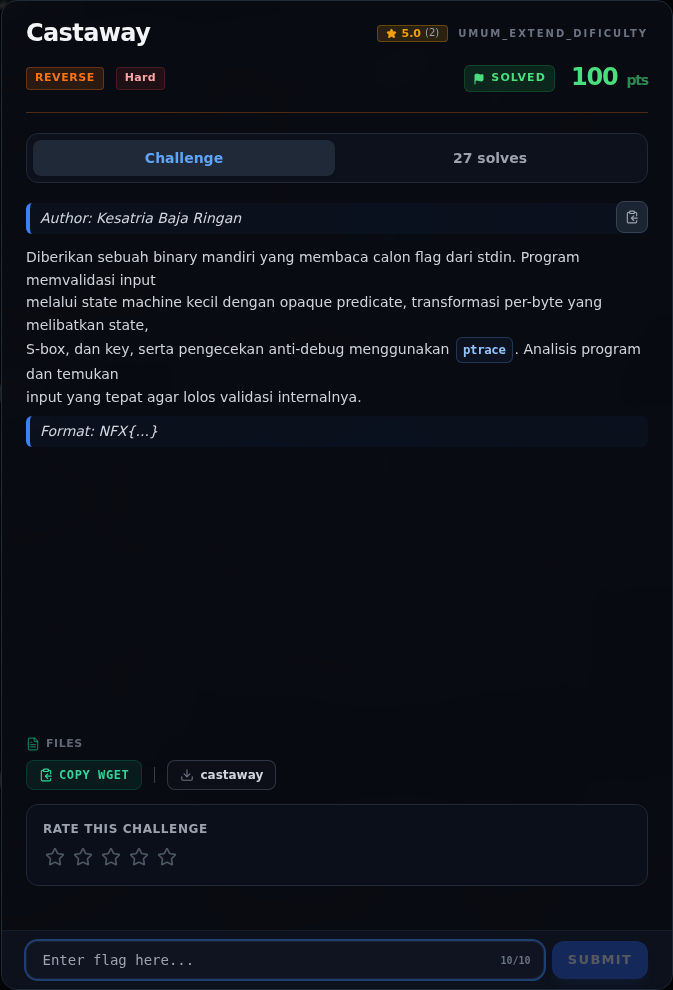
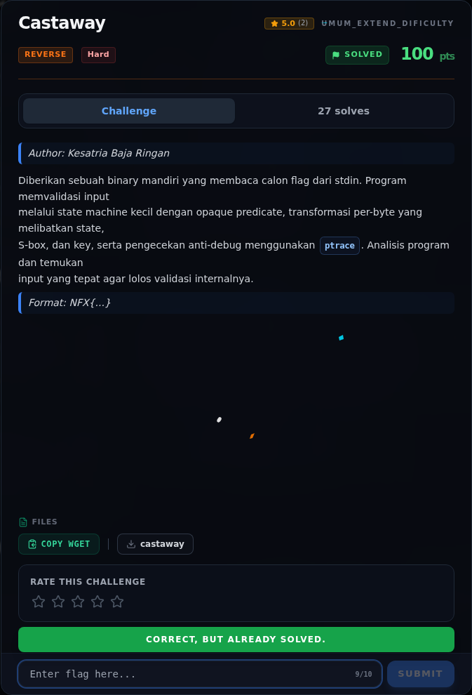

# Castaway

Track Umum / Extend · ReverseHard100 poinVERIFIED

| Field | Nilai |
|---|---|
| Event | `umum_Extend` |
| Kategori | `Reverse` |
| Difficulty | `Hard` |
| Poin | `100` |
| Author | `Kesatria Baja Ringan` |
| Solves | `22` |
| Tools | python3, pwntools, checksec, gdb, objdump, readelf, strings |
| Flag | `NFX{c4st4w4y_0n_4n_0p4qu3_st4t3_m4ch1n3}` |
| Status | `VERIFIED` |

[← Kembali ke Index](index.md)

## Challenge Brief (platform)

*Challenge brief asli di platform NFX CTF 2026.*

## TL;DR

- `castaway` membaca calon flag dari **stdin** (`fgets`), bukan dari argumen.
- Panjang harus tepat **40 byte**. Program menjalankan transformasi per byte dengan **state machine**, **rolling key**, **S-box 256 byte**, dan **S-box 16 byte**.
- Ada **opaque predicate** `(i*i) & 3 == 2` yang selalu false, sehingga state `0x32` (yang akan menulis `0xff`) adalah dead code.
- Ada **anti-debug** `ptrace(PTRACE_TRACEME)`: jika return `-1` (dijalankan di bawah debugger), byte hasil transformasi pertama di-XOR `1`, sehingga flag benar tetap ditolak.
- Inversi dilakukan per byte dengan brute force 256 kandidat; key state dipulihkan berurutan dari ciphertext.
- Flag: `NFX{c4st4w4y_0n_4n_0p4qu3_st4t3_m4ch1n3}`.

Pratinjau evidence. Buka halaman <a href="43-castaway-03-perintah-akuisisi-bukti.html">Evidence / Bukti</a> untuk semua screenshot dan transkrip.

## Navigasi Halaman

<a class="nx-page-card" href="43-castaway-01-recon.html"><b>Recon</b>Enumerasi target dan bukti awal</a>
<a class="nx-page-card" href="43-castaway-02-triage-awal.html"><b>Triage awal</b>Baca bagian ini</a>
<a class="nx-page-card" href="43-castaway-03-perintah-akuisisi-bukti.html"><b>Perintah akuisisi bukti</b>Screenshot, transkrip, dan artefak</a>
<a class="nx-page-card" href="43-castaway-04-fungsi-main.html"><b>Fungsi `main`</b>Baca bagian ini</a>
<a class="nx-page-card" href="43-castaway-05-analisis.html"><b>Analisis</b>Membaca alur dan akar masalah</a>
<a class="nx-page-card" href="43-castaway-06-fungsi-transform-0x1282.html"><b>Fungsi transform `0x1282`</b>Baca bagian ini</a>
<a class="nx-page-card" href="43-castaway-07-transformasi-per-byte.html"><b>Transformasi per byte</b>Baca bagian ini</a>
<a class="nx-page-card" href="43-castaway-08-data-di-rodata.html"><b>Data di `.rodata`</b>Baca bagian ini</a>
<a class="nx-page-card" href="43-castaway-09-strategi.html"><b>Strategi</b>Baca bagian ini</a>
<a class="nx-page-card" href="43-castaway-10-solver-lengkap.html"><b>Solver lengkap</b>Langkah exploit dan solver</a>
<a class="nx-page-card" href="43-castaway-11-output-asli.html"><b>Output asli</b>Baca bagian ini</a>
<a class="nx-page-card" href="43-castaway-12-flag.html"><b>Flag</b>Flag dan verifikasi platform</a>
<a class="nx-page-card" href="43-castaway-13-bukti-evidence.html"><b>Bukti / Evidence</b>Screenshot, transkrip, dan artefak</a>
<a class="nx-page-card" href="43-castaway-14-referensi.html"><b>Referensi</b>Sumber dan bacaan lanjutan</a>

