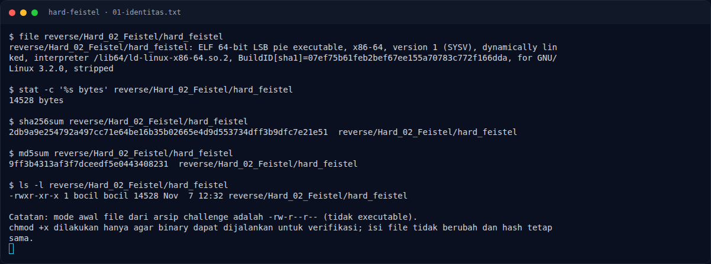

# Hard Feistel — Recon

[← Overview](44-hard-feistel.md) · [Index](index.md)

> **Langkah 1/13 — Recon.** Deskripsi sudah memberi struktur lengkap: 16 ronde, blok 32-bit, key 16-bit.
>
> **Titik penting:** NFX{...}
>
> **Berikutnya:** [Triage awal](44-hard-feistel-02-triage-awal.md)

## 1.1 Deskripsi challenge

> **Author: cypera**
>
> Flag dienkripsi dengan jaringan Feistel 16 ronde pada blok 32-bit (L dan R masing-masing 16-bit). Round key diturunkan dari jadwal sederhana dan tertanam di binary. Karena Feistel invertible, dekripsi tidak perlu menginversi fungsi F.
>
> Format: `NFX{...}`

Deskripsi sudah memberi struktur lengkap: 16 ronde, blok 32-bit, key 16-bit. Tantangannya adalah menemukan detail fungsi `F`, jadwal key, dan cara output di-serialisasi.

## 1.2 File yang diberikan

| File | Ukuran | SHA-256 | MD5 |
|---|---|---|---|
| `reverse/Hard_02_Feistel/hard_feistel` | 14.528 byte | `2db9a9e254792a497cc71e64be16b35b02665e4d9d553734dff3b9dfc7e21e51` | `9ff3b4313af3f7dceedf5e0443408231` |

Catatan operasional: file asli tidak executable; `chmod +x` dilakukan agar bisa dijalankan untuk verifikasi. Isi binary tidak berubah (hash tetap).

## 1.3 Environment

- Linux x86-64; tools: `file`, `readelf`, `objdump`, `strings`, `gdb`, `python3`, `pyelftools`, `pwntools`.
- `checksec` standalone tidak tersedia; memakai `ELF.checksec()`.
- Binary membaca flag dari `argv[1]`.

### Evidence langkah ini

*Terminal evidence — `01-identitas.txt` (arsip transkrip sesi solve).*

**Berkas mentah langkah ini:**

- [`01-identitas.txt`](assets/hard-feistel/01-identitas.txt)
