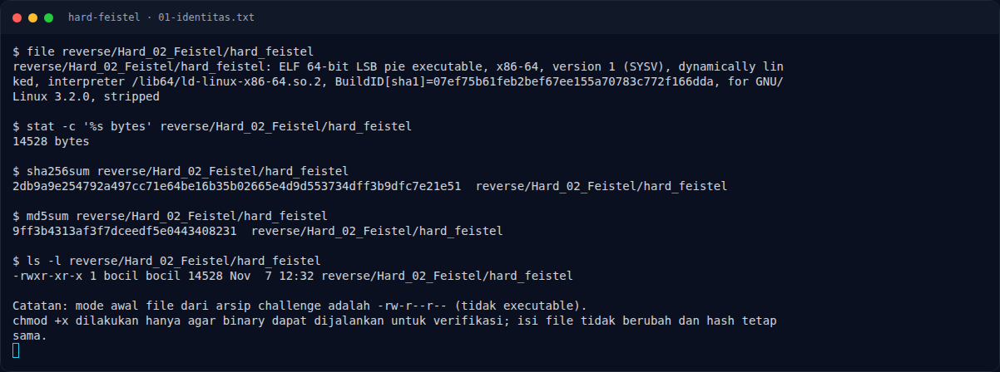
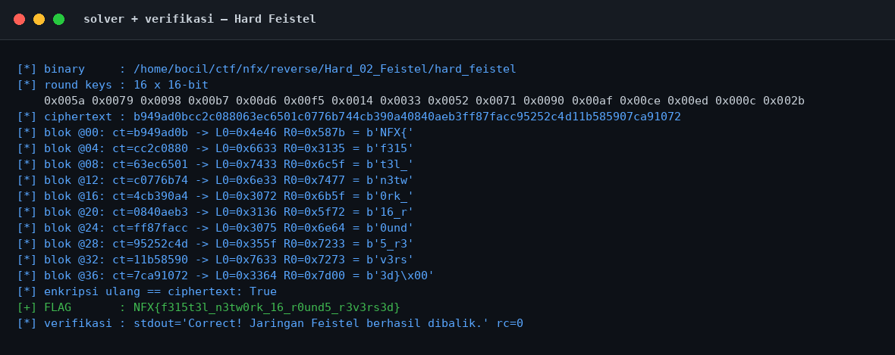

# Hard Feistel — Triage awal

[← Overview](44-hard-feistel.md) · [Index](index.md)

> **Langkah 2/13 — Triage awal.** Triage awal
>
> **Titik penting:** file reverse/Hard_02_Feistel/hard_feistel · sha256sum reverse/Hard_02_Feistel/hard_feistel · md5sum reverse/Hard_02_Feistel/hard_feistel
>
> **Berikutnya:** [Perintah akuisisi bukti](44-hard-feistel-03-perintah-akuisisi-bukti.md)

## 1.4 Triage awal

```text
$ file reverse/Hard_02_Feistel/hard_feistel
reverse/Hard_02_Feistel/hard_feistel: ELF 64-bit LSB pie executable, x86-64,
version 1 (SYSV), dynamically linked, interpreter /lib64/ld-linux-x86-64.so.2,
BuildID[sha1]=07ef75b61feb2bef67ee155a70783c772f166dda, for GNU/Linux 3.2.0, stripped
```

```text
$ sha256sum reverse/Hard_02_Feistel/hard_feistel
2db9a9e254792a497cc71e64be16b35b02665e4d9d553734dff3b9dfc7e21e51  reverse/Hard_02_Feistel/hard_feistel

$ md5sum reverse/Hard_02_Feistel/hard_feistel
9ff3b4313af3f7dceedf5e0443408231  reverse/Hard_02_Feistel/hard_feistel

$ stat -c '%s bytes' reverse/Hard_02_Feistel/hard_feistel
14528 bytes
```

```text
$ python3 -c "from pwn import *; print(ELF('reverse/Hard_02_Feistel/hard_feistel').checksec())"
RELRO:      Full RELRO
Stack:      Canary found
NX:         NX enabled
PIE:        PIE enabled
FORTIFY:    Enabled
SHSTK:      Enabled
IBT:        Enabled
```

```text
$ strings -n 4 reverse/Hard_02_Feistel/hard_feistel
...
Pemakaian: %s <flag>
Wrong!
Correct! Jaringan Feistel berhasil dibalik.
...
```

**Temuan:** panjang input dicek `== 0x27` (39 byte) di `0x111a`. Ciphertext tidak muncul sebagai string; ia berada di `.data` dan diakses lewat `lea rsi,[rip+0x2e3b] # 4020`. Round key berada di `.rodata` `0x2060` dan terlihat sebagai deret nilai 16-bit.

### Evidence langkah ini



*Terminal evidence — `01-identitas.txt` (arsip transkrip sesi solve).*



*Evidence — `01-solver.png`.*

**Berkas mentah langkah ini:**

- [`01-identitas.txt`](assets/hard-feistel/01-identitas.txt)
