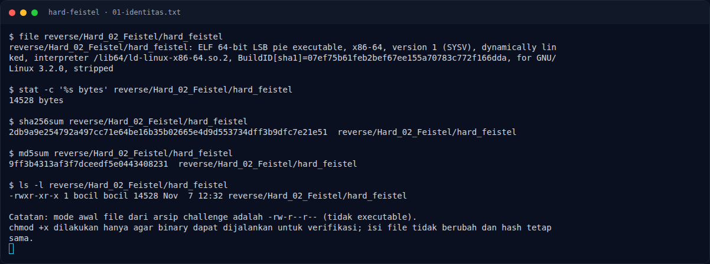
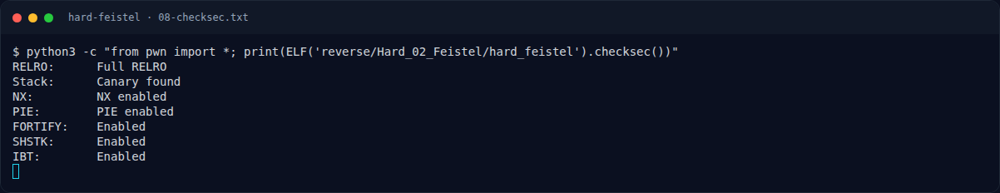

# Hard Feistel — Perintah akuisisi bukti

[← Overview](44-hard-feistel.md) · [Index](index.md)

> **Langkah 3/13 — Perintah akuisisi bukti.** Perintah akuisisi bukti
>
> **Titik penting:** file "$BIN" > docs/assets/hard-feistel/01-identitas.txt · strings -n 4 "$BIN" > docs/assets/hard-feistel/03-strings.txt · objdump -d -Mintel "$BIN" > docs/assets/hard-feistel/04-disasm.txt
>
> **Berikutnya:** [Analisis](44-hard-feistel-04-analisis.md)

## 1.5 Perintah akuisisi bukti

```bash
mkdir -p docs/assets/hard-feistel
BIN=reverse/Hard_02_Feistel/hard_feistel
file "$BIN"                                  >  docs/assets/hard-feistel/01-identitas.txt
sha256sum "$BIN"                             >> docs/assets/hard-feistel/01-identitas.txt
md5sum "$BIN"                                >> docs/assets/hard-feistel/01-identitas.txt
readelf -hW -lW -SW -dW "$BIN"               >  docs/assets/hard-feistel/02-readelf.txt
strings -n 4 "$BIN"                          >  docs/assets/hard-feistel/03-strings.txt
objdump -d -Mintel "$BIN"                    >  docs/assets/hard-feistel/04-disasm.txt
objdump -s -j .rodata "$BIN"                 >  docs/assets/hard-feistel/05-rodata-data-hexdump.txt
objdump -s -j .data "$BIN"                   >> docs/assets/hard-feistel/05-rodata-data-hexdump.txt
python3 -c "from pwn import *; print(ELF('$BIN').checksec())" \
                                             >  docs/assets/hard-feistel/08-checksec.txt
python3 docs/assets/hard-feistel/solve_feistel.py \
                                             | tee docs/assets/hard-feistel/06-solver-output.txt
```

### Evidence langkah ini



*Terminal evidence — `01-identitas.txt` (arsip transkrip sesi solve).*



*Terminal evidence — `08-checksec.txt` (arsip transkrip sesi solve).*

**Berkas mentah langkah ini:**

- [`01-identitas.txt`](assets/hard-feistel/01-identitas.txt)
- [`08-checksec.txt`](assets/hard-feistel/08-checksec.txt)
