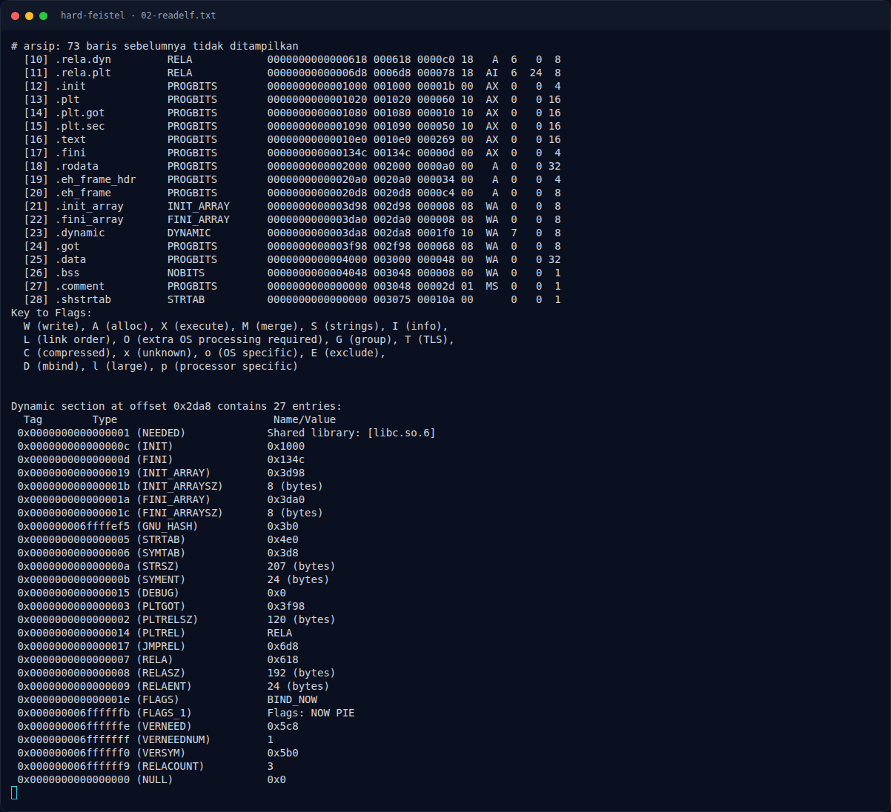
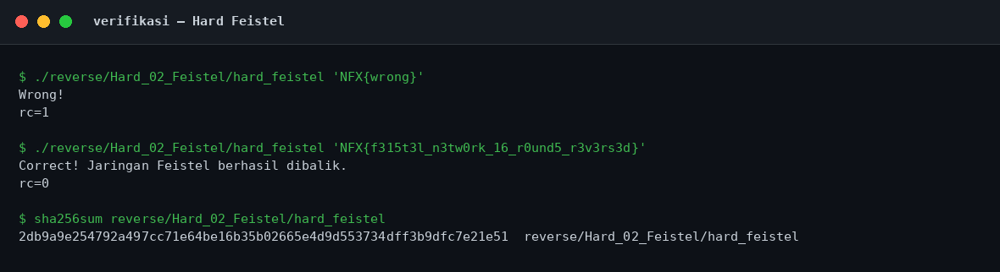

# Hard Feistel — Analisis

[← Overview](44-hard-feistel.md) · [Index](index.md)

## 2.1 Main dan layout

Main ada di `0x10e0`.

```asm
1102:  cmp    edi,0x1
1105:  jle    1236                   ; usage
110b:  mov    rbp,QWORD PTR [rsi+0x8] ; argv[1]
110f:  call   10a0 <strlen@plt>
1117:  mov    rdx,rax
111a:  cmp    rax,0x27               ; 39 byte
111e:  jne    11f4                   ; Wrong!
1124:  lea    rsi,[rsp+0x20]
1129:  mov    r8,rsp
112c:  mov    ecx,0x38              ; zero 224 byte
1136:  lea    r9,[rsp+0x100]         ; buffer output
113e:  lea    r11,[rsp+0x28]         ; akhir input (40 byte)
1143:  mov    rsi,rbp
1146:  rep stos DWORD PTR es:[rdi],eax
114b:  mov    rdi,r8
114e:  mov    rcx,rdx
1151:  rep movs BYTE PTR es:[rdi],BYTE PTR ds:[rsi]  ; copy 39 byte
```

Input 39 byte disalin ke `[rsp]`, sisa buffer sudah di-zero, sehingga blok terakhir (byte ke-40) bernilai `0x00`. Loop memproses `[rsp]` sampai `[rsp+0x28)`, yaitu **10 blok × 4 byte = 40 byte**.

## 2.2 Memuat blok dan round key

```asm
1156:  lea    r8,[rip+0xf43]        # 20a0  (akhir array key)
1160:  movzx  esi,BYTE PTR [rdi]    ; byte 0
1163:  movzx  eax,BYTE PTR [rdi+1]  ; byte 1
1167:  lea    rcx,[rip+0xef6]        # 2064 (key ke-1)
116e:  mov    ebp,0x5a               ; key ke-0
1173:  movzx  ebx,BYTE PTR [rdi+2]  ; byte 2
1177:  shl    esi,0x8
117a:  or     esi,eax                ; L = (b0 << 8) | b1
117c:  movzx  eax,BYTE PTR [rdi+3]  ; byte 3
1180:  shl    ebx,0x8
1183:  or     ebx,eax                ; R = (b2 << 8) | b3
```

Jadi blok 4 byte dibaca **big-endian**: `L = b0b1`, `R = b2b3`.

Round key disimpan sebagai 16 dword di `0x2060`, tetapi nilainya 16-bit. Key pertama `0x5a` di-load langsung, sisanya dibaca dari `0x2064`, `0x2068`, ..., `0x209c`.

### Evidence langkah ini



*Terminal evidence — `02-readelf.txt` (arsip transkrip sesi solve).*



*Evidence — `02-verifikasi.png`.*
