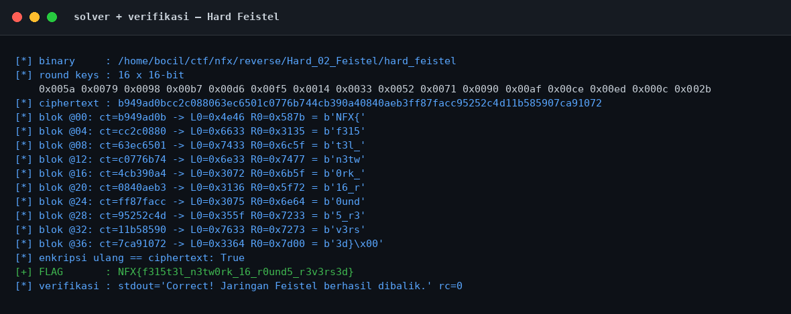
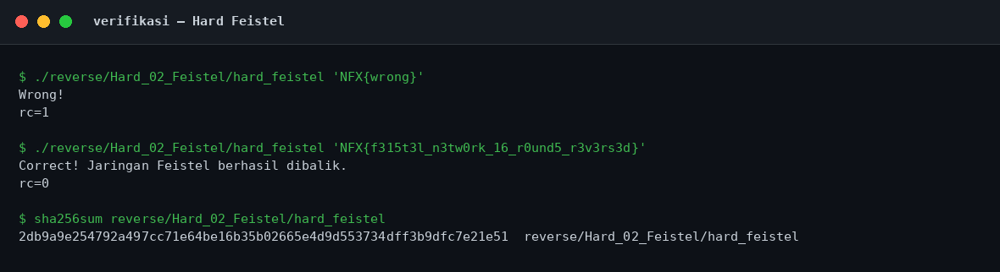
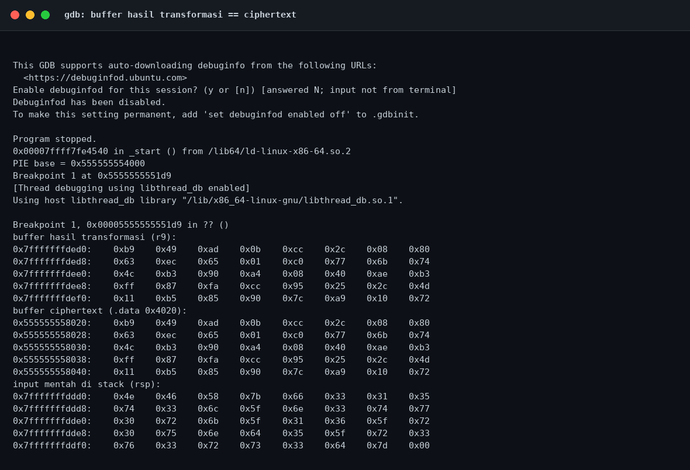

# Hard Feistel — Evidence / Bukti

[← Overview](44-hard-feistel.md) · [Index](index.md)

## Arsip Evidence

> Semua file di bawah berasal dari folder `assets/hard-feistel/`. Screenshot ditempel langsung; file teks/script ditautkan.

### Screenshot

### Transkrip / file pendukung

- [`01-identitas.txt`](assets/hard-feistel/01-identitas.txt)
- [`02-readelf.txt`](assets/hard-feistel/02-readelf.txt)
- [`03-strings.txt`](assets/hard-feistel/03-strings.txt)
- [`04-disasm.txt`](assets/hard-feistel/04-disasm.txt)
- [`05-rodata-data-hexdump.txt`](assets/hard-feistel/05-rodata-data-hexdump.txt)
- [`06-solver-output.txt`](assets/hard-feistel/06-solver-output.txt)
- [`07-verifikasi.txt`](assets/hard-feistel/07-verifikasi.txt)
- [`08-checksec.txt`](assets/hard-feistel/08-checksec.txt)
- [`08-gdb-output-buffer.txt`](assets/hard-feistel/08-gdb-output-buffer.txt)
- [`solve_feistel.py`](assets/hard-feistel/solve_feistel.py)

## Tabel Evidence

| Bukti | File | Keterangan |
|---|---|---|
| Identitas & hash | `01-identitas.txt` | `file`, hash, permission |
| ELF metadata | `02-readelf.txt` | Header, segmen, section |
| Strings | `03-strings.txt` | `strings -n 4` |
| Disassembly | `04-disasm.txt` | Round function dan serialisasi |
| Hex dump | `05-rodata-data-hexdump.txt` | Round key `.rodata` + ciphertext `.data` |
| Solver | `solve_feistel.py` | Dekripsi Feistel |
| Output solver | `06-solver-output.txt` | Output asli |
| Verifikasi | `07-verifikasi.txt` | Salah vs benar + hash |
| Checksec | `08-checksec.txt` | Hasil `ELF.checksec()` |
| gdb buffer | `08-gdb-output-buffer.txt` | Bukti output == ciphertext |
| Screenshot solver | `01-solver.png` | Render output solver |
| Screenshot verifikasi | `02-verifikasi.png` | Render output verifikasi |
| Screenshot gdb | `03-gdb.png` | Render bukti gdb |
