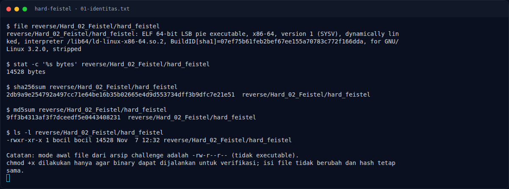
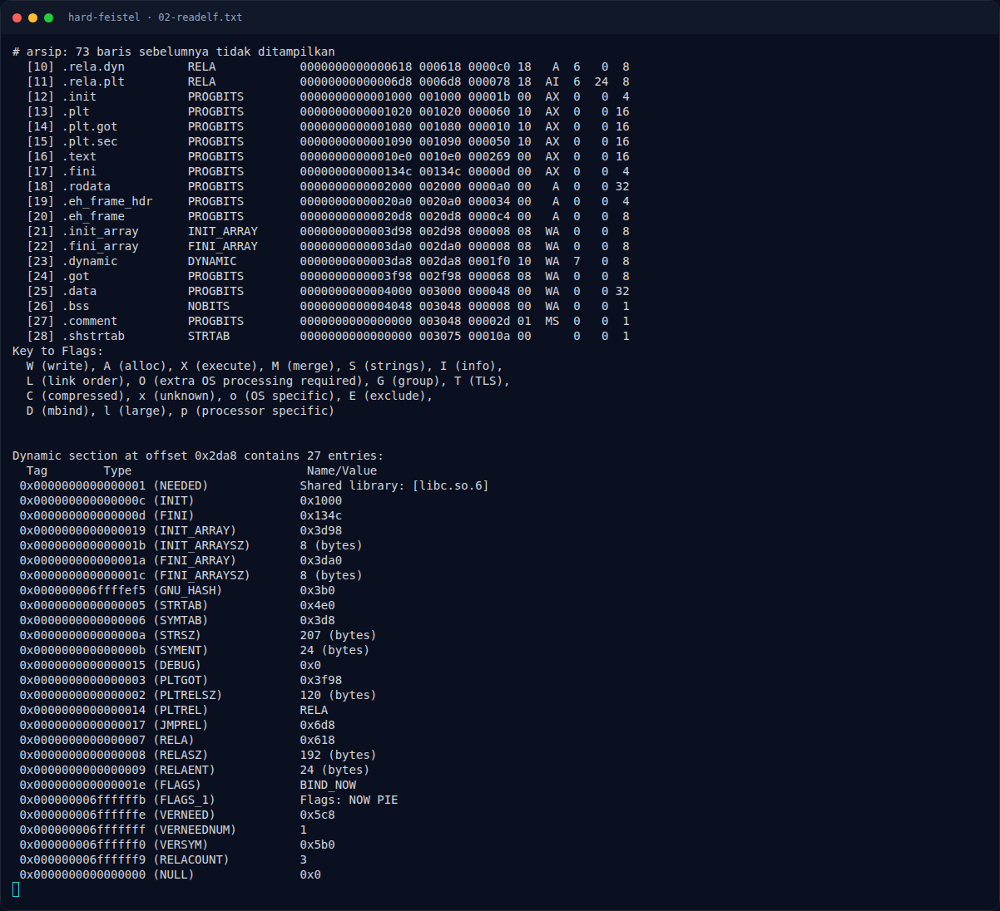
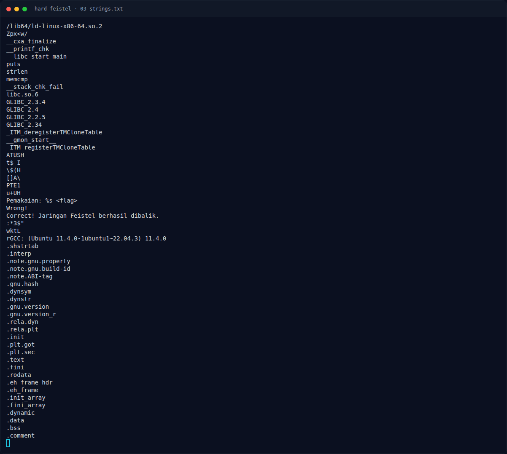
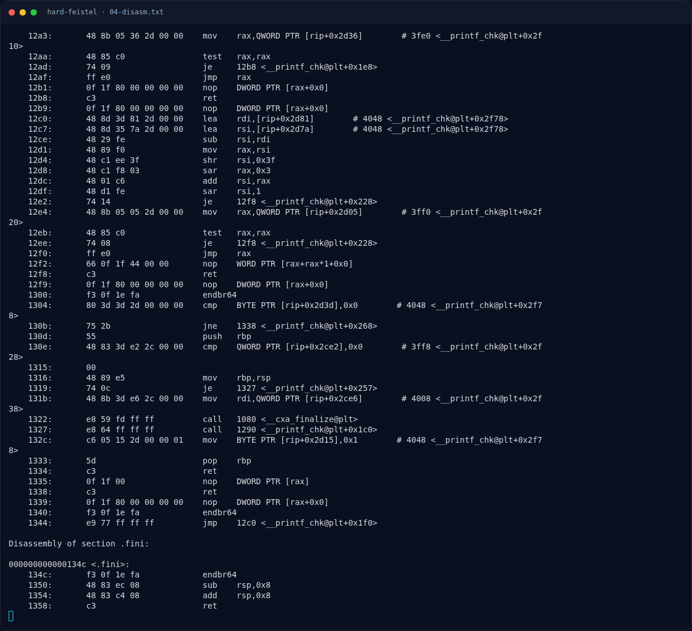
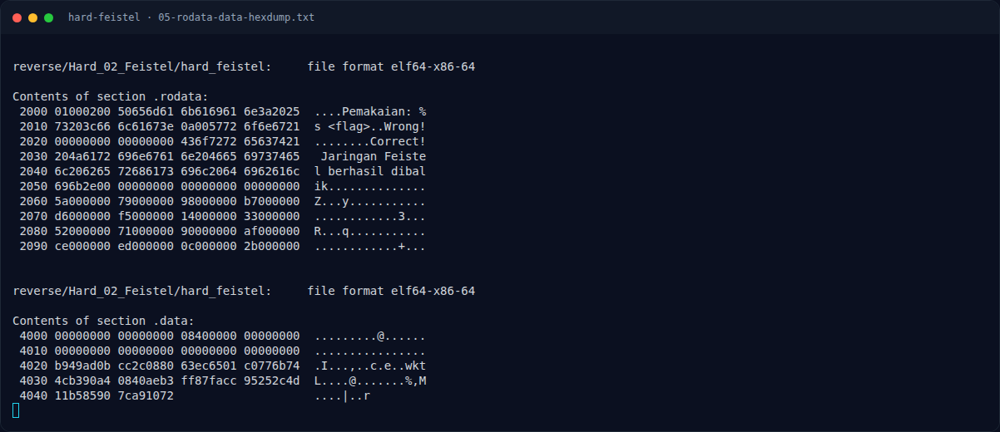
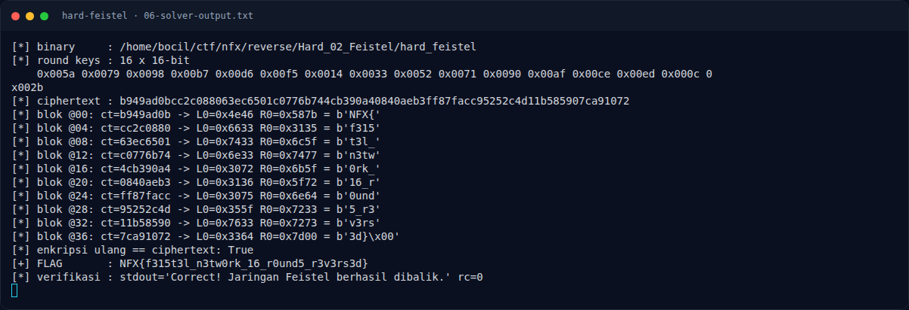
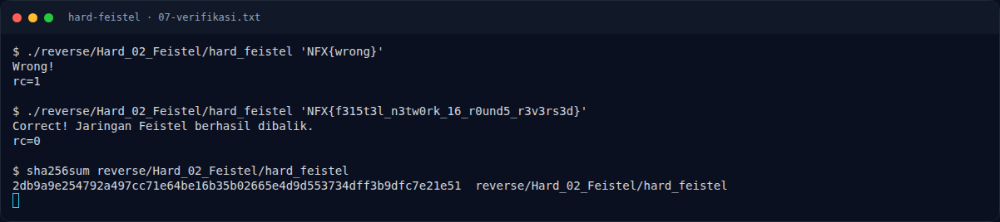
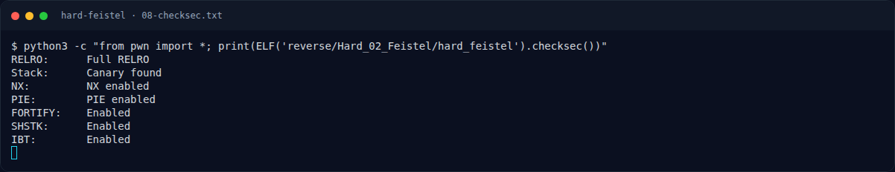
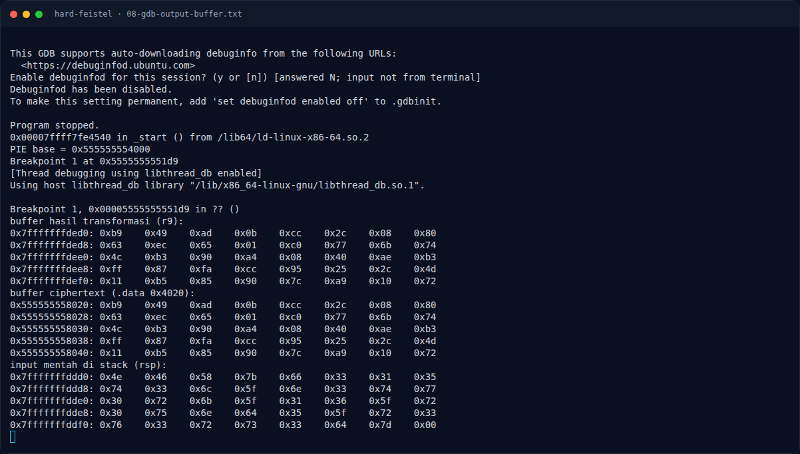

# Hard Feistel — Strategi

[← Overview](44-hard-feistel.md) · [Index](index.md)

## 3.1 Strategi

1. Ekstrak 16 round key dari `.rodata` `0x2060`.
2. Ekstrak ciphertext 40 byte dari `.data` `0x4020`.
3. Untuk tiap blok 4 byte, baca `L16` dan `R16` big-endian.
4. Jalankan inverse Feistel 16 ronde.
5. Tulis `L0` dan `R0` big-endian, gabungkan 10 blok.
6. Buang padding `\x00` di akhir, verifikasi dengan binary.
7. Enkripsi ulang untuk memastikan hasilnya sama dengan ciphertext.

### Evidence langkah ini

*Terminal evidence — `01-identitas.txt` (arsip transkrip sesi solve).*

*Terminal evidence — `02-readelf.txt` (arsip transkrip sesi solve).*

*Terminal evidence — `03-strings.txt` (arsip transkrip sesi solve).*

*Terminal evidence — `04-disasm.txt` (arsip transkrip sesi solve).*

*Terminal evidence — `05-rodata-data-hexdump.txt` (arsip transkrip sesi solve).*

*Terminal evidence — `06-solver-output.txt` (arsip transkrip sesi solve).*

*Terminal evidence — `07-verifikasi.txt` (arsip transkrip sesi solve).*

*Terminal evidence — `08-checksec.txt` (arsip transkrip sesi solve).*

*Terminal evidence — `08-gdb-output-buffer.txt` (arsip transkrip sesi solve).*

**Berkas mentah langkah ini:**

- [`01-identitas.txt`](assets/hard-feistel/01-identitas.txt)
- [`02-readelf.txt`](assets/hard-feistel/02-readelf.txt)
- [`03-strings.txt`](assets/hard-feistel/03-strings.txt)
- [`04-disasm.txt`](assets/hard-feistel/04-disasm.txt)
- [`05-rodata-data-hexdump.txt`](assets/hard-feistel/05-rodata-data-hexdump.txt)
- [`06-solver-output.txt`](assets/hard-feistel/06-solver-output.txt)
