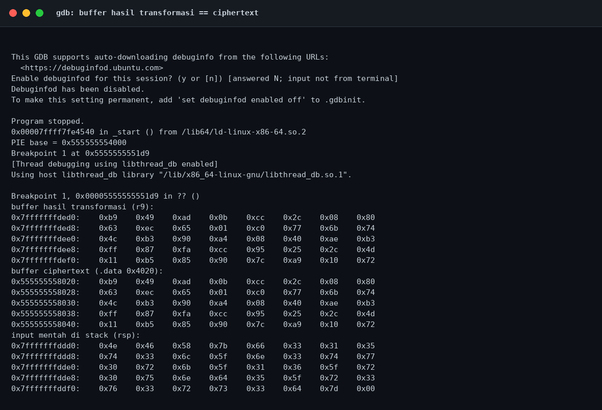

# Hard Feistel — Strategi

[← Overview](44-hard-feistel.md) · [Index](index.md)

## 3.1 Strategi

1. Ekstrak 16 round key dari `.rodata` `0x2060`.
2. Ekstrak ciphertext 40 byte dari `.data` `0x4020`.
3. Untuk tiap blok 4 byte, baca `L16` dan `R16` big-endian.
4. Jalankan inverse Feistel 16 ronde.
5. Tulis `L0` dan `R0` big-endian, gabungkan 10 blok.
6. Buang padding `\x00` di akhir, verifikasi dengan binary.
7. Enkripsi ulang untuk memastikan hasilnya sama dengan ciphertext.

### Evidence langkah ini

*Terminal evidence — `03-strings.txt` (arsip transkrip sesi solve).*

*Evidence — `03-gdb.png`.*
