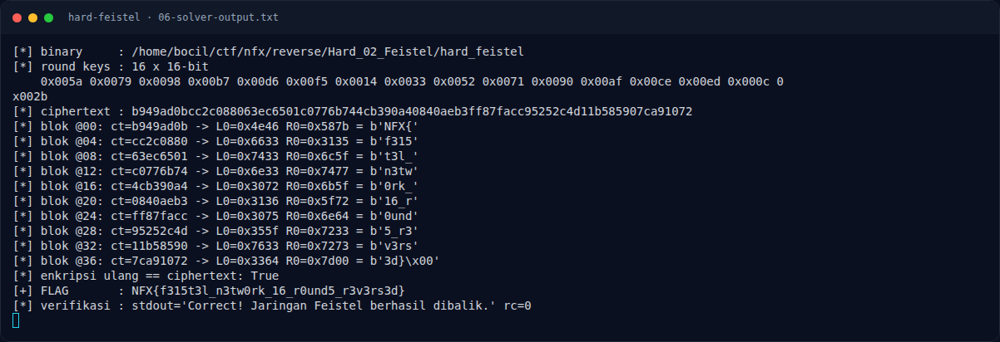

# Hard Feistel — Output asli

[← Overview](44-hard-feistel.md) · [Index](index.md)

> **Langkah 9/13 — Output asli.** Blok terakhir berisi 3d 7d 00 — } diikuti padding nol.
>
> **Titik penting:** python3 docs/assets/hard-feistel/solve_feistel.py · NFX{f315t3l_n3tw0rk_16_r0und5_r3v3rs3d}
>
> **Berikutnya:** [Verifikasi tambahan dengan gdb](44-hard-feistel-10-verifikasi-tambahan-dengan-gdb.md)

## 3.3 Output asli

```text
$ python3 docs/assets/hard-feistel/solve_feistel.py
[*] binary     : <repo>/reverse/Hard_02_Feistel/hard_feistel
[*] round keys : 16 x 16-bit
    0x005a 0x0079 0x0098 0x00b7 0x00d6 0x00f5 0x0014 0x0033 0x0052 0x0071 0x0090 0x00af 0x00ce 0x00ed 0x000c 0x002b
[*] ciphertext : b949ad0bcc2c088063ec6501c0776b744cb390a40840aeb3ff87facc95252c4d11b585907ca91072
[*] blok @00: ct=b949ad0b -> L0=0x4e46 R0=0x587b = b'NFX{'
[*] blok @04: ct=cc2c0880 -> L0=0x6633 R0=0x3135 = b'f315'
[*] blok @08: ct=63ec6501 -> L0=0x7433 R0=0x6c5f = b't3l_'
[*] blok @12: ct=c0776b74 -> L0=0x6e33 R0=0x7477 = b'n3tw'
[*] blok @16: ct=4cb390a4 -> L0=0x3072 R0=0x6b5f = b'0rk_'
[*] blok @20: ct=0840aeb3 -> L0=0x3136 R0=0x5f72 = b'16_r'
[*] blok @24: ct=ff87facc -> L0=0x3075 R0=0x6e64 = b'0und'
[*] blok @28: ct=95252c4d -> L0=0x355f R0=0x7233 = b'5_r3'
[*] blok @32: ct=11b58590 -> L0=0x7633 R0=0x7273 = b'v3rs'
[*] blok @36: ct=7ca91072 -> L0=0x3364 R0=0x7d00 = b'3d}\x00'
[*] enkripsi ulang == ciphertext: True
[+] FLAG       : NFX{f315t3l_n3tw0rk_16_r0und5_r3v3rs3d}
[*] verifikasi : stdout='Correct! Jaringan Feistel berhasil dibalik.' rc=0
```

Blok terakhir berisi `3d 7d 00` — `}` diikuti padding nol. Itu sebabnya flag efektif 39 byte, sementara buffer 40 byte.

### Evidence langkah ini



*Terminal evidence — `06-solver-output.txt` (arsip transkrip sesi solve).*

**Berkas mentah langkah ini:**

- [`06-solver-output.txt`](assets/hard-feistel/06-solver-output.txt)
