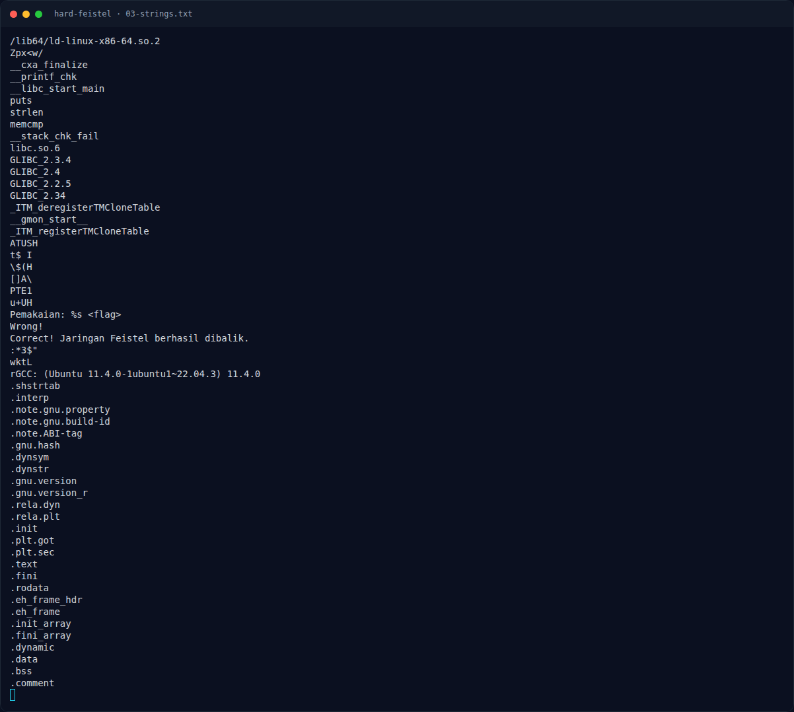
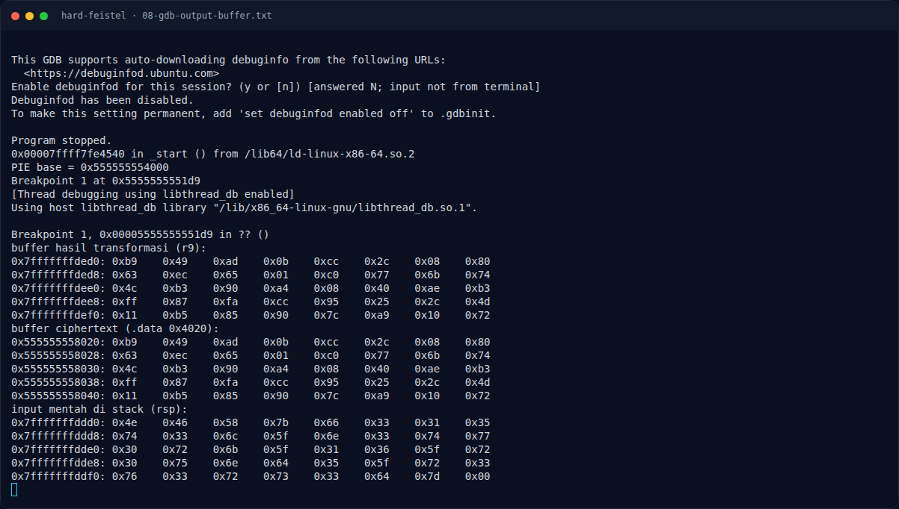

# Hard Feistel — Verifikasi tambahan dengan gdb

[← Overview](44-hard-feistel.md) · [Index](index.md)

## 3.4 Verifikasi tambahan dengan gdb

Untuk memastikan pemahaman serialisasi output benar, binary dijalankan di gdb dengan flag yang benar. Breakpoint dipasang tepat sebelum `memcmp` (setelah loop transformasi, `0x11d9`). Buffer hasil transformasi dibandingkan dengan ciphertext di `.data`:

```text
PIE base = 0x555555554000
Breakpoint 1 at 0x5555555551d9
buffer hasil transformasi (r9):
0x7fffffffded0: 0xb9 0x49 0xad 0x0b 0xcc 0x2c 0x08 0x80
0x7fffffffded8: 0x63 0xec 0x65 0x01 0xc0 0x77 0x6b 0x74
...
buffer ciphertext (.data 0x4020):
0x555555558020: 0xb9 0x49 0xad 0x0b 0xcc 0x2c 0x08 0x80
0x555555558028: 0x63 0xec 0x65 0x01 0xc0 0x77 0x6b 0x74
...
input mentah di stack (rsp):
0x7fffffffddd0: 0x4e 0x46 0x58 0x7b 0x66 0x33 0x31 0x35
...
```

Output buffer identik dengan ciphertext, dan input mentah adalah flag. Ini mengonfirmasi model enkripsi/dekripsi.

### Evidence langkah ini



*Terminal evidence — `03-strings.txt` (arsip transkrip sesi solve).*



*Terminal evidence — `08-gdb-output-buffer.txt` (arsip transkrip sesi solve).*

**Berkas mentah langkah ini:**

- [`03-strings.txt`](assets/hard-feistel/03-strings.txt)
- [`08-gdb-output-buffer.txt`](assets/hard-feistel/08-gdb-output-buffer.txt)
