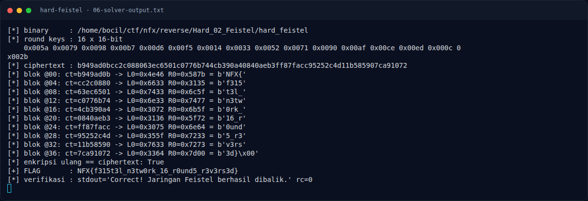

# Hard Feistel — Flag & Verifikasi

[← Overview](44-hard-feistel.md) · [Index](index.md)

> **Langkah 11/13 — Flag.** Cek file flag lokal:
>
> **Titik penting:** NFX{f315t3l_n3tw0rk_16_r0und5_r3v3rs3d}
>
> **Berikutnya:** [Bukti / Evidence](44-hard-feistel-12-bukti-evidence.md)

> **Asal flag.** Flag diperoleh dari langkah exploit/solver yang terdokumentasi, lalu disubmit ke platform.  
> **Tingkat bukti metode.** Terdokumentasi. [Buka Evidence](44-hard-feistel-12-bukti-evidence.md)

> **Flag:** `NFX{f315t3l_n3tw0rk_16_r0und5_r3v3rs3d}`
> **Status:** `VERIFIED`

```text
NFX{f315t3l_n3tw0rk_16_r0und5_r3v3rs3d}
```

Cek file flag lokal:

```text
$ cat flags/reverse/Hard_02_Feistel.txt
NFX{f315t3l_n3tw0rk_16_r0und5_r3v3rs3d}
```

Verifikasi:

```text
$ ./reverse/Hard_02_Feistel/hard_feistel 'NFX{f315t3l_n3tw0rk_16_r0und5_r3v3rs3d}'
Correct! Jaringan Feistel berhasil dibalik.
rc=0

$ ./reverse/Hard_02_Feistel/hard_feistel 'NFX{wrong}'
Wrong!
rc=1
```

Isi `flags/reverse/Hard_02_Feistel.txt` identik. **Status: `VERIFIED platform`.** Flag tercatat accepted di platform (lihat terminal evidence asli); verifikasi lokal tetap dilakukan terhadap binary dan file flag.

### Terminal evidence (real)



*Terminal evidence (real).*

> **Bukti:** terminal evidence (real).
