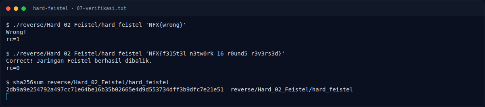

# Hard Feistel — Referensi

[← Overview](44-hard-feistel.md) · [Index](index.md)

- Feistel network — Horst Feistel / IBM, dasar DES.
- `objdump(1)`, `readelf(1)` — binutils.
- `gdb` — breakpoint dan dump memori.
- `pyelftools` — parsing ELF.
- `pwntools` `ELF.checksec()`.

### Evidence langkah ini

*Terminal evidence — `07-verifikasi.txt` (arsip transkrip sesi solve).*

**Berkas mentah langkah ini:**

- [`07-verifikasi.txt`](assets/hard-feistel/07-verifikasi.txt)
