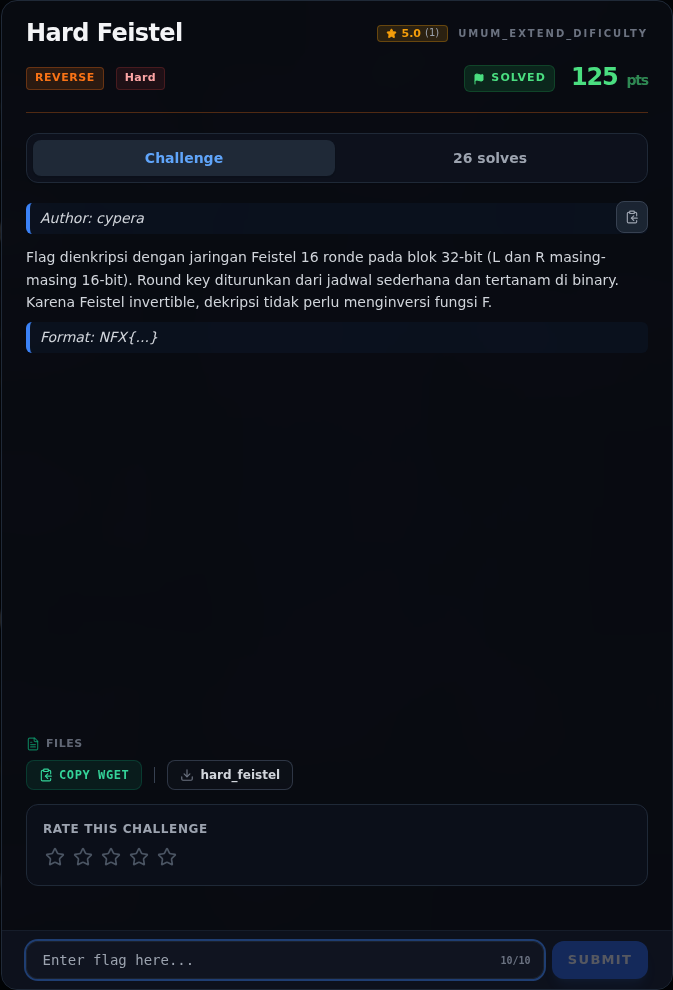
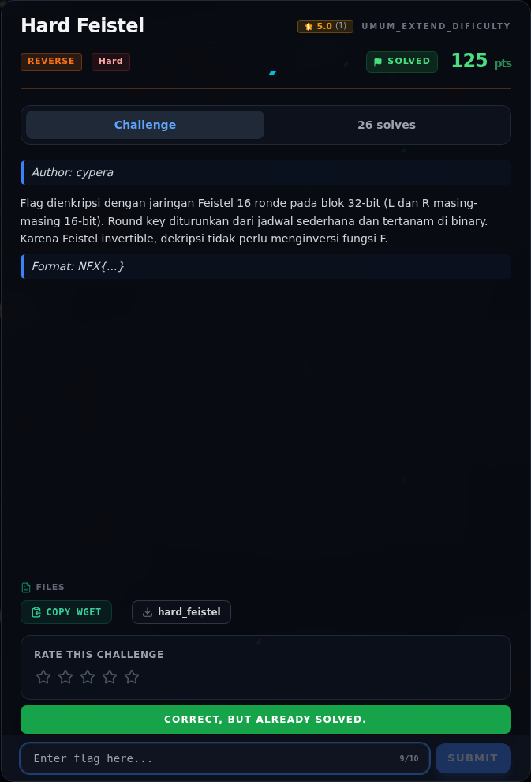

# Hard Feistel

Track Umum / Extend · ReverseHard230 poinVERIFIED

| Field | Nilai |
|---|---|
| Event | `umum_Extend` |
| Kategori | `Reverse` |
| Difficulty | `Hard` |
| Poin | `230` |
| Author | `cypera` |
| Solves | `19` |
| Tools | python3, pwntools, checksec, gdb, objdump, readelf, strings, sage |
| Flag | `NFX{f315t3l_n3tw0rk_16_r0und5_r3v3rs3d}` |
| Status | `VERIFIED` |

[← Kembali ke Index](index.md)

## Challenge Brief (platform)

*Challenge brief asli di platform NFX CTF 2026.*

## Alur & Titik Penting

| # | Langkah | Titik penting | Buka |
|---:|---|---|---|
| 1 | Recon | NFX{...} | [Buka](44-hard-feistel-01-recon.md) |
| 2 | Triage awal | file reverse/Hard_02_Feistel/hard_feistel | [Buka](44-hard-feistel-02-triage-awal.md) |
| 3 | Perintah akuisisi bukti | python3 -c "from pwn import *; print(ELF('$BIN').checksec())" \ | [Buka](44-hard-feistel-03-perintah-akuisisi-bukti.md) |
| 4 | Analisis | Input 39 byte disalin ke [rsp], sisa buffer sudah di-zero, sehingga blok terakhir (byte ke-40) bernilai 0x00. | [Buka](44-hard-feistel-04-analisis.md) |
| 5 | Analisis | K 257 sama dengan K + (K << 8), yaitu menduplikasi byte rendah key ke dua byte (karena key hanya 8-bit). | [Buka](44-hard-feistel-05-analisis-2.md) |
| 6 | Analisis | Setelah 16 ronde, register berisi: | [Buka](44-hard-feistel-06-analisis-3.md) |
| 7 | Strategi | — | [Buka](44-hard-feistel-07-strategi.md) |
| 8 | Solver lengkap | File: writeups/assets/hard-feistel/solvefeistel.py | [Buka](44-hard-feistel-08-solver-lengkap.md) |
| 9 | Output asli | python3 writeups/assets/hard-feistel/solve_feistel.py | [Buka](44-hard-feistel-09-output-asli.md) |
| 10 | Verifikasi tambahan dengan gdb | Untuk memastikan pemahaman serialisasi output benar, binary dijalankan di gdb dengan flag yang benar. | [Buka](44-hard-feistel-10-verifikasi-tambahan-dengan-gdb.md) |
| 11 | Flag | NFX{f315t3l_n3tw0rk_16_r0und5_r3v3rs3d} | [Buka](44-hard-feistel-11-flag.md) |
| 12 | Bukti / Evidence | arsip screenshot dan transkrip | [Buka](44-hard-feistel-12-bukti-evidence.md) |
| 13 | Referensi | — | [Buka](44-hard-feistel-13-referensi.md) |

## TL;DR

- `hard_feistel` memvalidasi flag 39 byte dari `argv[1]` dan memprosesnya sebagai 10 blok 32-bit.
- Setiap blok dipecah menjadi `L` dan `R` 16-bit, lalu melewati **16 ronde Feistel**.
- Fungsi ronde: `F(R,K) = (((R * 0x9e3779b1) mod 2^32) >> 5) XOR ((K * 257) & 0xffff)`.
- 16 round key 16-bit tertanam di `.rodata` `0x2060`; ciphertext 40 byte di `.data` `0x4020`.
- Output tiap blok adalah `big-endian(L16) || big-endian(R16)`, jadi dekripsi cukup membalik urutan ronde tanpa menginversi `F`.
- Flag: `NFX{f315t3l_n3tw0rk_16_r0und5_r3v3rs3d}`.

Pratinjau evidence. Buka halaman <a href="44-hard-feistel-03-perintah-akuisisi-bukti.html">Evidence / Bukti</a> untuk semua screenshot dan transkrip.

## Navigasi Halaman

<a class="nx-page-card" href="44-hard-feistel-01-recon.html"><b>Recon</b>Enumerasi target dan bukti awal</a>
<a class="nx-page-card" href="44-hard-feistel-02-triage-awal.html"><b>Triage awal</b>Baca bagian ini</a>
<a class="nx-page-card" href="44-hard-feistel-03-perintah-akuisisi-bukti.html"><b>Perintah akuisisi bukti</b>Screenshot, transkrip, dan artefak</a>
<a class="nx-page-card" href="44-hard-feistel-04-analisis.html"><b>Analisis</b>Membaca alur dan akar masalah</a>
<a class="nx-page-card" href="44-hard-feistel-05-analisis-2.html"><b>Analisis</b>Membaca alur dan akar masalah</a>
<a class="nx-page-card" href="44-hard-feistel-06-analisis-3.html"><b>Analisis</b>Membaca alur dan akar masalah</a>
<a class="nx-page-card" href="44-hard-feistel-07-strategi.html"><b>Strategi</b>Baca bagian ini</a>
<a class="nx-page-card" href="44-hard-feistel-08-solver-lengkap.html"><b>Solver lengkap</b>Langkah exploit dan solver</a>
<a class="nx-page-card" href="44-hard-feistel-09-output-asli.html"><b>Output asli</b>Baca bagian ini</a>
<a class="nx-page-card" href="44-hard-feistel-10-verifikasi-tambahan-dengan-gdb.html"><b>Verifikasi tambahan dengan gdb</b>Baca bagian ini</a>
<a class="nx-page-card" href="44-hard-feistel-11-flag.html"><b>Flag</b>Flag dan verifikasi platform</a>
<a class="nx-page-card" href="44-hard-feistel-12-bukti-evidence.html"><b>Bukti / Evidence</b>Screenshot, transkrip, dan artefak</a>
<a class="nx-page-card" href="44-hard-feistel-13-referensi.html"><b>Referensi</b>Sumber dan bacaan lanjutan</a>

