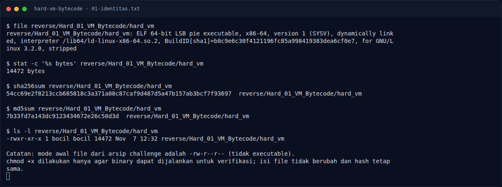

# Hard VM Bytecode — Recon

[← Overview](45-hard-vm-bytecode.md) · [Index](index.md)

## 1.1 Deskripsi challenge

> **Author: cypera**
>
> Binary ini bukan validator biasa: ia menjalankan bytecode custom pada VM kecil. Setiap karakter diproses dengan urutan LOAD, XOR, ADD, ROL, lalu CMP. Tugasmu adalah memahami opcode dan membalik transformasinya.
>
> Format: `NFX{...}`

Deskripsi memberi tahu urutan operasi per karakter. Tantangan sebenarnya adalah memetakan opcode ke handler, memahami format instruksi (3 byte), dan menemukan di mana bytecode berada.

## 1.2 File yang diberikan

| File | Ukuran | SHA-256 | MD5 |
|---|---|---|---|
| `reverse/Hard_01_VM_Bytecode/hard_vm` | 14.472 byte | `54cc69e2f8213ccb685818c3a371a08c87caf9d487d5a47b157ab3bcf7f93697` | `7b33fd7a143dc9123434672e26c50d3d` |

Catatan operasional: file asli tidak memiliki bit executable (`-rw-r--r--`). Agar bisa dijalankan untuk verifikasi, permission diubah dengan `chmod +x reverse/Hard_01_VM_Bytecode/hard_vm`. Ini tidak mengubah isi binary (hash tetap sama).

## 1.3 Environment

- Linux x86-64; tools: `file`, `readelf`, `objdump`, `strings`, `gdb`, `python3`, `pyelftools`, `pwntools`.
- `checksec` standalone tidak tersedia; memakai `ELF.checksec()`.
- Binary membaca flag dari `argv[1]`.

### Evidence langkah ini

*Terminal evidence — `01-identitas.txt` (arsip transkrip sesi solve).*

**Berkas mentah langkah ini:**

- [`01-identitas.txt`](assets/hard-vm-bytecode/01-identitas.txt)
