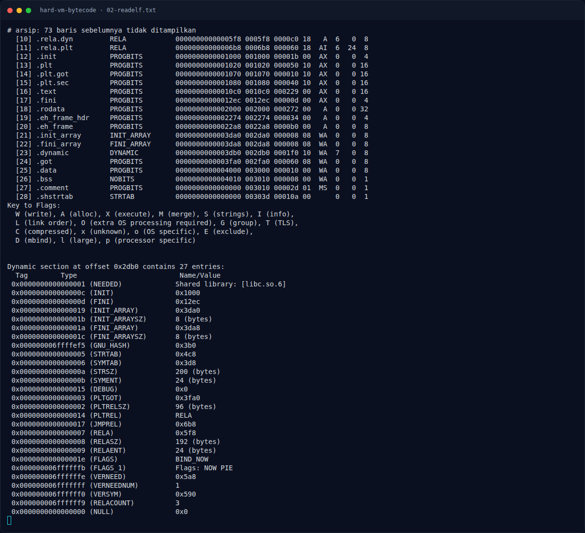
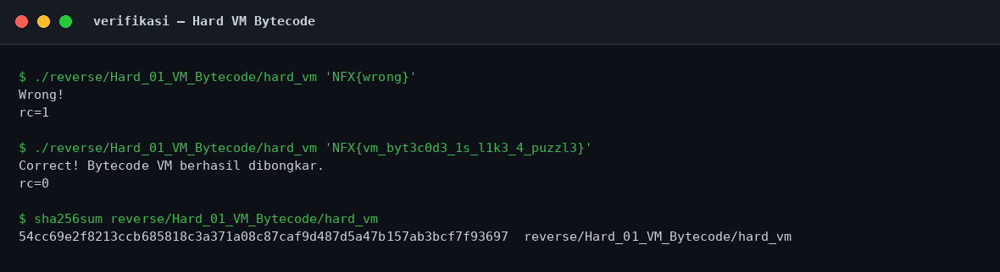

# Hard VM Bytecode — Main dan layout

[← Overview](45-hard-vm-bytecode.md) · [Index](index.md)

## 2.1 Main dan layout

Main ada di `0x10c0`. Bagian awal:

```asm
10df:  cmp    edi,0x1
10e2:  jle    11dc                   ; usage
10e8:  mov    rbp,QWORD PTR [rsi+0x8] ; argv[1]
10ef:  call   1090 <strlen@plt>
10f4:  mov    rdx,rax
10f7:  cmp    rax,0x21               ; 33 byte
10fb:  jne    1170                   ; Wrong!
```

Lalu:

```asm
10fd:  lea    rsi,[rsp+0x30]         ; buffer state
1102:  mov    ecx,0x38              ; zero 0x38 dword = 224 byte
1109:  mov    DWORD PTR [rsp+0xc],0x0
1111:  mov    rdi,rsi
1114:  lea    r8,[rsp+0x10]          ; buffer input
1119:  mov    rsi,rbp
111c:  rep stos DWORD PTR es:[rdi],eax
111e:  mov    rcx,rdx
1121:  lea    rdx,[rip+0xf58]        ; bytecode @ 0x2080
1128:  mov    rdi,r8
112b:  rep movs BYTE PTR es:[rdi],BYTE PTR ds:[rsi]  ; copy 33 byte input
112d:  lea    r8,[rdx+0x1f2]         ; akhir bytecode = 0x2080 + 498
1134:  lea    rdi,[rip+0xf25]        ; dispatch table @ 0x2060
```

Layout stack yang relevan:

- `[rsp+0x0c]` — register/state byte (hanya dword pertama di-zero).
- `[rsp+0x10]` — input flag 33 byte.
- `[rsp+0x30]` — buffer tambahan yang di-zero (tidak dipakai sebagai register oleh bytecode ini).

### Evidence langkah ini



*Terminal evidence — `02-readelf.txt` (arsip transkrip sesi solve).*



*Evidence — `02-verifikasi.png`.*
