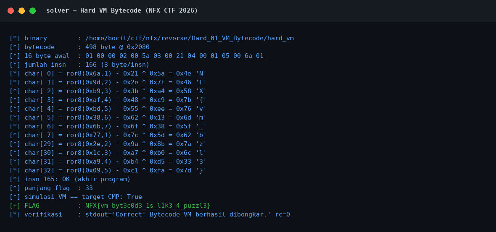
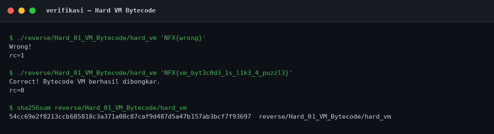

# Hard VM Bytecode — Evidence / Bukti

[← Overview](45-hard-vm-bytecode.md) · [Index](index.md)

## Arsip Evidence

> Semua file di bawah berasal dari folder `assets/hard-vm-bytecode/`. Screenshot ditempel langsung; file teks/script ditautkan.

### Screenshot

### Transkrip / file pendukung

- [`01-identitas.txt`](assets/hard-vm-bytecode/01-identitas.txt)
- [`02-readelf.txt`](assets/hard-vm-bytecode/02-readelf.txt)
- [`03-strings.txt`](assets/hard-vm-bytecode/03-strings.txt)
- [`04-disasm.txt`](assets/hard-vm-bytecode/04-disasm.txt)
- [`05-rodata-data-hexdump.txt`](assets/hard-vm-bytecode/05-rodata-data-hexdump.txt)
- [`06-solver-output.txt`](assets/hard-vm-bytecode/06-solver-output.txt)
- [`07-verifikasi.txt`](assets/hard-vm-bytecode/07-verifikasi.txt)
- [`08-checksec.txt`](assets/hard-vm-bytecode/08-checksec.txt)
- [`solve_vm.py`](assets/hard-vm-bytecode/solve_vm.py)

## Tabel Evidence

| Bukti | File | Keterangan |
|---|---|---|
| Identitas & hash | `01-identitas.txt` | `file`, hash, permission awal |
| ELF metadata | `02-readelf.txt` | Header, segmen, section |
| Strings | `03-strings.txt` | `strings -n 4` |
| Disassembly | `04-disasm.txt` | Interpreter dan dispatch |
| Hex dump | `05-rodata-data-hexdump.txt` | Dispatch table + bytecode |
| Solver | `solve_vm.py` | Parser bytecode + inversi |
| Output solver | `06-solver-output.txt` | Output asli |
| Verifikasi | `07-verifikasi.txt` | Salah vs benar + hash |
| Checksec | `08-checksec.txt` | Hasil `ELF.checksec()` |
| Screenshot solver | `01-solver.png` | Render output solver |
| Screenshot verifikasi | `02-verifikasi.png` | Render output verifikasi |
