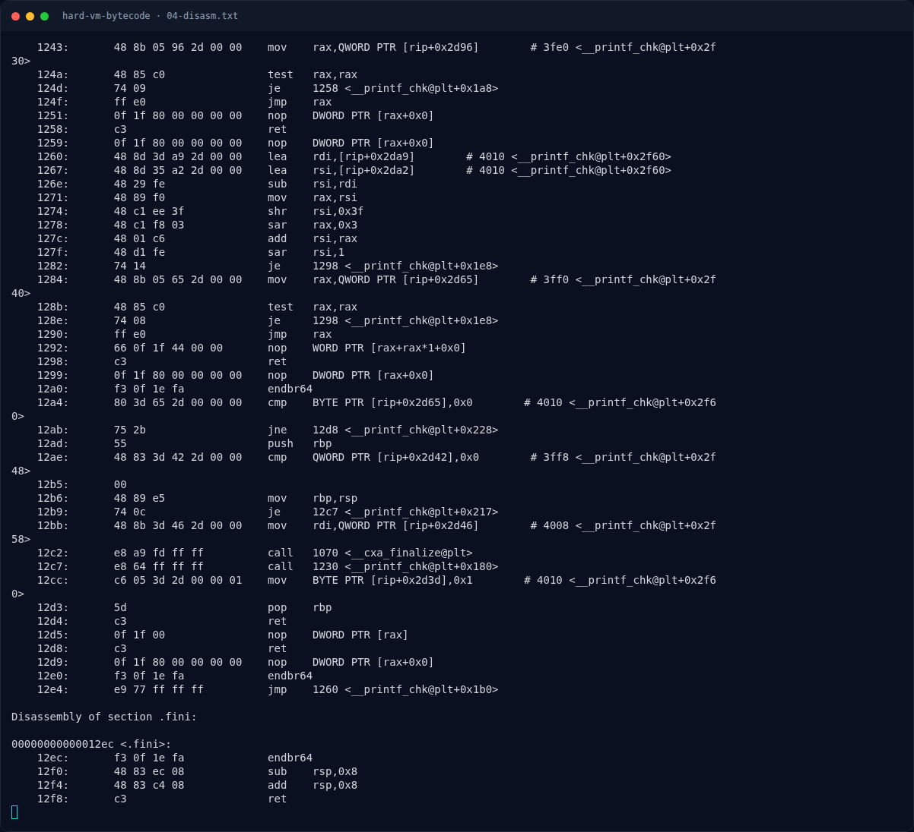
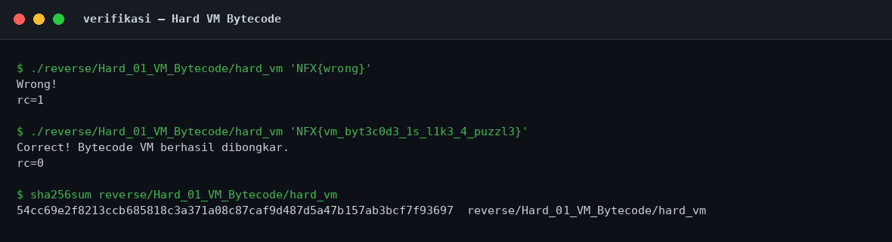

# Hard VM Bytecode — Format instruksi

[← Overview](45-hard-vm-bytecode.md) · [Index](index.md)

## 2.2 Format instruksi

Loop mengambil **3 byte** per instruksi:

```asm
113b:  movzx  eax,BYTE PTR [rdx]      ; opcode
113e:  movzx  esi,BYTE PTR [rdx+0x1]  ; reg / index
1142:  movzx  ecx,BYTE PTR [rdx+0x2]  ; immediate
1146:  cmp    al,0x5
1148:  ja     11c8                    ; opcode > 5 -> cek 0xff
114a:  test   al,al
114c:  je     1170                    ; opcode 0 -> gagal
1152:  movsxd rax,DWORD PTR [rdi+rax*4] ; dispatch table
1156:  add    rax,rdi
1159:  notrack jmp rax
```

Dispatch table berada di `.rodata` `0x2060`:

```text
Contents of section .rodata:
 2060 56f1ffff 56f1ffff 48f1ffff fcf0ffff  V...V...H.......
 2070 3df1ffff 4ef1ffff 00000000 00000000  =...N...........
```

Setiap entry adalah offset 32-bit bertanda relatif terhadap `rdi = 0x2060`:

| Index | Raw | Target | Handler |
|---|---|---|---|
| 0 | `0xfffff156` | `0x11b6` | LOAD (tidak terpakai; opcode 0 langsung gagal) |
| 1 | `0xfffff156` | `0x11b6` | LOAD |
| 2 | `0xfffff148` | `0x11a8` | XOR |
| 3 | `0xfffff0fc` | `0x115c` | ADD |
| 4 | `0xfffff13d` | `0x119d` | ROL |
| 5 | `0xfffff14e` | `0x11ae` | CMP |

Perhitungan contoh: `0xfffff148` sebagai signed = `-0xeb8`; `0x2060 - 0xeb8 = 0x11a8`.

### Evidence langkah ini



*Terminal evidence — `04-disasm.txt` (arsip transkrip sesi solve).*



*Evidence — `02-verifikasi.png`.*

**Berkas mentah langkah ini:**

- [`04-disasm.txt`](assets/hard-vm-bytecode/04-disasm.txt)
