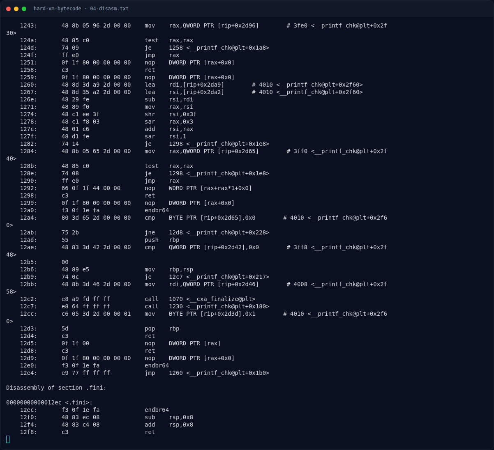

# Hard VM Bytecode — Analisis

[← Overview](45-hard-vm-bytecode.md) · [Index](index.md)

## 2.3 Semantik tiap opcode

```asm
; ADD: state[reg] += imm
115c:  add    BYTE PTR [rsp+rsi*1+0xc],cl
1160:  add    rdx,0x3
1164:  cmp    rdx,r8
1167:  jne    113b

; ROL: state[reg] = rol8(state[reg], imm & 7)
119d:  and    cl,0x7
11a0:  je     1160                 ; rotasi 0 -> tidak ada perubahan
11a2:  rol    BYTE PTR [rsp+rsi*1+0xc],cl

; XOR: state[reg] ^= imm
11a8:  xor    BYTE PTR [rsp+rsi*1+0xc],cl

; CMP: bandingkan state[reg] dengan imm
11ae:  cmp    BYTE PTR [rsp+rsi*1+0xc],cl
11b2:  je     1160                 ; sama -> lanjut
11b4:  jmp    1170                 ; beda -> Wrong!

; LOAD: state[reg] = input[imm]
11b6:  movzx  eax,BYTE PTR [rsp+rcx*1+0x10]
11bb:  mov    BYTE PTR [rsp+rsi*1+0xc],al

; 0xff -> sukses
11c8:  cmp    al,0xff
11ca:  jne    1170
11cc:  lea    rdi,[rip+0xe55]      # 2028 "Correct! Bytecode VM berhasil dibongkar."
11d3:  call   1080 <puts@plt>
```

Catatan penting: pada `LOAD`, byte ketiga instruksi adalah **index input**, sedangkan pada opcode lain byte ketiga adalah **immediate**. Pada challenge ini semua instruksi memakai `reg = 0`, tetapi interpreter mendukung register lain karena `reg` dipakai sebagai offset ke `[rsp+reg+0xc]`.

## 2.4 Bytecode

Bytecode 498 byte di `0x2080`. 16 byte pertama:

```text
01 00 00 02 00 5a 03 00 21 04 00 01 05 00 6a 01
```

Dibaca per 3 byte:

```text
01 00 00   LOAD reg0, input[0]
02 00 5a   XOR  reg0, 0x5a
03 00 21   ADD  reg0, 0x21
04 00 01   ROL  reg0, 1
05 00 6a   CMP  reg0, 0x6a
01 00 01   LOAD reg0, input[1]
...
```

Jumlah instruksi: `498 / 3 = 166`. Karena flag 33 karakter dan tiap karakter memakai 5 instruksi, totalnya `33 × 5 = 165`, ditambah satu instruksi terakhir `ff 00 00` (OK). Ini cocok persis.

### Evidence langkah ini



*Terminal evidence — `04-disasm.txt` (arsip transkrip sesi solve).*

**Berkas mentah langkah ini:**

- [`04-disasm.txt`](assets/hard-vm-bytecode/04-disasm.txt)
