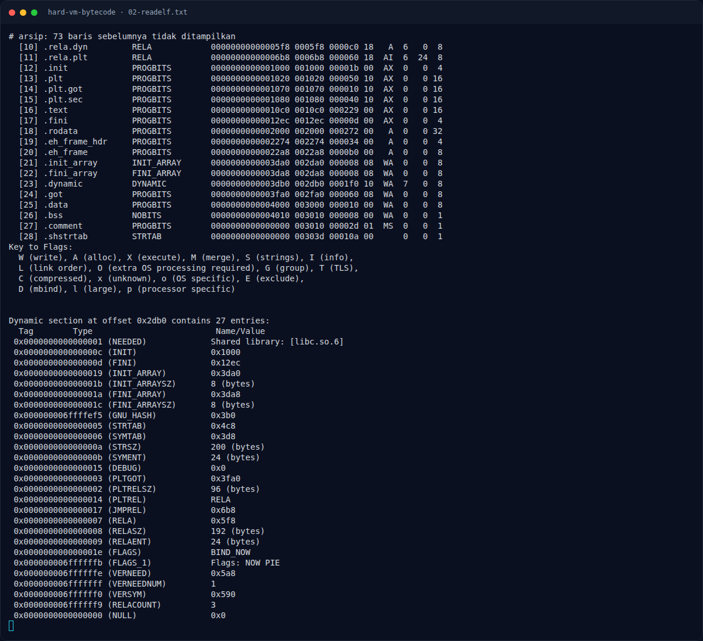

# Hard VM Bytecode — Membalik transformasi

[← Overview](45-hard-vm-bytecode.md) · [Index](index.md)

## 2.5 Membalik transformasi

Untuk karakter ke-`i`, bytecode melakukan:

```text
v = input[i]
v = v XOR xor_i
v = (v + add_i) mod 256
v = rol8(v, rot_i)
assert v == cmp_i
```

Maka inverse-nya:

```text
v = ror8(cmp_i, rot_i)
v = (v - add_i) mod 256
input[i] = v XOR xor_i
```

Dengan `ror8(x, n) = ((x >> n) | (x << (8-n))) & 0xff`.

Contoh karakter pertama dari output solver:

```text
char[0] = ror8(0x6a, 1) - 0x21 ^ 0x5a
        = 0x35 - 0x21 ^ 0x5a
        = 0x14 ^ 0x5a
        = 0x4e = 'N'
```

### Evidence langkah ini



*Terminal evidence — `02-readelf.txt` (arsip transkrip sesi solve).*

**Berkas mentah langkah ini:**

- [`02-readelf.txt`](assets/hard-vm-bytecode/02-readelf.txt)
