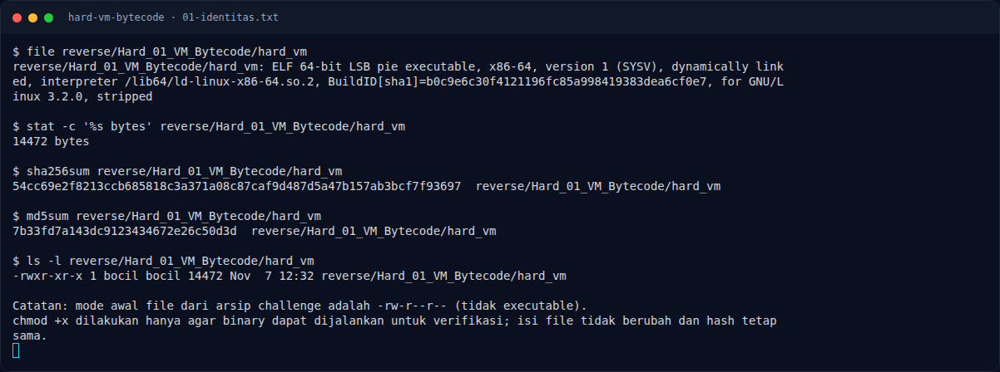
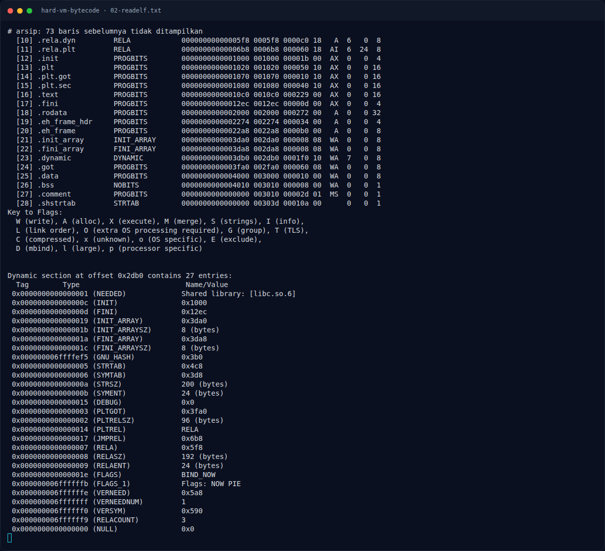
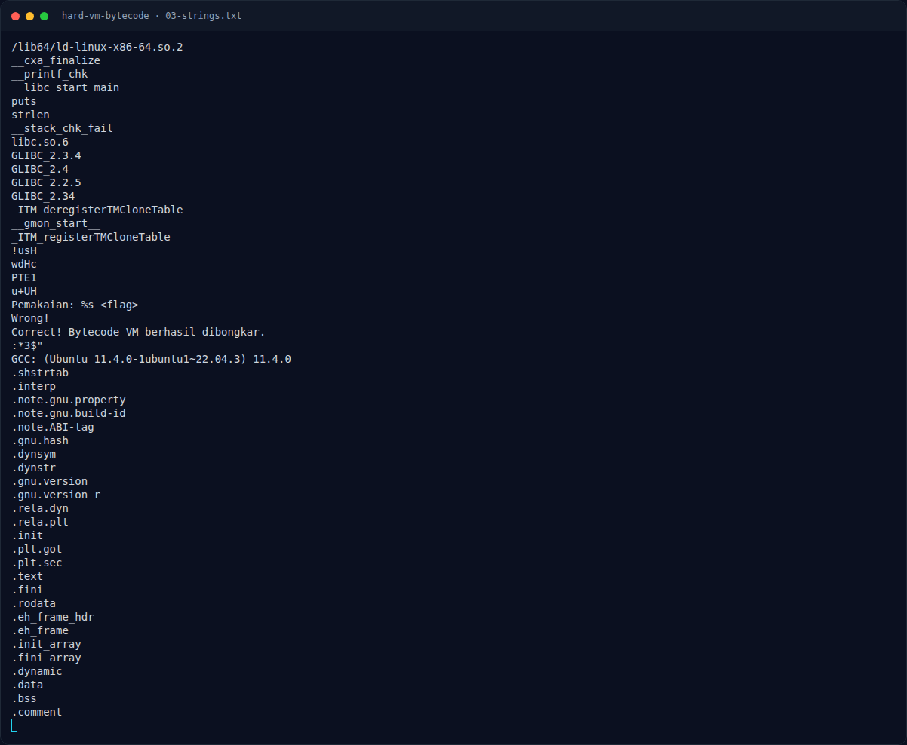
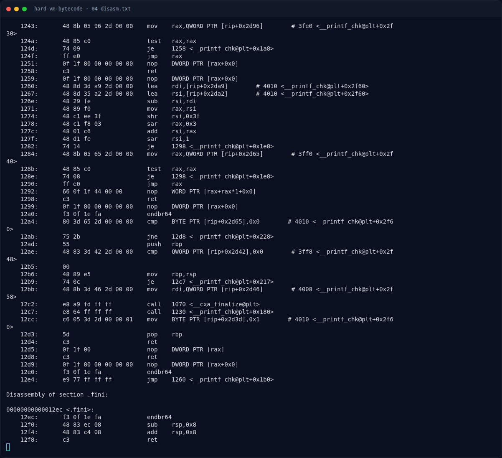
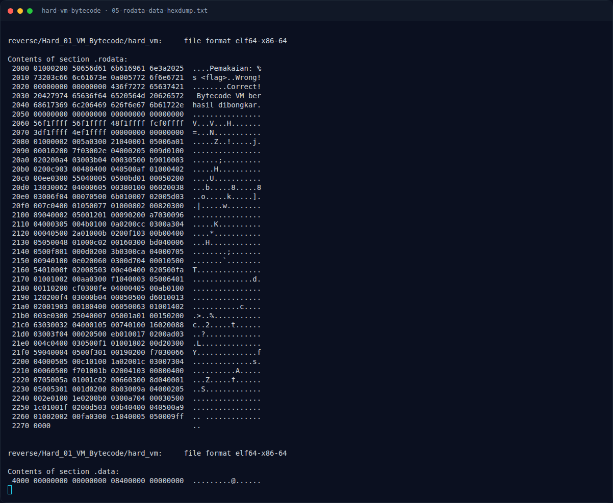
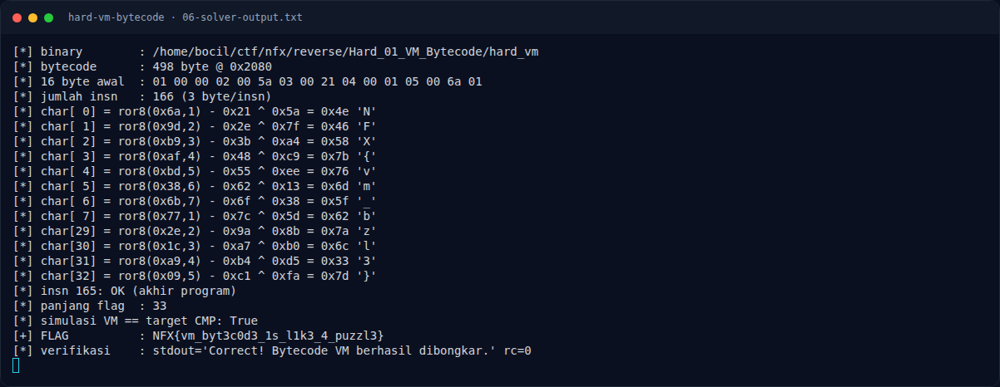
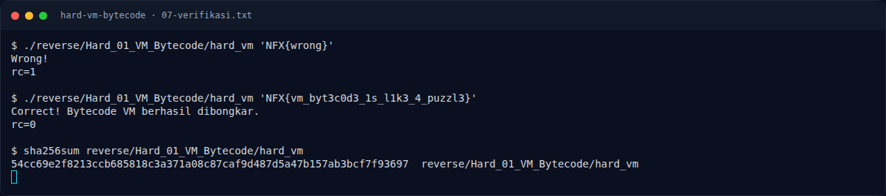
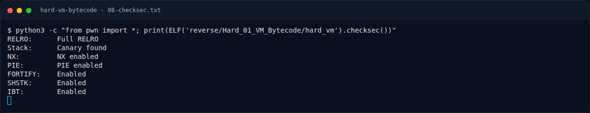

# Hard VM Bytecode — Strategi

[← Overview](45-hard-vm-bytecode.md) · [Index](index.md)

## 3.1 Strategi

1. Ekstrak bytecode 498 byte dari `.rodata` `0x2080`.
2. Parse tiap 3 byte menjadi `(opcode, reg, arg)`.
3. Kelompokkan 5 instruksi per karakter, berhenti di opcode `0xff`.
4. Inversi `CMP → ROL⁻¹ → ADD⁻¹ → XOR⁻¹`.
5. Simulasikan ulang transformasi forward untuk memastikan setiap `CMP` terpenuhi.
6. Jalankan binary dengan flag hasil rekonstruksi.

### Evidence langkah ini

*Terminal evidence — `01-identitas.txt` (arsip transkrip sesi solve).*

*Terminal evidence — `02-readelf.txt` (arsip transkrip sesi solve).*

*Terminal evidence — `03-strings.txt` (arsip transkrip sesi solve).*

*Terminal evidence — `04-disasm.txt` (arsip transkrip sesi solve).*

*Terminal evidence — `05-rodata-data-hexdump.txt` (arsip transkrip sesi solve).*

*Terminal evidence — `06-solver-output.txt` (arsip transkrip sesi solve).*

*Terminal evidence — `07-verifikasi.txt` (arsip transkrip sesi solve).*

*Terminal evidence — `08-checksec.txt` (arsip transkrip sesi solve).*

**Berkas mentah langkah ini:**

- [`01-identitas.txt`](assets/hard-vm-bytecode/01-identitas.txt)
- [`02-readelf.txt`](assets/hard-vm-bytecode/02-readelf.txt)
- [`03-strings.txt`](assets/hard-vm-bytecode/03-strings.txt)
- [`04-disasm.txt`](assets/hard-vm-bytecode/04-disasm.txt)
- [`05-rodata-data-hexdump.txt`](assets/hard-vm-bytecode/05-rodata-data-hexdump.txt)
- [`06-solver-output.txt`](assets/hard-vm-bytecode/06-solver-output.txt)
