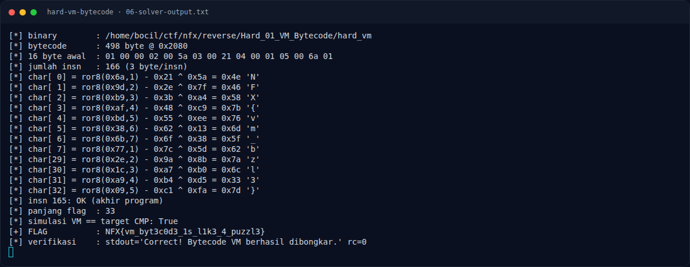

# Hard VM Bytecode — Solver lengkap

[← Overview](45-hard-vm-bytecode.md) · [Index](index.md)

> **Langkah 9/13 — Solver lengkap.** File: docs/assets/hard-vm-bytecode/solvevm.py
>
> **Titik penting:** File: docs/assets/hard-vm-bytecode/solvevm.py
>
> **Berikutnya:** [Output asli](45-hard-vm-bytecode-10-output-asli.md)

## 3.2 Solver lengkap

File: `docs/assets/hard-vm-bytecode/solve_vm.py`

```python
#!/usr/bin/env python3
# Solver Hard VM Bytecode — NFX CTF 2026 (Reverse / Hard)
# Bytecode 498 byte di .rodata 0x2080 dijalankan oleh interpreter kecil.
# Dispatch table di 0x2060 memetakan opcode:
#   1 = LOAD  reg, input[index]   (bytecode: 01 reg idx)
#   2 = XOR   reg, imm            (02 reg imm)
#   3 = ADD   reg, imm            (03 reg imm)
#   4 = ROL   reg, count          (04 reg count)
#   5 = CMP   reg, imm            (05 reg imm)
#   0 = HALT/gagal, 0xff = sukses
# Satu karakter = 5 instruksi: LOAD, XOR, ADD, ROL, CMP.
import argparse
import pathlib
import subprocess
import sys

from elftools.elf.elffile import ELFFile

DEFAULT_BIN = pathlib.Path(__file__).resolve().parent / "hard_vm"

OP = {0: "HALT", 1: "LOAD", 2: "XOR", 3: "ADD", 4: "ROL", 5: "CMP", 0xFF: "OK"}

def read_vaddr(path: pathlib.Path, vaddr: int, size: int) -> bytes:
    with open(path, "rb") as f:
        elf = ELFFile(f)
        for seg in elf.iter_segments():
            if seg["p_type"] != "PT_LOAD":
                continue
            start, filesz = seg["p_vaddr"], seg["p_filesz"]
            if start <= vaddr and vaddr + size <= start + filesz:
                f.seek(seg["p_offset"] + (vaddr - start))
                return f.read(size)
    raise ValueError(f"vaddr {vaddr:#x} tidak ditemukan")

def rol8(x: int, n: int) -> int:
    n &= 7
    if n == 0:
        return x & 0xFF
    return ((x << n) | (x >> (8 - n))) & 0xFF

def ror8(x: int, n: int) -> int:
    n &= 7
    if n == 0:
        return x & 0xFF
    return ((x >> n) | (x << (8 - n))) & 0xFF

def main() -> int:
    ap = argparse.ArgumentParser()
    ap.add_argument("--bin", default=str(DEFAULT_BIN))
    args = ap.parse_args()
    path = pathlib.Path(args.bin)

    # Alamat dari disassembly:
    #   0x1121 lea rdx,[rip+0xf58]  -> bytecode 0x2080
    #   0x112d lea r8,[rdx+0x1f2]    -> panjang 498 byte
    code = read_vaddr(path, 0x2080, 0x1F2)
    print(f"[*] binary        : {path}")
    print(f"[*] bytecode      : {len(code)} byte @ 0x2080")
    print(f"[*] 16 byte awal  : {code[:16].hex(' ')}")

    instrs = [tuple(code[i:i + 3]) for i in range(0, len(code) - 2, 3)]
    print(f"[*] jumlah insn   : {len(instrs)} (3 byte/insn)")

    # Decode per karakter: kumpulkan sampai CMP.
    flag = bytearray()
    group: list[tuple[int, int, int]] = []
    for idx, (op, reg, arg) in enumerate(instrs):
        if op not in OP:
            print(f"[!] opcode tidak dikenal {op:#04x} di insn {idx}", file=sys.stderr)
            return 1
        if op == 0xFF:
            print(f"[*] insn {idx}: OK (akhir program)")
            break
        if op == 0x00:
            print(f"[!] insn {idx}: HALT (program berhenti)", file=sys.stderr)
            return 1
        if op == 1:
            group = [(op, reg, arg)]
        else:
            group.append((op, reg, arg))
        if op == 5:
            assert [g[0] for g in group] == [1, 2, 3, 4, 5], f"pola tak terduga: {group}"
            assert len({g[1] for g in group}) == 1, f"register beda: {group}"
            load_reg, load_idx = group[0][1], group[0][2]
            xor_v = group[1][2]
            add_v = group[2][2]
            rot = group[3][2]
            cmp_v = group[4][2]
            # Invers urutan: CMP -> ROL^-1 -> ADD^-1 -> XOR^-1 -> LOAD
            v = ror8(cmp_v, rot)
            v = (v - add_v) & 0xFF
            v ^= xor_v
            flag.append(v)
            if len(flag) <= 8 or len(flag) >= 30:
                print(f"[*] char[{load_idx:2d}] = ror8({cmp_v:#04x},{rot}) - {add_v:#04x} "
                      f"^ {xor_v:#04x} = {v:#04x} {chr(v)!r}")
            group = []

    print(f"[*] panjang flag  : {len(flag)}")
    text = bytes(flag).decode()

    # Verifikasi forward: jalankan transformasi yang sama seperti VM.
    sim = bytearray()
    for i, ch in enumerate(flag):
        v = rol8((ch ^ instrs[i * 5 + 1][2]) + instrs[i * 5 + 2][2] & 0xFF, instrs[i * 5 + 3][2])
        sim.append(v)
        assert v == instrs[i * 5 + 4][2], f"mismatch char {i}"
    print(f"[*] simulasi VM == target CMP: True")

    print(f"[+] FLAG          : {text}")
    proc = subprocess.run([str(path), text], capture_output=True, text=True)
    print(f"[*] verifikasi    : stdout={proc.stdout.strip()!r} rc={proc.returncode}")
    return 0

if __name__ == "__main__":
    raise SystemExit(main())
```

### Evidence langkah ini



*Terminal evidence — `06-solver-output.txt` (arsip transkrip sesi solve).*

**Berkas mentah langkah ini:**

- [`06-solver-output.txt`](assets/hard-vm-bytecode/06-solver-output.txt)
