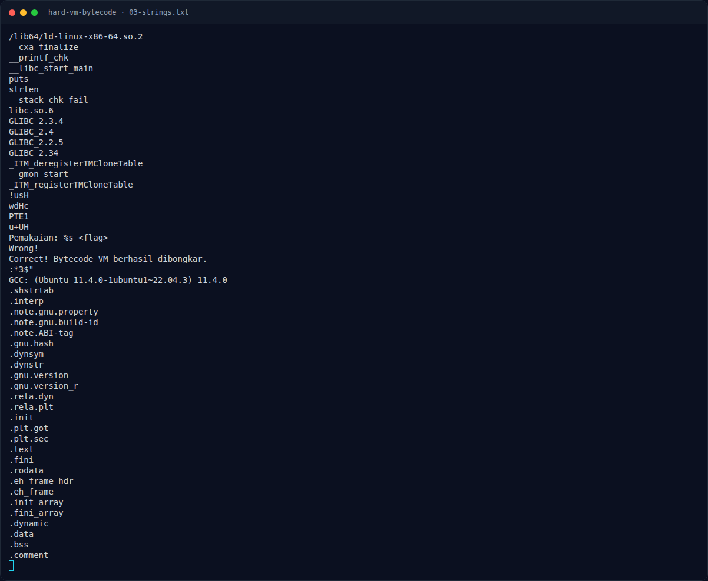
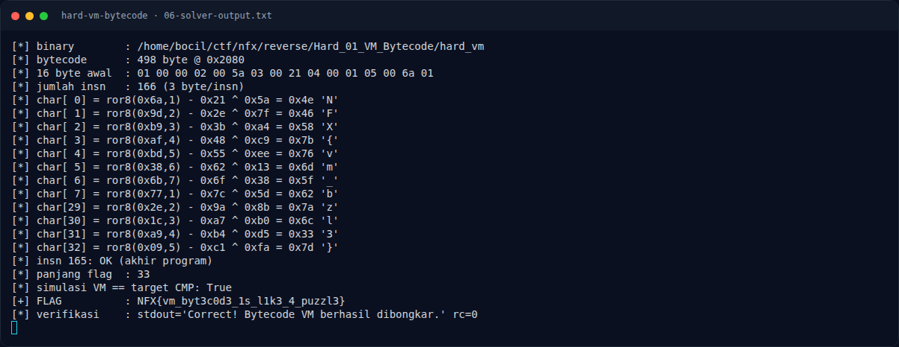

# Hard VM Bytecode — Output asli

[← Overview](45-hard-vm-bytecode.md) · [Index](index.md)

> **Langkah 10/13 — Output asli.** Output asli
>
> **Titik penting:** python3 docs/assets/hard-vm-bytecode/solve_vm.py · NFX{vm_byt3c0d3_1s_l1k3_4_puzzl3}
>
> **Berikutnya:** [Flag](45-hard-vm-bytecode-11-flag.md)

## 3.3 Output asli

```text
$ python3 docs/assets/hard-vm-bytecode/solve_vm.py
[*] binary        : <repo>/reverse/Hard_01_VM_Bytecode/hard_vm
[*] bytecode      : 498 byte @ 0x2080
[*] 16 byte awal  : 01 00 00 02 00 5a 03 00 21 04 00 01 05 00 6a 01
[*] jumlah insn   : 166 (3 byte/insn)
[*] char[ 0] = ror8(0x6a,1) - 0x21 ^ 0x5a = 0x4e 'N'
[*] char[ 1] = ror8(0x9d,2) - 0x2e ^ 0x7f = 0x46 'F'
[*] char[ 2] = ror8(0xb9,3) - 0x3b ^ 0xa4 = 0x58 'X'
[*] char[ 3] = ror8(0xaf,4) - 0x48 ^ 0xc9 = 0x7b '{'
[*] char[ 4] = ror8(0xbd,5) - 0x55 ^ 0xee = 0x76 'v'
[*] char[ 5] = ror8(0x38,6) - 0x62 ^ 0x13 = 0x6d 'm'
[*] char[ 6] = ror8(0x6b,7) - 0x6f ^ 0x38 = 0x5f '_'
[*] char[ 7] = ror8(0x77,1) - 0x7c ^ 0x5d = 0x62 'b'
[*] char[29] = ror8(0x2e,2) - 0x9a ^ 0x8b = 0x7a 'z'
[*] char[30] = ror8(0x1c,3) - 0xa7 ^ 0xb0 = 0x6c 'l'
[*] char[31] = ror8(0xa9,4) - 0xb4 ^ 0xd5 = 0x33 '3'
[*] char[32] = ror8(0x09,5) - 0xc1 ^ 0xfa = 0x7d '}'
[*] insn 165: OK (akhir program)
[*] panjang flag  : 33
[*] simulasi VM == target CMP: True
[+] FLAG          : NFX{vm_byt3c0d3_1s_l1k3_4_puzzl3}
[*] verifikasi    : stdout='Correct! Bytecode VM berhasil dibongkar.' rc=0
```

### Evidence langkah ini



*Terminal evidence — `03-strings.txt` (arsip transkrip sesi solve).*



*Terminal evidence — `06-solver-output.txt` (arsip transkrip sesi solve).*

**Berkas mentah langkah ini:**

- [`03-strings.txt`](assets/hard-vm-bytecode/03-strings.txt)
- [`06-solver-output.txt`](assets/hard-vm-bytecode/06-solver-output.txt)
