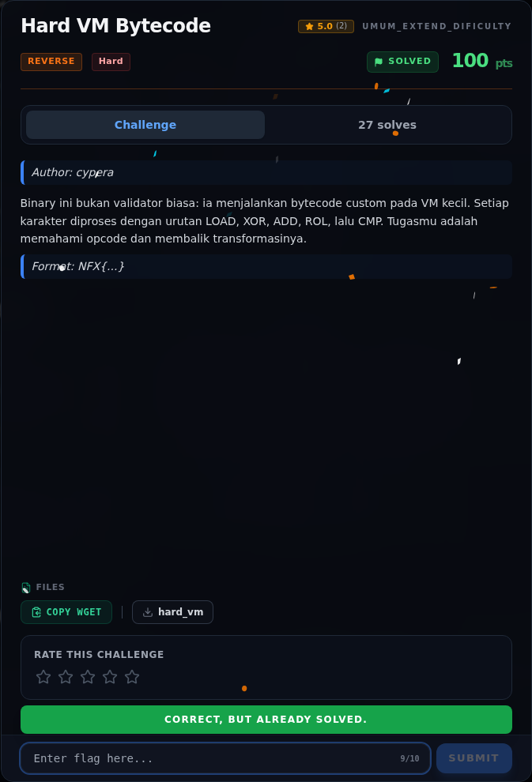

# Hard VM Bytecode — Flag & Verifikasi

[← Overview](45-hard-vm-bytecode.md) · [Index](index.md)

> **Langkah 11/13 — Flag.** Cek file flag lokal:
>
> **Titik penting:** NFX{vm_byt3c0d3_1s_l1k3_4_puzzl3}
>
> **Berikutnya:** [Bukti / Evidence](45-hard-vm-bytecode-12-bukti-evidence.md)

> **Flag:** `NFX{vm_byt3c0d3_1s_l1k3_4_puzzl3}`
> **Status:** `VERIFIED`

```text
NFX{vm_byt3c0d3_1s_l1k3_4_puzzl3}
```

Cek file flag lokal:

```text
$ cat flags/reverse/Hard_01_VM_Bytecode.txt
NFX{vm_byt3c0d3_1s_l1k3_4_puzzl3}
```

Verifikasi:

```text
$ ./reverse/Hard_01_VM_Bytecode/hard_vm 'NFX{vm_byt3c0d3_1s_l1k3_4_puzzl3}'
Correct! Bytecode VM berhasil dibongkar.
rc=0

$ ./reverse/Hard_01_VM_Bytecode/hard_vm 'NFX{wrong}'
Wrong!
rc=1
```

Isi `flags/reverse/Hard_01_VM_Bytecode.txt` identik. **Status: `VERIFIED platform`.** Flag sudah disubmit lewat web platform dan diterima (lihat screenshot submit); verifikasi lokal tetap dilakukan terhadap binary dan file flag.

### Bukti submit di platform



*Submit flag di platform: `CORRECT, BUT ALREADY SOLVED.`*

> **Bukti submit:** screenshot form challenge di atas menampilkan `CORRECT, BUT ALREADY SOLVED.`
