# Hard VM Bytecode — Evidence / Bukti

12 screenshot9 transkrip / script

[← Overview](45-hard-vm-bytecode.md) · [Index](index.md)

> **Langkah 12/13 — Bukti / Evidence.** Bukti / Evidence
>
> **Titik penting:** arsip screenshot dan transkrip
>
> **Berikutnya:** [Referensi](45-hard-vm-bytecode-13-referensi.md)

## Arsip Evidence

> Semua file berasal dari `assets/hard-vm-bytecode/`. Screenshot platform dan terminal adalah bukti asli dari sesi solve; transkrip mentah tetap ditautkan di bagian bawah.

### Platform

<figure><a href="assets/hard-vm-bytecode/00-challenge-platform.png" target="_blank" rel="noopener">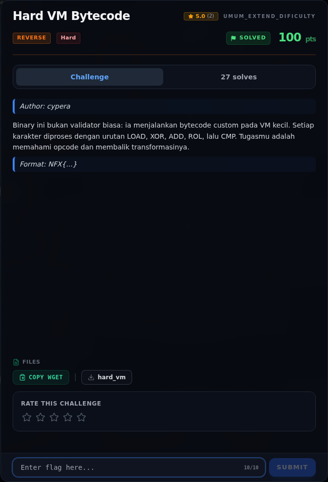</a><figcaption>00-challenge-platform.png</figcaption></figure>

*Challenge brief asli di platform NFX CTF 2026.*

<figure><a href="assets/hard-vm-bytecode/00b-terminal-evidence.png" target="_blank" rel="noopener">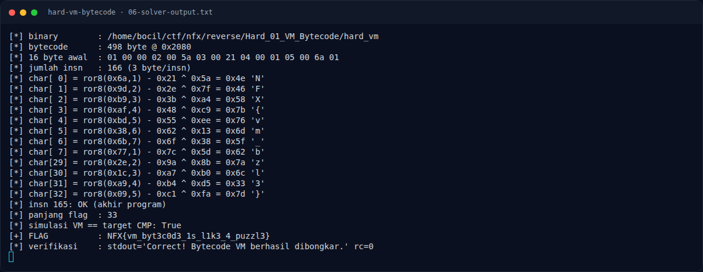</a><figcaption>Terminal evidence (real)</figcaption></figure>

*Terminal evidence (real).*

### Terminal (arsip sesi)

<figure><a href="assets/hard-vm-bytecode/term-01-identitas.png" target="_blank" rel="noopener">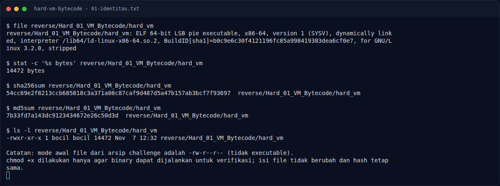</a><figcaption>term-01-identitas.png</figcaption></figure>

*Terminal evidence — `01-identitas.txt` (arsip transkrip sesi solve).*

<figure><a href="assets/hard-vm-bytecode/term-02-readelf.png" target="_blank" rel="noopener">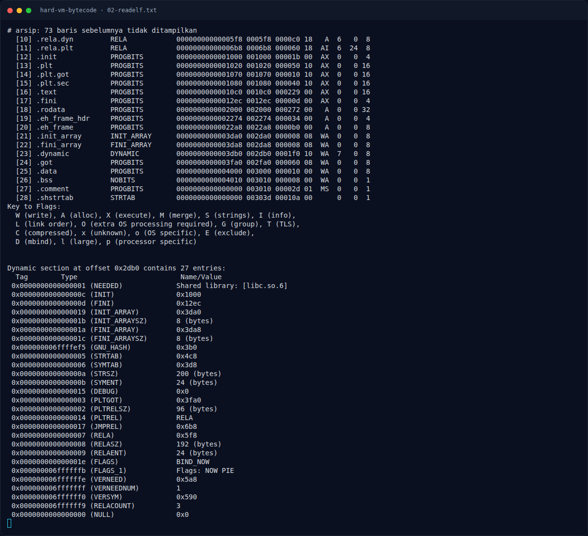</a><figcaption>term-02-readelf.png</figcaption></figure>

*Terminal evidence — `02-readelf.txt` (arsip transkrip sesi solve).*

<figure><a href="assets/hard-vm-bytecode/term-03-strings.png" target="_blank" rel="noopener">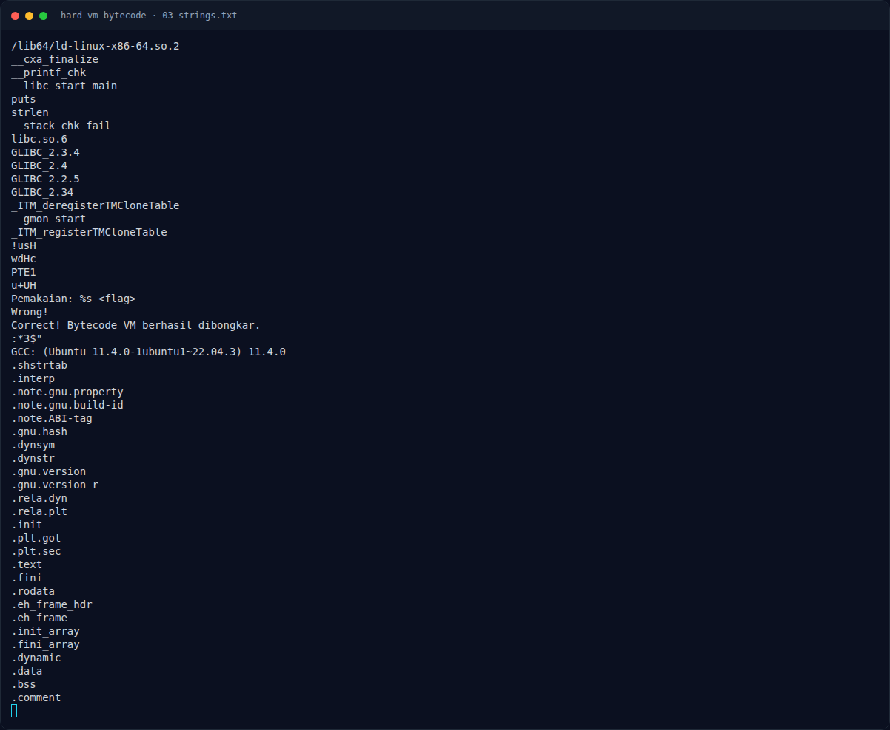</a><figcaption>term-03-strings.png</figcaption></figure>

*Terminal evidence — `03-strings.txt` (arsip transkrip sesi solve).*

<figure><a href="assets/hard-vm-bytecode/term-04-disasm.png" target="_blank" rel="noopener">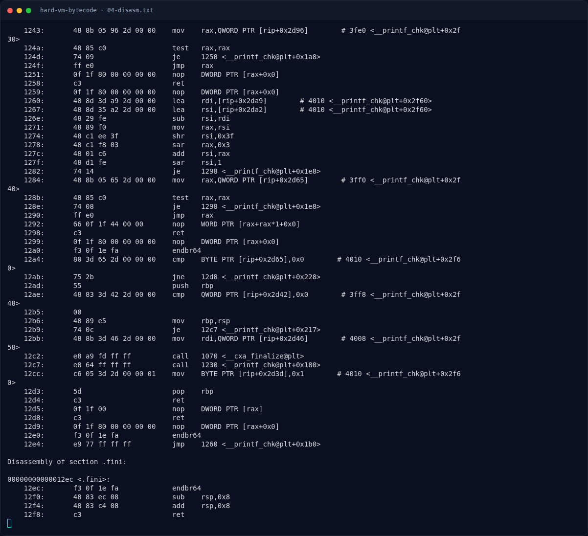</a><figcaption>term-04-disasm.png</figcaption></figure>

*Terminal evidence — `04-disasm.txt` (arsip transkrip sesi solve).*

<figure><a href="assets/hard-vm-bytecode/term-05-rodata-data-hexdump.png" target="_blank" rel="noopener">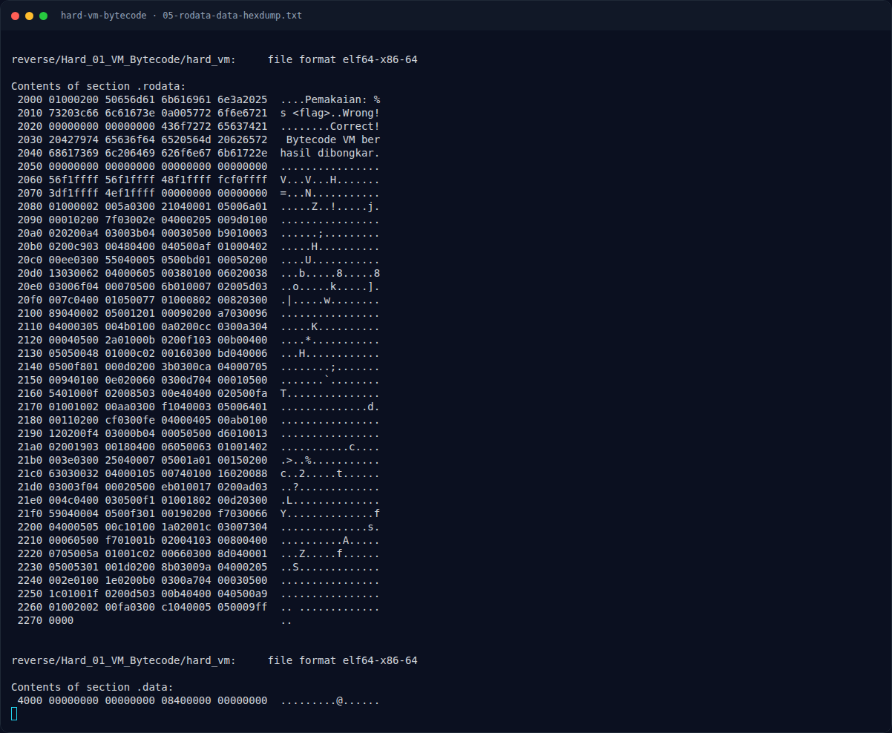</a><figcaption>term-05-rodata-data-hexdump.png</figcaption></figure>

*Terminal evidence — `05-rodata-data-hexdump.txt` (arsip transkrip sesi solve).*

<figure><figcaption>term-06-solver-output.png</figcaption></figure>

*Terminal evidence — `06-solver-output.txt` (arsip transkrip sesi solve).*

<figure><a href="assets/hard-vm-bytecode/term-07-verifikasi.png" target="_blank" rel="noopener">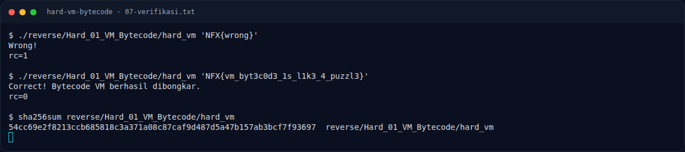</a><figcaption>term-07-verifikasi.png</figcaption></figure>

*Terminal evidence — `07-verifikasi.txt` (arsip transkrip sesi solve).*

<figure><a href="assets/hard-vm-bytecode/term-08-checksec.png" target="_blank" rel="noopener">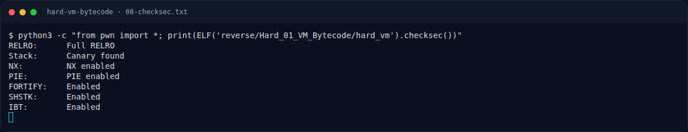</a><figcaption>term-08-checksec.png</figcaption></figure>

*Terminal evidence — `08-checksec.txt` (arsip transkrip sesi solve).*

### Screenshot langkah

<figure><a href="assets/hard-vm-bytecode/01-solver.png" target="_blank" rel="noopener">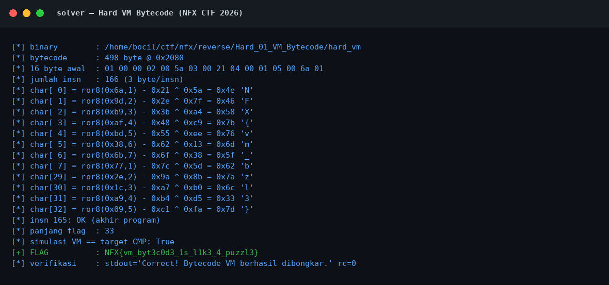</a><figcaption>01-solver.png</figcaption></figure>

*Evidence — `01-solver.png`.*

<figure><a href="assets/hard-vm-bytecode/02-verifikasi.png" target="_blank" rel="noopener">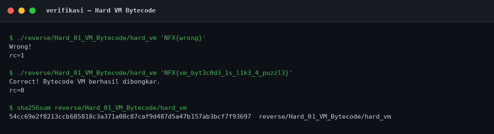</a><figcaption>02-verifikasi.png</figcaption></figure>

*Evidence — `02-verifikasi.png`.*

### Transkrip mentah & script

- [`01-identitas.txt`](assets/hard-vm-bytecode/01-identitas.txt)
- [`02-readelf.txt`](assets/hard-vm-bytecode/02-readelf.txt)
- [`03-strings.txt`](assets/hard-vm-bytecode/03-strings.txt)
- [`04-disasm.txt`](assets/hard-vm-bytecode/04-disasm.txt)
- [`05-rodata-data-hexdump.txt`](assets/hard-vm-bytecode/05-rodata-data-hexdump.txt)
- [`06-solver-output.txt`](assets/hard-vm-bytecode/06-solver-output.txt)
- [`07-verifikasi.txt`](assets/hard-vm-bytecode/07-verifikasi.txt)
- [`08-checksec.txt`](assets/hard-vm-bytecode/08-checksec.txt)
- [`solve_vm.py`](assets/hard-vm-bytecode/solve_vm.py)

## Validasi platform (real)

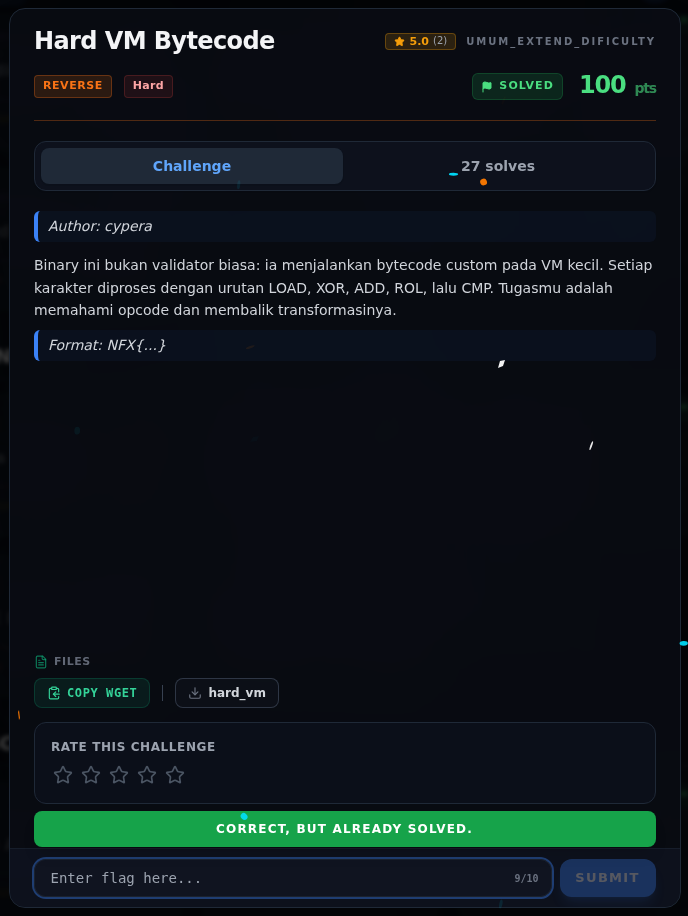

*Screenshot asli dari platform NFX CTF 2026. Platform menjawab
`CORRECT, BUT ALREADY SOLVED.` untuk flag ini.*

## Tabel Evidence

| Bukti | File | Keterangan |
|---|---|---|
| Identitas & hash | `01-identitas.txt` | `file`, hash, permission awal |
| ELF metadata | `02-readelf.txt` | Header, segmen, section |
| Strings | `03-strings.txt` | `strings -n 4` |
| Disassembly | `04-disasm.txt` | Interpreter dan dispatch |
| Hex dump | `05-rodata-data-hexdump.txt` | Dispatch table + bytecode |
| Solver | `solve_vm.py` | Parser bytecode + inversi |
| Output solver | `06-solver-output.txt` | Output asli |
| Verifikasi | `07-verifikasi.txt` | Salah vs benar + hash |
| Checksec | `08-checksec.txt` | Hasil `ELF.checksec()` |
| Screenshot solver | `01-solver.png` | Render output solver |
| Screenshot verifikasi | `02-verifikasi.png` | Render output verifikasi |