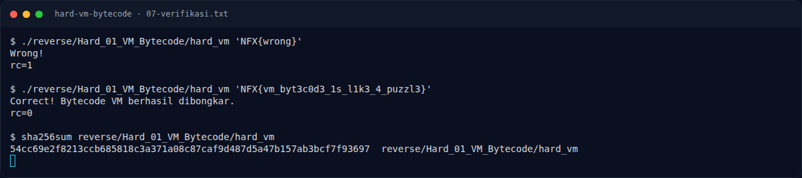

# Hard VM Bytecode — Referensi

[← Overview](45-hard-vm-bytecode.md) · [Index](index.md)

> **Langkah 13/13 — Referensi.** Referensi
>
> **Titik penting:** —
>
> **Selesai.** Kembali ke [Overview](45-hard-vm-bytecode.md).

- Teknik analisis dispatch table dan jump table pada binary hasil kompilasi C.
- `objdump(1)`, `readelf(1)` — binutils.
- `pyelftools` — parsing ELF.
- `pwntools` `ELF.checksec()`.

### Evidence langkah ini

*Terminal evidence — `07-verifikasi.txt` (arsip transkrip sesi solve).*

**Berkas mentah langkah ini:**

- [`07-verifikasi.txt`](assets/hard-vm-bytecode/07-verifikasi.txt)
