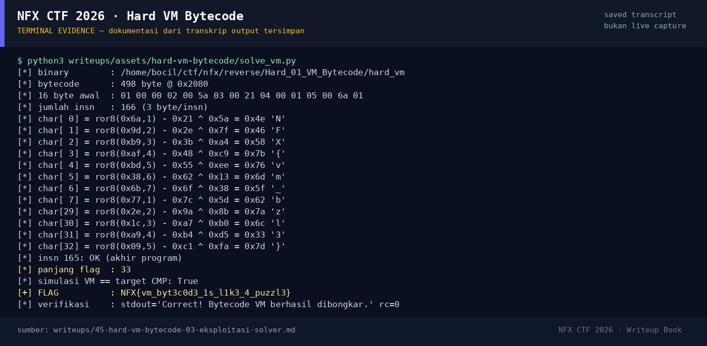

# Hard VM Bytecode

Track Umum / Extend · ReverseHard100 poinVERIFIED

| Field | Nilai |
|---|---|
| Event | `umum_Extend` |
| Kategori | `Reverse` |
| Difficulty | `Hard` |
| Poin | `100` |
| Author | `cypera` |
| Solves | `21` |
| Tools | python3, pwntools, checksec, gdb, objdump, readelf, strings, sage |
| Flag | `NFX{vm_byt3c0d3_1s_l1k3_4_puzzl3}` |
| Status | `VERIFIED` |

[← Kembali ke Index](index.md)

## TL;DR

- `hard_vm` bukan validator biasa: ia adalah **interpreter bytecode** mini dengan 498 byte program di `.rodata` `0x2080`.
- Dispatch table di `0x2060` memetakan opcode: `1=LOAD`, `2=XOR`, `3=ADD`, `4=ROL`, `5=CMP`, `0xff=OK`, `0=HALT/gagal`.
- Setiap karakter flag diproses dengan pola 5 instruksi: `LOAD`, `XOR`, `ADD`, `ROL`, `CMP`.
- Dengan membalik urutan operasi (`CMP → ROL⁻¹ → ADD⁻¹ → XOR⁻¹`), semua 33 karakter dapat dipulihkan tanpa menjalankan binary.
- Flag: `NFX{vm_byt3c0d3_1s_l1k3_4_puzzl3}`.

Pratinjau evidence. Buka halaman <a href="45-hard-vm-bytecode-05-bukti-evidence.html">Evidence / Bukti</a> untuk semua screenshot dan transkrip.

## Navigasi Halaman

<a class="nx-page-card" href="45-hard-vm-bytecode-01-recon.html"><b>Recon</b>Enumerasi target dan bukti awal</a>
<a class="nx-page-card" href="45-hard-vm-bytecode-02-analisis.html"><b>Analisis</b>Membaca alur dan akar masalah</a>
<a class="nx-page-card" href="45-hard-vm-bytecode-03-eksploitasi-solver.html"><b>Eksploitasi / Solver</b>Langkah exploit dan solver</a>
<a class="nx-page-card" href="45-hard-vm-bytecode-04-flag.html"><b>Flag</b>Flag dan verifikasi platform</a>
<a class="nx-page-card" href="45-hard-vm-bytecode-05-bukti-evidence.html"><b>Bukti / Evidence</b>Screenshot, transkrip, dan artefak</a>
<a class="nx-page-card" href="45-hard-vm-bytecode-06-referensi.html"><b>Referensi</b>Sumber dan bacaan lanjutan</a>

