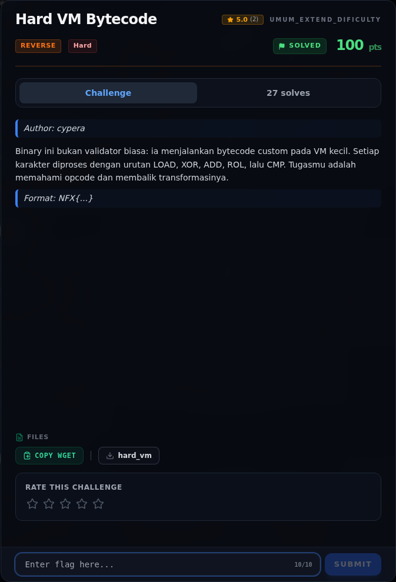

# Hard VM Bytecode

Track Umum / Extend · ReverseHard100 poinVERIFIED

| Field | Nilai |
|---|---|
| Event | `umum_Extend` |
| Kategori | `Reverse` |
| Difficulty | `Hard` |
| Poin | `100` |
| Author | `cypera` |
| Solves | `21` |
| Tools | python3, pwntools, checksec, gdb, objdump, readelf, strings, sage |
| Flag | `NFX{vm_byt3c0d3_1s_l1k3_4_puzzl3}` |
| Status | `VERIFIED` |

[← Kembali ke Index](index.md)

## Challenge Brief (platform)

*Challenge brief asli di platform NFX CTF 2026.*

## Alur & Titik Penting

| # | Langkah | Titik penting | Buka |
|---:|---|---|---|
| 1 | Recon | NFX{...} | [Buka](45-hard-vm-bytecode-01-recon.md) |
| 2 | Triage awal | file reverse/Hard_01_VM_Bytecode/hard_vm | [Buka](45-hard-vm-bytecode-02-triage-awal.md) |
| 3 | Perintah akuisisi bukti | python3 -c "from pwn import *; print(ELF('$BIN').checksec())" \ | [Buka](45-hard-vm-bytecode-03-perintah-akuisisi-bukti.md) |
| 4 | Main dan layout | Layout stack yang relevan: | [Buka](45-hard-vm-bytecode-04-main-dan-layout.md) |
| 5 | Format instruksi | Loop mengambil 3 byte per instruksi: | [Buka](45-hard-vm-bytecode-05-format-instruksi.md) |
| 6 | Analisis | Catatan penting: pada LOAD, byte ketiga instruksi adalah index input, sedangkan pada opcode lain byte ketiga adalah immediate. | [Buka](45-hard-vm-bytecode-06-analisis.md) |
| 7 | Membalik transformasi | Untuk karakter ke-i, bytecode melakukan: | [Buka](45-hard-vm-bytecode-07-membalik-transformasi.md) |
| 8 | Strategi | — | [Buka](45-hard-vm-bytecode-08-strategi.md) |
| 9 | Solver lengkap | File: writeups/assets/hard-vm-bytecode/solvevm.py | [Buka](45-hard-vm-bytecode-09-solver-lengkap.md) |
| 10 | Output asli | python3 writeups/assets/hard-vm-bytecode/solve_vm.py | [Buka](45-hard-vm-bytecode-10-output-asli.md) |
| 11 | Flag | NFX{vm_byt3c0d3_1s_l1k3_4_puzzl3} | [Buka](45-hard-vm-bytecode-11-flag.md) |
| 12 | Bukti / Evidence | arsip screenshot dan transkrip | [Buka](45-hard-vm-bytecode-12-bukti-evidence.md) |
| 13 | Referensi | — | [Buka](45-hard-vm-bytecode-13-referensi.md) |

## TL;DR

- `hard_vm` bukan validator biasa: ia adalah **interpreter bytecode** mini dengan 498 byte program di `.rodata` `0x2080`.
- Dispatch table di `0x2060` memetakan opcode: `1=LOAD`, `2=XOR`, `3=ADD`, `4=ROL`, `5=CMP`, `0xff=OK`, `0=HALT/gagal`.
- Setiap karakter flag diproses dengan pola 5 instruksi: `LOAD`, `XOR`, `ADD`, `ROL`, `CMP`.
- Dengan membalik urutan operasi (`CMP → ROL⁻¹ → ADD⁻¹ → XOR⁻¹`), semua 33 karakter dapat dipulihkan tanpa menjalankan binary.
- Flag: `NFX{vm_byt3c0d3_1s_l1k3_4_puzzl3}`.

Pratinjau evidence. Buka halaman <a href="45-hard-vm-bytecode-03-perintah-akuisisi-bukti.html">Evidence / Bukti</a> untuk semua screenshot dan transkrip.

## Navigasi Halaman

<a class="nx-page-card" href="45-hard-vm-bytecode-01-recon.html"><b>Recon</b>Enumerasi target dan bukti awal</a>
<a class="nx-page-card" href="45-hard-vm-bytecode-02-triage-awal.html"><b>Triage awal</b>Baca bagian ini</a>
<a class="nx-page-card" href="45-hard-vm-bytecode-03-perintah-akuisisi-bukti.html"><b>Perintah akuisisi bukti</b>Screenshot, transkrip, dan artefak</a>
<a class="nx-page-card" href="45-hard-vm-bytecode-04-main-dan-layout.html"><b>Main dan layout</b>Baca bagian ini</a>
<a class="nx-page-card" href="45-hard-vm-bytecode-05-format-instruksi.html"><b>Format instruksi</b>Baca bagian ini</a>
<a class="nx-page-card" href="45-hard-vm-bytecode-06-analisis.html"><b>Analisis</b>Membaca alur dan akar masalah</a>
<a class="nx-page-card" href="45-hard-vm-bytecode-07-membalik-transformasi.html"><b>Membalik transformasi</b>Baca bagian ini</a>
<a class="nx-page-card" href="45-hard-vm-bytecode-08-strategi.html"><b>Strategi</b>Baca bagian ini</a>
<a class="nx-page-card" href="45-hard-vm-bytecode-09-solver-lengkap.html"><b>Solver lengkap</b>Langkah exploit dan solver</a>
<a class="nx-page-card" href="45-hard-vm-bytecode-10-output-asli.html"><b>Output asli</b>Baca bagian ini</a>
<a class="nx-page-card" href="45-hard-vm-bytecode-11-flag.html"><b>Flag</b>Flag dan verifikasi platform</a>
<a class="nx-page-card" href="45-hard-vm-bytecode-12-bukti-evidence.html"><b>Bukti / Evidence</b>Screenshot, transkrip, dan artefak</a>
<a class="nx-page-card" href="45-hard-vm-bytecode-13-referensi.html"><b>Referensi</b>Sumber dan bacaan lanjutan</a>

