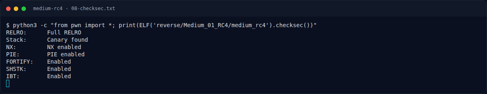

# Medium RC4 — Recon

[← Overview](46-medium-rc4.md) · [Index](index.md)

> **Langkah 1/11 — Recon.** Deskripsi sudah memberi petunjuk besar: algoritmanya RC4, key tertanam, ciphertext berupa array byte.
>
> **Titik penting:** NFX{...}
>
> **Berikutnya:** [Triage awal](46-medium-rc4-02-triage-awal.md)

## 1.1 Deskripsi challenge

> **Author: cypera**
>
> Sebuah layanan validasi menggunakan RC4 dengan kunci yang tertanam di binary. Ciphertext flag disimpan sebagai array byte. RC4 bersifat simetris, jadi dekripsi memakai fungsi yang sama dengan enkripsi.
>
> Format: `NFX{...}`

Deskripsi sudah memberi petunjuk besar: algoritmanya RC4, key tertanam, ciphertext berupa array byte. Tantangannya adalah menemukan **di mana** key dan ciphertext berada, lalu membalik arahnya.

## 1.2 File yang diberikan

| File | Ukuran | SHA-256 | MD5 |
|---|---|---|---|
| `reverse/Medium_01_RC4/medium_rc4` | 14.472 byte | `cc8b962d1501755603febfb884c5c49b42d9814aff165ed21d9cc81cda71d0f1` | `1fc7cd71f875fb9ad48c1b4e986e5781` |

Direktori challenge hanya berisi satu binary; tidak ada source, README, atau service jaringan. Binary adalah target lokal yang membaca flag dari argumen.

## 1.3 Environment

- OS: Linux x86-64 (Ubuntu 22.04/24.04-based).
- Tool yang dipakai: `file`, `readelf`, `objdump`, `strings`, `gdb`, `python3`, `pyelftools`, `pwntools` (untuk `checksec`).
- `checksec` standalone tidak terpasang di environment ini, sehingga digunakan implementasi `ELF.checksec()` dari pwntools. Hasilnya identik dengan `checksec --file`.
- Binary dijalankan langsung; tidak perlu library atau flag tambahan.

### Evidence langkah ini

*Terminal evidence — `08-checksec.txt` (arsip transkrip sesi solve).*

**Berkas mentah langkah ini:**

- [`08-checksec.txt`](assets/medium-rc4/08-checksec.txt)
