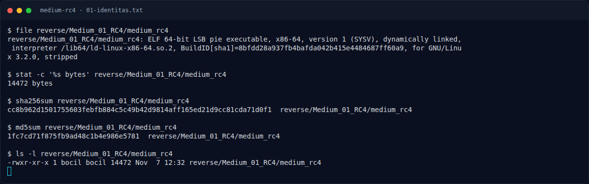
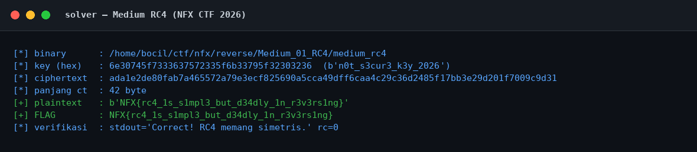

# Medium RC4 — Triage awal

[← Overview](46-medium-rc4.md) · [Index](index.md)

> **Langkah 2/11 — Triage awal.** Menjalankan binary tanpa argumen:
>
> **Titik penting:** file reverse/Medium_01_RC4/medium_rc4 · sha256sum reverse/Medium_01_RC4/medium_rc4 · md5sum reverse/Medium_01_RC4/medium_rc4
>
> **Berikutnya:** [Perintah akuisisi bukti](46-medium-rc4-03-perintah-akuisisi-bukti.md)

## 1.4 Triage awal

```bash
$ file reverse/Medium_01_RC4/medium_rc4
reverse/Medium_01_RC4/medium_rc4: ELF 64-bit LSB pie executable, x86-64,
version 1 (SYSV), dynamically linked, interpreter /lib64/ld-linux-x86-64.so.2,
BuildID[sha1]=8bfdd28a937fb4bafda042b415e4484687ff60a9, for GNU/Linux 3.2.0, stripped
```

```text
$ sha256sum reverse/Medium_01_RC4/medium_rc4
cc8b962d1501755603febfb884c5c49b42d9814aff165ed21d9cc81cda71d0f1  reverse/Medium_01_RC4/medium_rc4

$ md5sum reverse/Medium_01_RC4/medium_rc4
1fc7cd71f875fb9ad48c1b4e986e5781  reverse/Medium_01_RC4/medium_rc4

$ stat -c '%s bytes' reverse/Medium_01_RC4/medium_rc4
14472 bytes
```

```text
$ python3 -c "from pwn import *; print(ELF('reverse/Medium_01_RC4/medium_rc4').checksec())"
RELRO:      Full RELRO
Stack:      Canary found
NX:         NX enabled
PIE:        PIE enabled
FORTIFY:    Enabled
SHSTK:      Enabled
IBT:        Enabled
```

```text
$ strings -n 4 reverse/Medium_01_RC4/medium_rc4
/lib64/ld-linux-x86-64.so.2
__cxa_finalize
__printf_chk
__libc_start_main
puts
strlen
memcmp
__stack_chk_fail
libc.so.6
...
Pemakaian: %s <flag>
Wrong!
n0t_s3cur3_k3y_2026
Correct! RC4 memang simetris.
...
```

**Temuan dari triage:**

1. Binary **stripped** dan **PIE**, jadi alamat di disassembly adalah offset relatif terhadap base. Untuk analisis statis ini tidak masalah karena semua referensi `rip-relative` tetap valid.
2. Ada string yang sangat mencolok: `n0t_s3cur3_k3y_2026`. Ini kandidat kuat untuk key RC4.
3. Pesan sukses menyebut RC4 secara eksplisit.
4. Binary memakai stack canary (`__stack_chk_fail`, akses `fs:0x28`) dan full RELRO, tetapi untuk challenge reversing proteksi ini tidak menghalangi analisis.
5. Argumen dibaca dari `argv[1]`, bukan stdin.

Menjalankan binary tanpa argumen:

```text
$ ./reverse/Medium_01_RC4/medium_rc4
Pemakaian: reverse/Medium_01_RC4/medium_rc4 <flag>
```

Menjalankan dengan input asal:

```text
$ ./reverse/Medium_01_RC4/medium_rc4 'NFX{wrong}'
Wrong!
```

### Evidence langkah ini



*Terminal evidence — `01-identitas.txt` (arsip transkrip sesi solve).*



*Evidence — `01-solver.png`.*

**Berkas mentah langkah ini:**

- [`01-identitas.txt`](assets/medium-rc4/01-identitas.txt)
