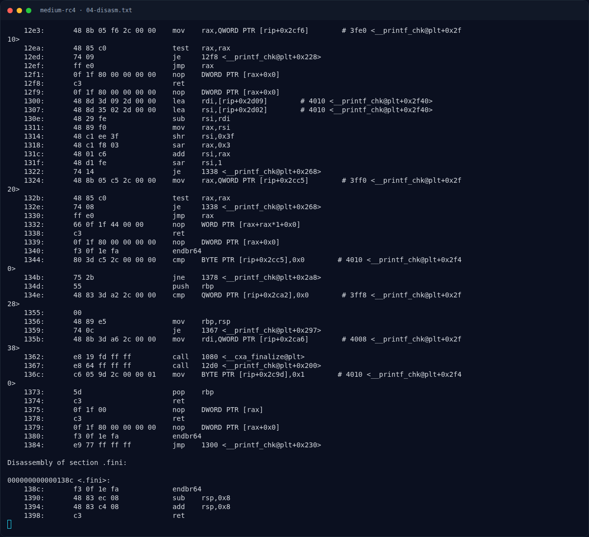
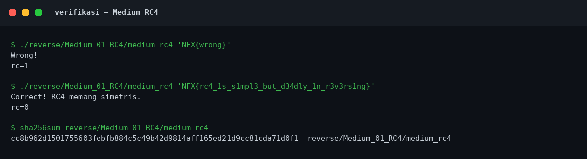

# Medium RC4 — Peta fungsi `main`

[← Overview](46-medium-rc4.md) · [Index](index.md)

> **Langkah 4/11 — Peta fungsi `main`.** Karena binary stripped, kita mulai dari entry point 0x12a0, yang memanggil libcstartmain dengan main di 0x10e0.
>
> **Titik penting:** Karena binary stripped, kita mulai dari entry point 0x12a0, yang memanggil libcstartmain dengan main di 0x10e0.
>
> **Berikutnya:** [Analisis](46-medium-rc4-05-analisis.md)

## 2.1 Peta fungsi `main`

Karena binary stripped, kita mulai dari entry point `0x12a0`, yang memanggil `__libc_start_main` dengan `main` di `0x10e0`. Alur `main`:

1. `0x1101` cek `argc > 1`; kalau tidak, cetak `Pemakaian: %s <flag>` dan keluar dengan kode 2.
2. `0x110a–0x111a` ambil `argv[1]`, panggil `strlen`, dan cek hasilnya `== 0x2a` (42).
3. Jika panjang bukan 42, cetak `Wrong!` dan return 1.
4. `0x1153–0x116d` inisialisasi array `S[0..255] = 0..255` di `[rsp+0x100]`.
5. `0x116f–0x11d6` key-scheduling algorithm (KSA) RC4.
6. `0x11d8–0x123c` pseudo-random generation algorithm (PRGA) + XOR dengan input, panjang 42.
7. `0x123e–0x124d` `memcmp(hasil, ciphertext@0x2060, 42)`.
8. Jika sama, cetak `Correct! RC4 memang simetris.`

Potongan disassembly yang relevan (dari `objdump -d -Mintel`):

```asm
; cek panjang = 42
110e:  mov    rdi,rbx
1111:  call   10a0 <strlen@plt>
1116:  cmp    rax,0x2a
111a:  je     1153

; inisialisasi S[i] = i
1153:  xor    eax,eax
1155:  lea    rdi,[rsp+0x100]
1160:  mov    BYTE PTR [rdi+rax*1],al
1163:  add    rax,0x1
1167:  cmp    rax,0x100
116d:  jne    1160

; key = 0x2021, magic modulus 19
1173:  lea    r10,[rip+0xea7]        # 2021
117a:  movabs r9,0xd79435e50d79435f
```

KSA (loop 256 kali) melakukan:

```asm
1188:  mov    rax,rcx                 ; i
118b:  movzx  r8d,BYTE PTR [rdi+rcx*1] ; S[i]
1190:  mul    r9                      ; magic multiply
1193:  shr    rdx,0x4
1197:  lea    rax,[rdx+rdx*8]
119b:  lea    rdx,[rdx+rax*2]         ; rdx = 19 * (i / 19)
119f:  mov    rax,rcx
11a2:  sub    rax,rdx                 ; rax = i % 19
11a5:  movzx  edx,r8b
11a9:  movzx  eax,BYTE PTR [r10+rax*1] ; key[i % 19]
11ae:  add    eax,edx
11b0:  add    eax,esi                 ; + j
11b2:  movzx  eax,al
11b5:  movzx  edx,BYTE PTR [rsp+rax*1+0x100] ; S[(j + ...) & 0xff]
11bd:  mov    rsi,rax                 ; j = ...
11c0:  mov    BYTE PTR [rdi+rcx*1],dl ; swap S[i], S[j]
11c3:  add    rcx,0x1
11c7:  mov    BYTE PTR [rsp+rax*1+0x100],r8b
11cf:  cmp    rcx,0x100
11d6:  jne    1188
```

Magic `0xd79435e50d79435f` adalah trik compiler untuk membagi 64-bit dengan 19 tanpa instruksi `div`. Setelah `mul`, `rdx >> 4`, lalu `rdx*19`, hasilnya `i - 19*(i/19) = i % 19`. Jadi panjang key adalah **19 byte**, cocok dengan string `n0t_s3cur3_k3y_2026`.

PRGA lalu XOR 42 byte:

```asm
11e8:  add    edx,0x1
11eb:  movzx  edi,dl
11ee:  movzx  eax,BYTE PTR [rsp+rdi*1+0x100]
11f9:  add    ecx,eax
11fb:  movzx  r9d,cl
11ff:  movzx  r10d,BYTE PTR [rsp+r9*1+0x100]
120b:  mov    BYTE PTR [rsp+rdi*1+0x100],r10b
1213:  mov    BYTE PTR [rsp+r9*1+0x100],al
121b:  add    al,BYTE PTR [rsp+rdi*1+0x100]
1222:  movzx  eax,al
1225:  movzx  eax,BYTE PTR [rsp+rax*1+0x100]
122d:  xor    al,BYTE PTR [rbx+rsi*1]  ; ^= input[i]
1230:  mov    BYTE PTR [r8+rsi*1],al   ; output[i]
1234:  add    rsi,0x1
1238:  cmp    rsi,0x2a
123c:  jne    11e8
```

Dan perbandingan:

```asm
123e:  mov    edx,0x2a
1243:  lea    rsi,[rip+0xe16]        # 2060
124a:  mov    rdi,r8
124d:  call   10c0 <memcmp@plt>
1252:  mov    r12d,eax
1255:  test   eax,eax
1257:  jne    111c                    ; Wrong!
```

### Evidence langkah ini



*Terminal evidence — `04-disasm.txt` (arsip transkrip sesi solve).*



*Evidence — `02-verifikasi.png`.*

**Berkas mentah langkah ini:**

- [`04-disasm.txt`](assets/medium-rc4/04-disasm.txt)
