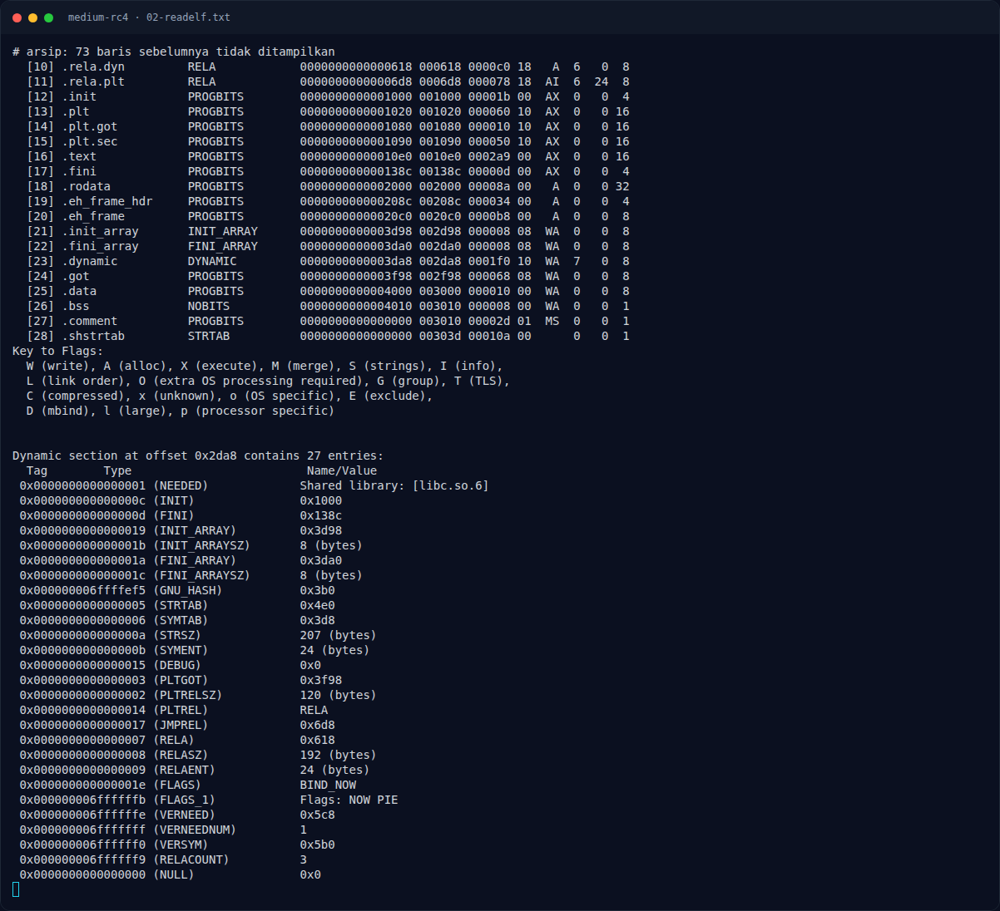
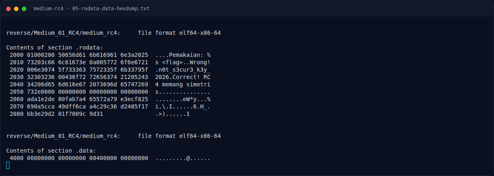

# Medium RC4 — Analisis

[← Overview](46-medium-rc4.md) · [Index](index.md)

## 2.2 Ekstraksi konstanta

Dari instruksi `lea` di atas:

- Key berada di `.rodata` **`0x2021`**, panjang 19 byte. Isinya persis `n0t_s3cur3_k3y_2026` (0x6e 0x30 0x74 ...).
- Ciphertext berada di **`0x2060`**, panjang `0x2a = 42` byte.

Hex dump `.rodata` (dari `objdump -s -j .rodata`):

```text
Contents of section .rodata:
 2000 01000200 50656d61 6b616961 6e3a2025  ....Pemakaian: %
 2010 73203c66 6c61673e 0a005772 6f6e6721  s <flag>..Wrong!
 2020 006e3074 5f733363 7572335f 6b33795f  .n0t_s3cur3_k3y_
 2030 32303236 00436f72 72656374 21205243  2026.Correct! RC
 2040 34206d65 6d616e67 2073696d 65747269  4 memang simetri
 2050 732e0000 00000000 00000000 00000000  s...............
 2060 ada1e2de 80fab7a4 65572a79 e3ecf825  ........eW*y...%
 2070 690a5cca 49dff6ca a4c29c36 d2485f17  i.\.I......6.H_.
 2080 bb3e29d2 01f7009c 9d31               .>)......1
```

Jadi:

```text
key        = 6e 30 74 5f 73 33 63 75 72 33 5f 6b 33 79 5f 32 30 32 36
           = "n0t_s3cur3_k3y_2026"
ciphertext = ad a1 e2 de 80 fa b7 a4 65 57 2a 79 e3 ec f8 25
             69 0a 5c ca 49 df f6 ca a4 c2 9c 36 d2 48 5f 17
             bb 3e 29 d2 01 f7 00 9c 9d 31
```

## 2.3 Mengapa dekripsi = enkripsi

RC4 adalah stream cipher: keystream `K` dibangkitkan dari key, lalu ciphertext `C = P XOR K`. Karena XOR involutif:

```text
P = C XOR K = (P XOR K) XOR K
```

Binary tidak pernah "mendekripsi" secara eksplisit; ia melakukan PRGA lalu XOR dengan input, kemudian membandingkan hasilnya dengan ciphertext. Artinya, jika kita memasukkan **plaintext yang benar**, hasilnya akan sama dengan ciphertext. Untuk mendapatkan plaintext dari ciphertext, kita menjalankan operasi XOR yang sama dengan ciphertext sebagai input.

### Evidence langkah ini



*Terminal evidence — `02-readelf.txt` (arsip transkrip sesi solve).*



*Terminal evidence — `05-rodata-data-hexdump.txt` (arsip transkrip sesi solve).*

**Berkas mentah langkah ini:**

- [`02-readelf.txt`](assets/medium-rc4/02-readelf.txt)
- [`05-rodata-data-hexdump.txt`](assets/medium-rc4/05-rodata-data-hexdump.txt)
