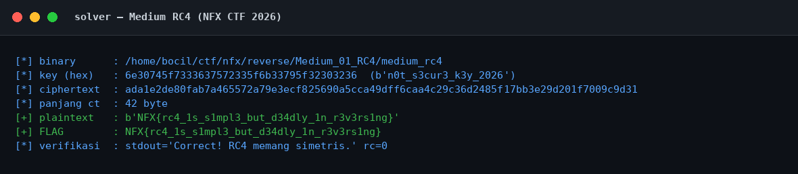
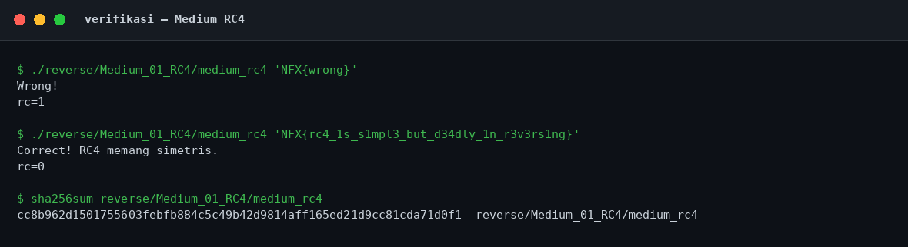

# Medium RC4 — Evidence / Bukti

[← Overview](46-medium-rc4.md) · [Index](index.md)

## Arsip Evidence

> Semua file di bawah berasal dari folder `assets/medium-rc4/`. Screenshot ditempel langsung; file teks/script ditautkan.

### Screenshot

### Transkrip / file pendukung

- [`01-identitas.txt`](assets/medium-rc4/01-identitas.txt)
- [`02-readelf.txt`](assets/medium-rc4/02-readelf.txt)
- [`03-strings.txt`](assets/medium-rc4/03-strings.txt)
- [`04-disasm.txt`](assets/medium-rc4/04-disasm.txt)
- [`05-rodata-data-hexdump.txt`](assets/medium-rc4/05-rodata-data-hexdump.txt)
- [`06-solver-output.txt`](assets/medium-rc4/06-solver-output.txt)
- [`07-verifikasi.txt`](assets/medium-rc4/07-verifikasi.txt)
- [`08-checksec.txt`](assets/medium-rc4/08-checksec.txt)
- [`solve_rc4.py`](assets/medium-rc4/solve_rc4.py)

## Tabel Evidence

Semua bukti berada di `writeups/assets/medium-rc4/`.

| Bukti | File | Keterangan |
|---|---|---|
| Identitas & hash | `01-identitas.txt` | `file`, `stat`, `sha256sum`, `md5sum`, `ls -l` |
| ELF metadata | `02-readelf.txt` | ELF header, program header, section header, dynamic |
| Strings | `03-strings.txt` | `strings -n 4`, termasuk key dan pesan sukses |
| Disassembly | `04-disasm.txt` | `objdump -d -Mintel` seluruh `.text` |
| Hex dump | `05-rodata-data-hexdump.txt` | `.rodata` dan `.data` |
| Solver | `solve_rc4.py` | Script Python yang benar-benar dijalankan |
| Output solver | `06-solver-output.txt` | Output asli solver |
| Verifikasi | `07-verifikasi.txt` | Percobaan salah vs benar + hash |
| Checksec | `08-checksec.txt` | Hasil `ELF.checksec()` |
| Screenshot solver | `01-solver.png` | Render terminal output solver |
| Screenshot verifikasi | `02-verifikasi.png` | Render terminal verifikasi |

Screenshot dibuat dari output teks asli dengan renderer terminal (bukan mockup manual), sehingga isinya sama dengan file `.txt` pendampingnya.
