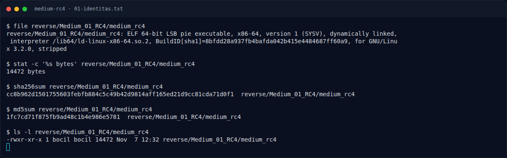
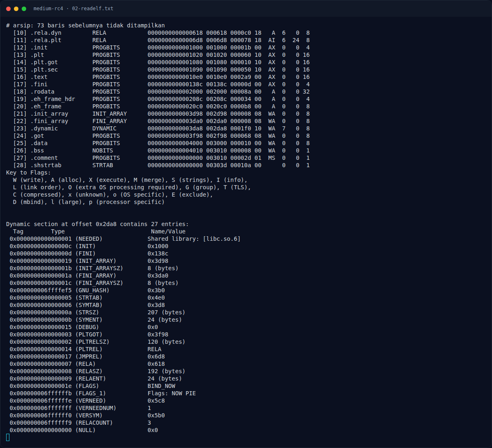
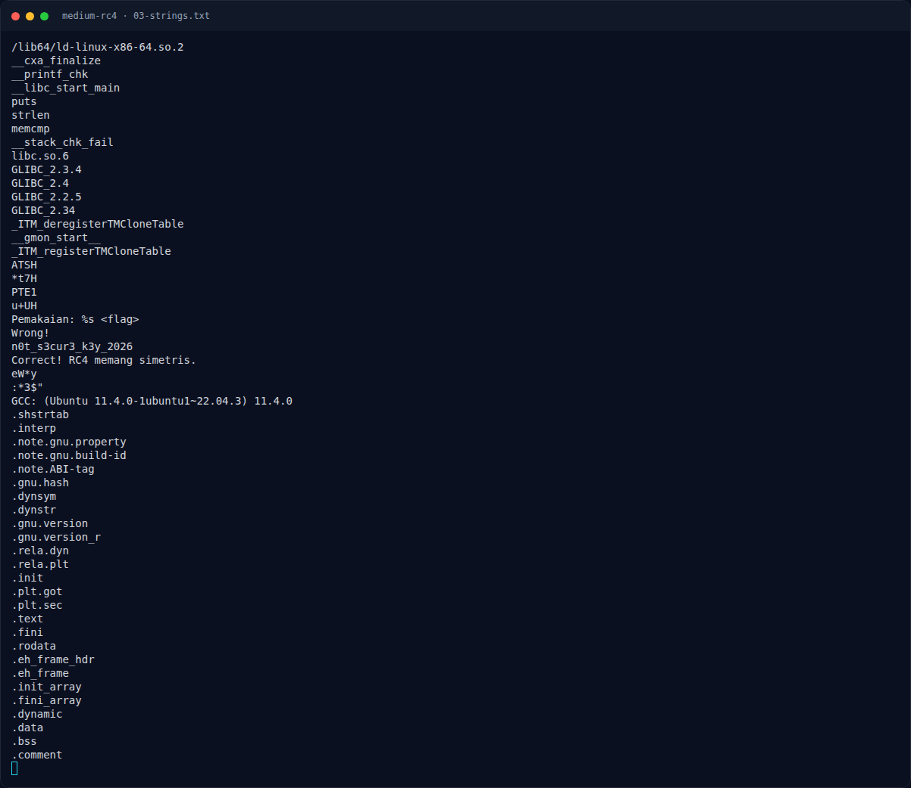
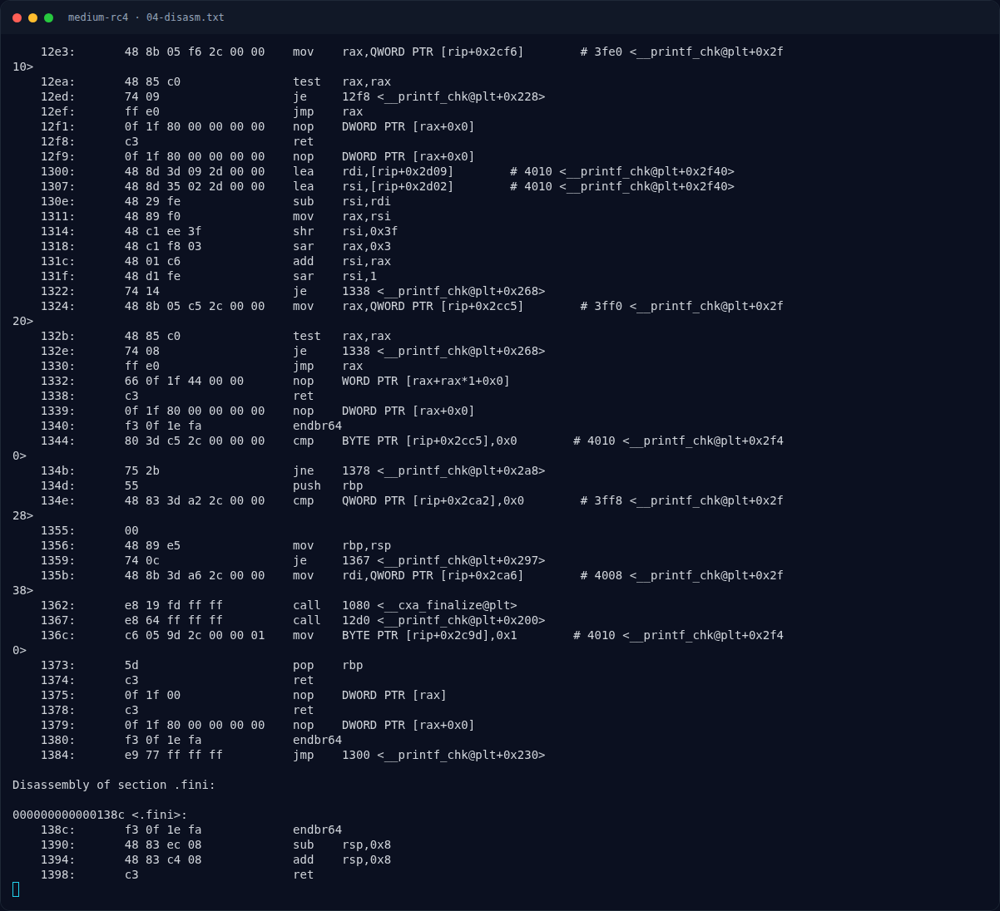
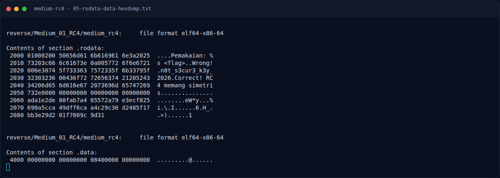
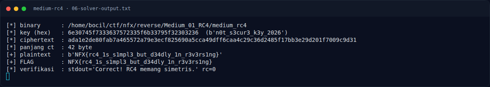
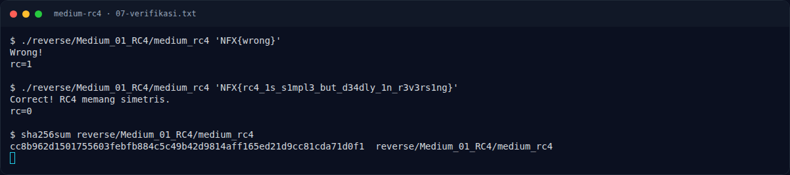
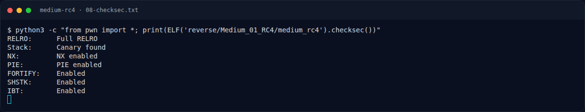

# Medium RC4 — Strategi

[← Overview](46-medium-rc4.md) · [Index](index.md)

## 3.1 Strategi

1. Ekstrak key 19 byte dari `.rodata` `0x2021`.
2. Ekstrak ciphertext 42 byte dari `.rodata` `0x2060`.
3. Implementasikan RC4 (KSA + PRGA) di Python.
4. Jalankan `rc4(key, ciphertext)` untuk mendapatkan plaintext.
5. Verifikasi dengan menjalankan binary memakai plaintext tersebut.

Solver membaca binary lewat **program header `PT_LOAD`**, bukan hardcode offset file, sehingga tetap benar meskipun layout section berubah. Ini juga mendemonstrasikan cara mengambil data dari alamat virtual yang ditemukan di disassembly.

### Evidence langkah ini

*Terminal evidence — `01-identitas.txt` (arsip transkrip sesi solve).*

*Terminal evidence — `02-readelf.txt` (arsip transkrip sesi solve).*

*Terminal evidence — `03-strings.txt` (arsip transkrip sesi solve).*

*Terminal evidence — `04-disasm.txt` (arsip transkrip sesi solve).*

*Terminal evidence — `05-rodata-data-hexdump.txt` (arsip transkrip sesi solve).*

*Terminal evidence — `06-solver-output.txt` (arsip transkrip sesi solve).*

*Terminal evidence — `07-verifikasi.txt` (arsip transkrip sesi solve).*

*Terminal evidence — `08-checksec.txt` (arsip transkrip sesi solve).*

**Berkas mentah langkah ini:**

- [`01-identitas.txt`](assets/medium-rc4/01-identitas.txt)
- [`02-readelf.txt`](assets/medium-rc4/02-readelf.txt)
- [`03-strings.txt`](assets/medium-rc4/03-strings.txt)
- [`04-disasm.txt`](assets/medium-rc4/04-disasm.txt)
- [`05-rodata-data-hexdump.txt`](assets/medium-rc4/05-rodata-data-hexdump.txt)
- [`06-solver-output.txt`](assets/medium-rc4/06-solver-output.txt)
