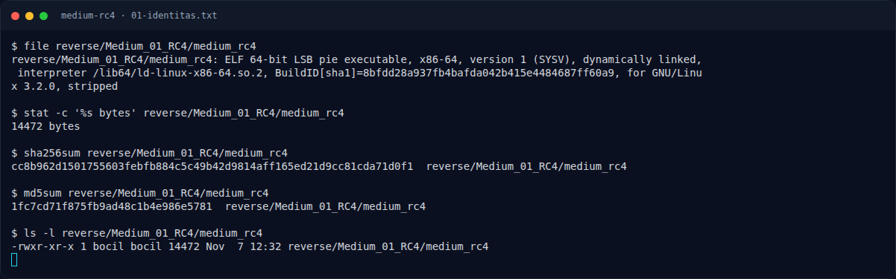
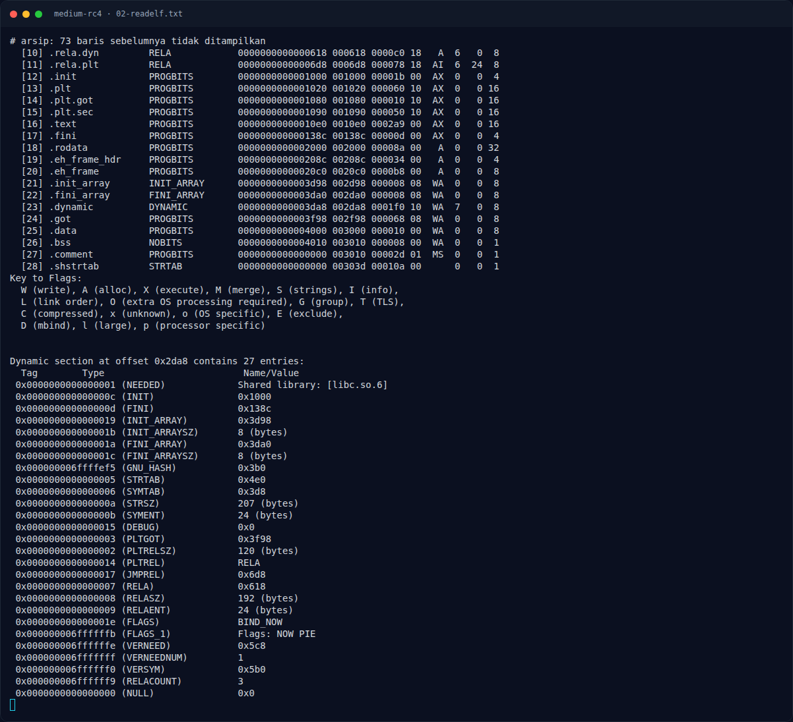
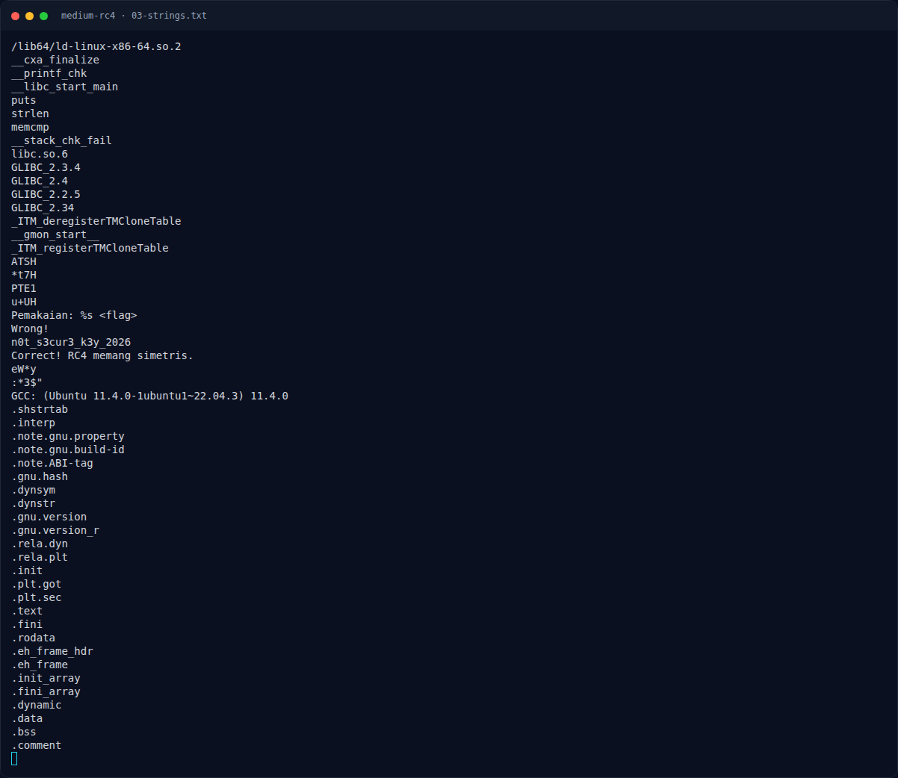
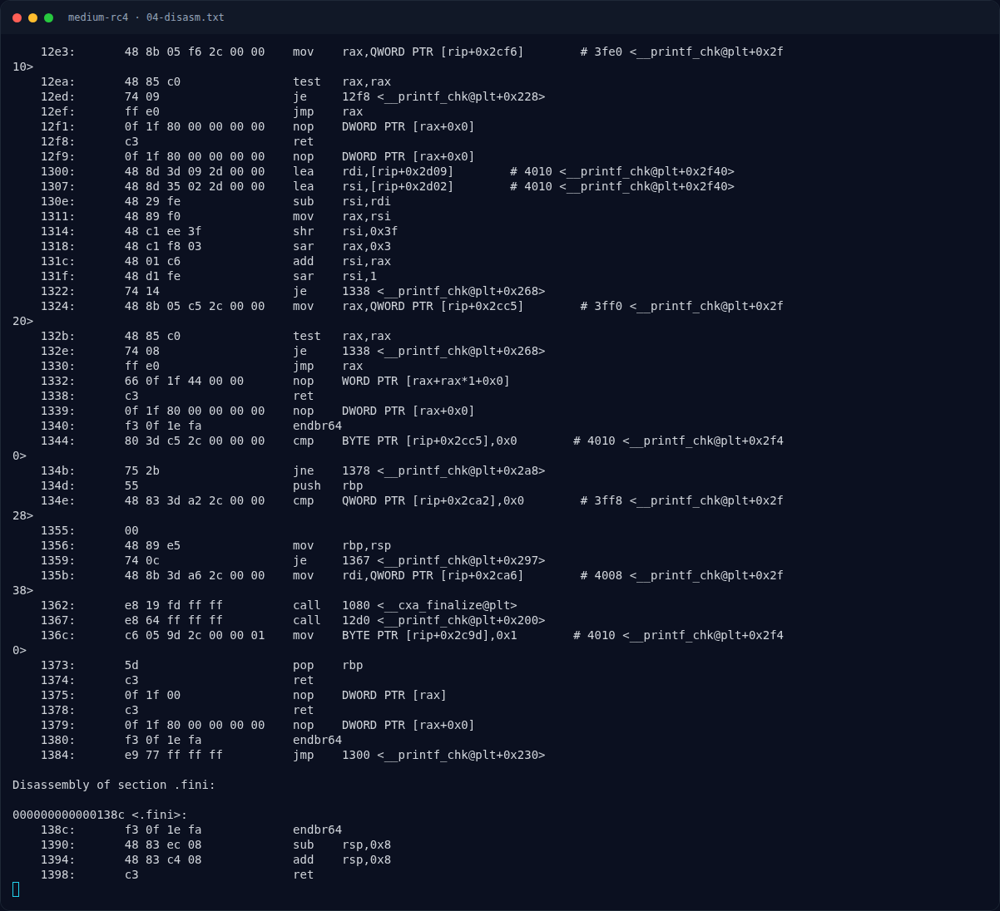
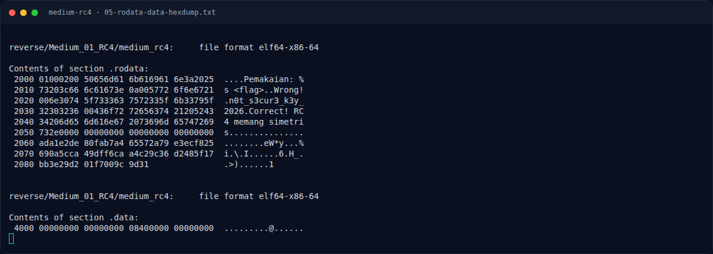
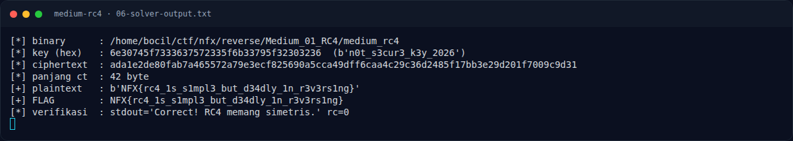
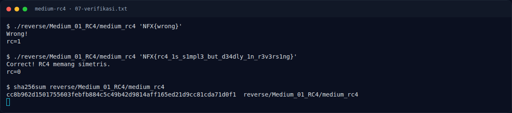
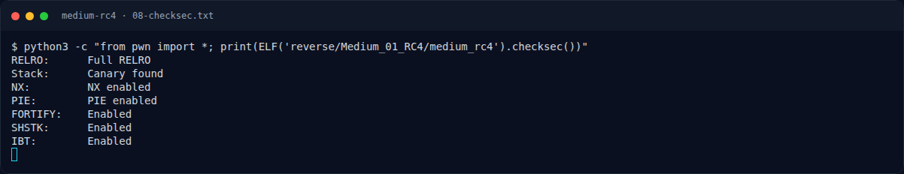

# Medium RC4 — Solver lengkap

[← Overview](46-medium-rc4.md) · [Index](index.md)

> **Langkah 7/11 — Solver lengkap.** File: writeups/assets/medium-rc4/solverc4.py
>
> **Titik penting:** File: writeups/assets/medium-rc4/solverc4.py
>
> **Berikutnya:** [Menjalankan solver](46-medium-rc4-08-menjalankan-solver.md)

## 3.2 Solver lengkap

File: `writeups/assets/medium-rc4/solve_rc4.py`

```python
#!/usr/bin/env python3
# Solver Medium RC4 — NFX CTF 2026 (Reverse / Medium)
# Analisis: binary medium_rc4 memakai RC4 dengan key hardcoded di .rodata
#           dan ciphertext 42 byte di 0x2060. RC4 simetris -> dekripsi = enkripsi.
import argparse
import pathlib
import struct
import subprocess
import sys

from elftools.elf.elffile import ELFFile

ROOT = pathlib.Path(__file__).resolve().parents[3]          # /home/bocil/ctf/nfx
DEFAULT_BIN = ROOT / "reverse" / "Medium_01_RC4" / "medium_rc4"

def read_vaddr(path: pathlib.Path, vaddr: int, size: int) -> bytes:
    """Ambil `size` byte dari alamat virtual `vaddr` memakai program header PT_LOAD."""
    with open(path, "rb") as f:
        elf = ELFFile(f)
        for seg in elf.iter_segments():
            if seg["p_type"] != "PT_LOAD":
                continue
            start, filesz = seg["p_vaddr"], seg["p_filesz"]
            if start <= vaddr and vaddr + size <= start + filesz:
                f.seek(seg["p_offset"] + (vaddr - start))
                return f.read(size)
    raise ValueError(f"vaddr {vaddr:#x} tidak ditemukan di PT_LOAD")

def rc4(key: bytes, data: bytes) -> bytes:
    S = list(range(256))
    j = 0
    for i in range(256):
        j = (j + S[i] + key[i % len(key)]) & 0xFF
        S[i], S[j] = S[j], S[i]
    i = j = 0
    out = bytearray()
    for b in data:
        i = (i + 1) & 0xFF
        j = (j + S[i]) & 0xFF
        S[i], S[j] = S[j], S[i]
        out.append(b ^ S[(S[i] + S[j]) & 0xFF])
    return bytes(out)

def main() -> int:
    ap = argparse.ArgumentParser()
    ap.add_argument("--bin", default=str(DEFAULT_BIN))
    args = ap.parse_args()
    path = pathlib.Path(args.bin)

    # Alamat dari disassembly:
    #   0x1173  lea r10,[rip+0xea7]  -> key  = 0x2021
    #   0x123e  mov edx,0x2a         -> panjang ciphertext = 42
    #   0x1243  lea rsi,[rip+0xe16]  -> ciphertext = 0x2060
    key = read_vaddr(path, 0x2021, 0x13)       # "n0t_s3cur3_k3y_2026"
    ct = read_vaddr(path, 0x2060, 0x2A)

    print(f"[*] binary      : {path}")
    print(f"[*] key (hex)   : {key.hex()}  ({key!r})")
    print(f"[*] ciphertext  : {ct.hex()}")
    print(f"[*] panjang ct  : {len(ct)} byte")
    pt = rc4(key, ct)
    print(f"[+] plaintext   : {pt!r}")

    try:
        flag = pt.decode()
        print(f"[+] FLAG        : {flag}")
        proc = subprocess.run([str(path), flag], capture_output=True, text=True)
        print(f"[*] verifikasi  : stdout={proc.stdout.strip()!r} rc={proc.returncode}")
    except UnicodeDecodeError:
        print("[!] plaintext bukan teks UTF-8", file=sys.stderr)
        return 1
    return 0

if __name__ == "__main__":
    raise SystemExit(main())
```

### Evidence langkah ini



*Terminal evidence — `01-identitas.txt` (arsip transkrip sesi solve).*



*Terminal evidence — `02-readelf.txt` (arsip transkrip sesi solve).*



*Terminal evidence — `03-strings.txt` (arsip transkrip sesi solve).*



*Terminal evidence — `04-disasm.txt` (arsip transkrip sesi solve).*



*Terminal evidence — `05-rodata-data-hexdump.txt` (arsip transkrip sesi solve).*



*Terminal evidence — `06-solver-output.txt` (arsip transkrip sesi solve).*



*Terminal evidence — `07-verifikasi.txt` (arsip transkrip sesi solve).*



*Terminal evidence — `08-checksec.txt` (arsip transkrip sesi solve).*

**Berkas mentah langkah ini:**

- [`01-identitas.txt`](assets/medium-rc4/01-identitas.txt)
- [`02-readelf.txt`](assets/medium-rc4/02-readelf.txt)
- [`03-strings.txt`](assets/medium-rc4/03-strings.txt)
- [`04-disasm.txt`](assets/medium-rc4/04-disasm.txt)
- [`05-rodata-data-hexdump.txt`](assets/medium-rc4/05-rodata-data-hexdump.txt)
- [`06-solver-output.txt`](assets/medium-rc4/06-solver-output.txt)
