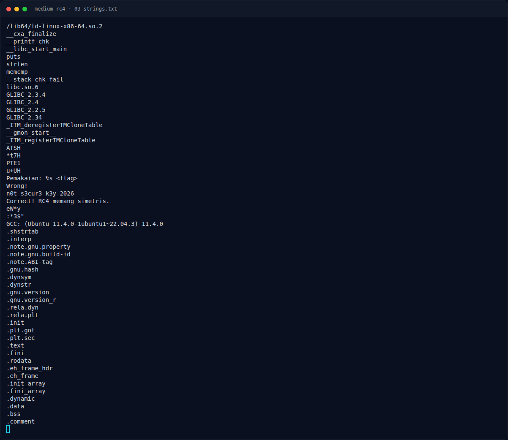
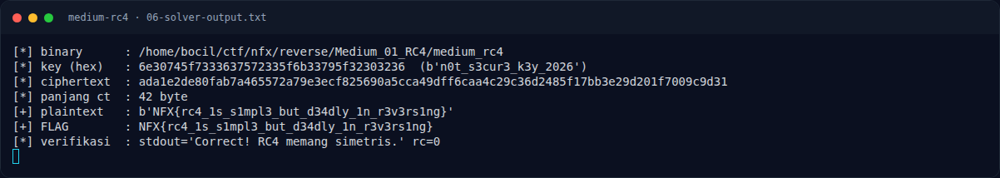

# Medium RC4 — Menjalankan solver

[← Overview](46-medium-rc4.md) · [Index](index.md)

> **Langkah 8/11 — Menjalankan solver.** Angka rc=0 dan pesan Correct!
>
> **Titik penting:** python3 docs/assets/medium-rc4/solve_rc4.py · NFX{rc4_1s_s1mpl3_but_d34dly_1n_r3v3rs1ng}
>
> **Berikutnya:** [Flag](46-medium-rc4-09-flag.md)

## 3.3 Menjalankan solver

```bash
$ python3 docs/assets/medium-rc4/solve_rc4.py
```

Output asli:

```text
[*] binary      : <repo>/reverse/Medium_01_RC4/medium_rc4
[*] key (hex)   : 6e30745f7333637572335f6b33795f32303236  (b'n0t_s3cur3_k3y_2026')
[*] ciphertext  : ada1e2de80fab7a465572a79e3ecf825690a5cca49dff6caa4c29c36d2485f17bb3e29d201f7009c9d31
[*] panjang ct  : 42 byte
[+] plaintext   : b'NFX{rc4_1s_s1mpl3_but_d34dly_1n_r3v3rs1ng}'
[+] FLAG        : NFX{rc4_1s_s1mpl3_but_d34dly_1n_r3v3rs1ng}
[*] verifikasi  : stdout='Correct! RC4 memang simetris.' rc=0
```

Angka `rc=0` dan pesan `Correct!` berasal dari eksekusi binary yang sama; solver tidak memalsukan hasil.

### Evidence langkah ini



*Terminal evidence — `03-strings.txt` (arsip transkrip sesi solve).*



*Terminal evidence — `06-solver-output.txt` (arsip transkrip sesi solve).*

**Berkas mentah langkah ini:**

- [`03-strings.txt`](assets/medium-rc4/03-strings.txt)
- [`06-solver-output.txt`](assets/medium-rc4/06-solver-output.txt)
