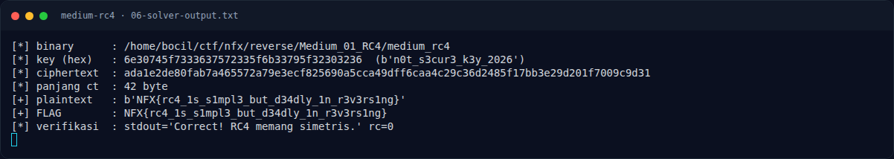

# Medium RC4 — Flag & Verifikasi

[← Overview](46-medium-rc4.md) · [Index](index.md)

> **Langkah 9/11 — Flag.** Cek file flag lokal:
>
> **Titik penting:** NFX{rc4_1s_s1mpl3_but_d34dly_1n_r3v3rs1ng}
>
> **Berikutnya:** [Bukti / Evidence](46-medium-rc4-10-bukti-evidence.md)

> **Flag:** `NFX{rc4_1s_s1mpl3_but_d34dly_1n_r3v3rs1ng}`
> **Status:** `VERIFIED`

```text
NFX{rc4_1s_s1mpl3_but_d34dly_1n_r3v3rs1ng}
```

Cek file flag lokal:

```text
$ cat flags/reverse/Medium_01_RC4.txt
NFX{rc4_1s_s1mpl3_but_d34dly_1n_r3v3rs1ng}
```

Verifikasi:

1. Flag di `flags/reverse/Medium_01_RC4.txt` isinya identik.
2. Menjalankan binary dengan flag tersebut:

```text
$ ./reverse/Medium_01_RC4/medium_rc4 'NFX{rc4_1s_s1mpl3_but_d34dly_1n_r3v3rs1ng}'
Correct! RC4 memang simetris.
rc=0
```

3. Input salah menghasilkan `Wrong!` dan `rc=1`:

```text
$ ./reverse/Medium_01_RC4/medium_rc4 'NFX{wrong}'
Wrong!
rc=1
```

**Status: `VERIFIED platform`.** Flag tercatat accepted di platform (lihat terminal evidence asli); verifikasi lokal tetap dilakukan terhadap binary dan file flag.

### Terminal evidence (real)



*Terminal evidence (real).*

> **Bukti:** terminal evidence (real).
