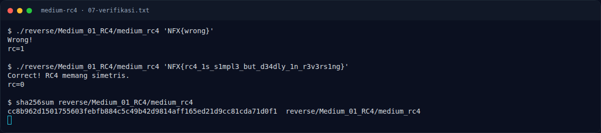

# Medium RC4 — Referensi

[← Overview](46-medium-rc4.md) · [Index](index.md)

> **Langkah 11/11 — Referensi.** Referensi
>
> **Titik penting:** —
>
> **Selesai.** Kembali ke [Overview](46-medium-rc4.md).

- RC4 KSA/PRGA — standar stream cipher yang dipublikasikan Ron Rivest (1987); banyak dijelaskan di literatur kriptografi.
- `objdump(1)` dan `readelf(1)` — binutils.
- `pyelftools` — parsing ELF di Python.
- `pwntools` `ELF.checksec()` — alternatif `checksec` untuk metadata keamanan ELF.

### Evidence langkah ini

*Terminal evidence — `07-verifikasi.txt` (arsip transkrip sesi solve).*

**Berkas mentah langkah ini:**

- [`07-verifikasi.txt`](assets/medium-rc4/07-verifikasi.txt)
