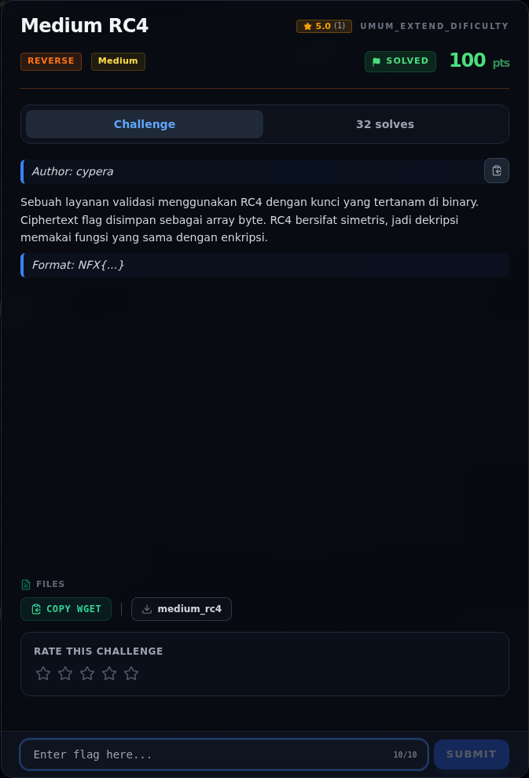
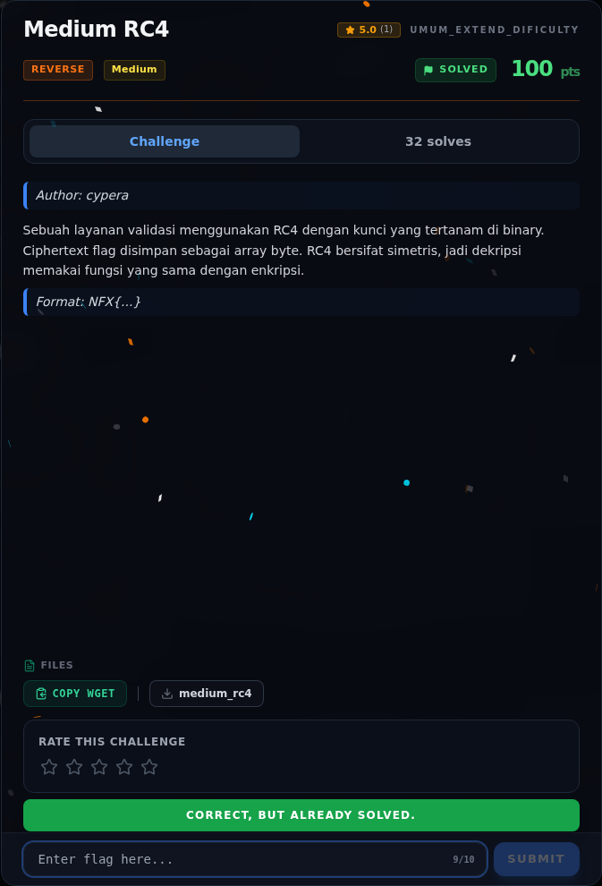

# Medium RC4

Track Umum / Extend · ReverseMedium100 poinVERIFIED

| Field | Nilai |
|---|---|
| Event | `umum_Extend` |
| Kategori | `Reverse` |
| Difficulty | `Medium` |
| Poin | `100` |
| Author | `cypera` |
| Solves | `26` |
| Tools | python3, pwntools, checksec, gdb, objdump, readelf, strings |
| Flag | `NFX{rc4_1s_s1mpl3_but_d34dly_1n_r3v3rs1ng}` |
| Status | `VERIFIED` |

[← Kembali ke Index](index.md)

## Challenge Brief (platform)

*Challenge brief asli di platform NFX CTF 2026.*

## Cerita singkat

Jadi ceritanya gini. binary `medium_rc4` adalah ELF x86-64 PIE, stripped, dan meminta flag lewat `argv[1]`. Terus, program mengecek panjang input tepat `42` byte, lalu menjalankan **RC4** dengan key hardcoded `n0t_s3cur3_k3y_2026`. Lalu, ciphertext 42 byte disimpan di `.rodata` pada alamat `0x2060`; hasil enkripsi input dibandingkan dengan `memcmp`. Nah, dari situ kita bisa sampai ke flag dan bukti submit-nya.

## Alur & Titik Penting

| # | Langkah | Titik penting | Buka |
|---:|---|---|---|
| 1 | Recon | NFX{...} | [Buka](46-medium-rc4-01-recon.md) |
| 2 | Triage awal | file reverse/Medium_01_RC4/medium_rc4 | [Buka](46-medium-rc4-02-triage-awal.md) |
| 3 | Perintah akuisisi bukti | file "$BIN" > writeups/assets/medium-rc4/01-identitas.txt | [Buka](46-medium-rc4-03-perintah-akuisisi-bukti.md) |
| 4 | Peta fungsi `main` | Karena binary stripped, kita mulai dari entry point 0x12a0, yang memanggil libcstartmain dengan main di 0x10e0. | [Buka](46-medium-rc4-04-peta-fungsi-main.md) |
| 5 | Analisis | Dari instruksi lea di atas: | [Buka](46-medium-rc4-05-analisis.md) |
| 6 | Strategi | Solver membaca binary lewat program header PTLOAD, bukan hardcode offset file, sehingga tetap benar meskipun layout section berubah. | [Buka](46-medium-rc4-06-strategi.md) |
| 7 | Solver lengkap | File: writeups/assets/medium-rc4/solverc4.py | [Buka](46-medium-rc4-07-solver-lengkap.md) |
| 8 | Menjalankan solver | python3 writeups/assets/medium-rc4/solve_rc4.py | [Buka](46-medium-rc4-08-menjalankan-solver.md) |
| 9 | Flag | NFX{rc4_1s_s1mpl3_but_d34dly_1n_r3v3rs1ng} | [Buka](46-medium-rc4-09-flag.md) |
| 10 | Bukti / Evidence | arsip screenshot dan transkrip | [Buka](46-medium-rc4-10-bukti-evidence.md) |
| 11 | Referensi | — | [Buka](46-medium-rc4-11-referensi.md) |

## TL;DR

- Binary `medium_rc4` adalah ELF x86-64 PIE, stripped, dan meminta flag lewat `argv[1]`.
- Program mengecek panjang input tepat `42` byte, lalu menjalankan **RC4** dengan key hardcoded `n0t_s3cur3_k3y_2026`.
- Ciphertext 42 byte disimpan di `.rodata` pada alamat `0x2060`; hasil enkripsi input dibandingkan dengan `memcmp`.
- Karena RC4 simetris, dekripsi memakai rutin yang sama dengan enkripsi. Cukup ekstrak key + ciphertext, jalankan RC4, selesai.
- Flag: `NFX{rc4_1s_s1mpl3_but_d34dly_1n_r3v3rs1ng}`.

Pratinjau evidence. Buka halaman <a href="46-medium-rc4-03-perintah-akuisisi-bukti.html">Evidence / Bukti</a> untuk semua screenshot dan transkrip.

## Navigasi Halaman

<a class="nx-page-card" href="46-medium-rc4-01-recon.html"><b>Recon</b>Enumerasi target dan bukti awal</a>
<a class="nx-page-card" href="46-medium-rc4-02-triage-awal.html"><b>Triage awal</b>Baca bagian ini</a>
<a class="nx-page-card" href="46-medium-rc4-03-perintah-akuisisi-bukti.html"><b>Perintah akuisisi bukti</b>Screenshot, transkrip, dan artefak</a>
<a class="nx-page-card" href="46-medium-rc4-04-peta-fungsi-main.html"><b>Peta fungsi `main`</b>Baca bagian ini</a>
<a class="nx-page-card" href="46-medium-rc4-05-analisis.html"><b>Analisis</b>Membaca alur dan akar masalah</a>
<a class="nx-page-card" href="46-medium-rc4-06-strategi.html"><b>Strategi</b>Baca bagian ini</a>
<a class="nx-page-card" href="46-medium-rc4-07-solver-lengkap.html"><b>Solver lengkap</b>Langkah exploit dan solver</a>
<a class="nx-page-card" href="46-medium-rc4-08-menjalankan-solver.html"><b>Menjalankan solver</b>Langkah exploit dan solver</a>
<a class="nx-page-card" href="46-medium-rc4-09-flag.html"><b>Flag</b>Flag dan verifikasi platform</a>
<a class="nx-page-card" href="46-medium-rc4-10-bukti-evidence.html"><b>Bukti / Evidence</b>Screenshot, transkrip, dan artefak</a>
<a class="nx-page-card" href="46-medium-rc4-11-referensi.html"><b>Referensi</b>Sumber dan bacaan lanjutan</a>

